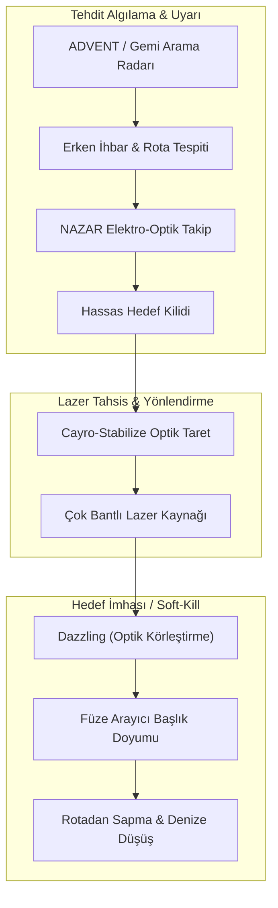

# 🔮 Proje: NAZAR (Lazer Elektronik Harp Sistemi)

  
  
  
  

  

---

## 🛡️ Stratejik Tanım & Doktriner Öncelik
NAZAR Lazer Elektronik Harp Sistemi, Deniz Kuvvetleri Komutanlığı'nın kritik suüstü muharip unsurlarını (MİLGEM korvet ve fırkateynleri, TCG ANADOLU) 3. ve 4. nesil elektro-optik (EO) ve kızılötesi (IIR) arayıcı başlıklı gemisavar füzelerine (AShM) karşı korumak için METEKSAN Savunma tarafından geliştirilmiş dünyadaki en ileri yönlendirilmiş lazer karşı tedbir (DIRCM) sistemlerinden biridir.

Geleneksel chaff/flare veya nokta hava savunma füzelerinin (RAM, Phalanx) aksine NAZAR; çok bantlı yönlendirilmiş lazer enerjisi kullanarak tehdit füzeyi henüz onlarca kilometre uzaktayken optik penceresinden yakalar, dedektörünü kalıcı olarak körleştirir (Soft-Kill) veya termal tahribat yaratarak (Hard-Kill) rotasından saptırır. Bu teknoloji, mühimmat sınırlamasını ortadan kaldırarak sınırsız angajman derinliği kazandırmaktadır.

---

## 📊 Kapsamlı Teknik Özellikler

| Parametre | Değer / Özellik | Operasyonel Karşılık |
| :--- | :--- | :--- |
| **Dalga Boyu Yelpazesi** | Çok Bantlı (Multi-Spectral IR & Lazer Bandı) | IIR, SWIR, MWIR, LWIR dedektör körleme |
| **Etki Menzili** | Çift Haneli Kilometreler (Geniş Ufuk Ötesi) | Geleneksel CIWS menzilinin 3 katı |
| **Kapsama Alanı** | 360° Azimut, -10° ila +85° Elevasyon | Tam küresel gemi savunma kubbesi |
| **Reaksiyon Süresi** | < 1.5 saniye (Tehdit bildiriminden ışımaya) | Süpersonik füzelere karşı reaktif savunma |
| **Etki Mekanizması** | Dazzling (Körleştirme) + Damping (Tahrip) | Soft-Kill ve Hard-Kill hibrit taarruz |
| **Hedef Tipi** | IIR Başlıklı Gemisavar Füzeleri, Kamikaze İHA'lar | Güdümlü tüm optik tehditler |
| **Güç & Soğutma** | Dahili Jeneratör & Kapalı Devre Sıvı Soğutma | Gemi ana güç ağından bağımsız çalışabilme |

---

## 🧩 Alt Sistemler ve Elektronik Entegrasyonu
- **Geniş Bant Dedektör ve Tehdit Algılama Birimi:** Yaklaşan optik ve lazer güdümlü mühimmatın dalga boyunu anında tespit eden optik alıcılar.
- **Yüksek Hassasiyetli Lazer Taret Sistemi:** Deniz şartlarında gemi yalpalamasını nötralize eden cayro-stabilize yönlendirme platformu.
- **Çok Bantlı Lazer Kaynağı:** Farklı arayıcı başlık malzemelerine (InSb, HgCdTe) göre frekans değiştirebilen katı-hal lazer mimarisi.
- **ADVENT Savaş Yönetim Sistemi Entegrasyonu:** Geminin merkezi radarları, optik gözetleme sistemleri ve taktik konsolları ile iki yönlü tam senkronizasyon.

---

## 🎯 Görev Profili ve Muharebe Senaryoları
- **Asimetrik ve Füze Doyurma Saldırıları:** Aynı anda farklı yönlerden gelen çoklu IIR füzelerin ardışık olarak lazer enerjisiyle körleştirilmesi.
- **Mavi Vatan Karasuları Koruması:** Boğaz geçişleri ve adalar denizinde dar su yollarında kıyıdan ateşlenen güdümlü mühimmatların savuşturulması.
- **Kara Konuşlu Varyant (NAZAR-K):** Stratejik hava üsleri, radar mevkileri ve komuta merkezlerinin korunması için mobil treyler entegrasyonu.

---

## 🌐 Sistem Mimarisi ve Karşı Tedbir Döngüsü

---

## 🚀 TRL Seviyesi ve Gelişim Yol Haritası (TRL 9)
- [x] Lazer kaynağı ve optik yönlendirici prototip geliştirme fazı
- [x] Karada sabit test sahasında atışlı körleştirme ve dedektör imha testleri
- [x] DzKK TCG İSTANBUL ve MİLGEM platformlarında deniz kabul testleri
- [x] Deniz Kuvvetleri Komutanlığı envanterine kabul ve operasyonel görev icrası
- [/] Mobil kara konuşlu NAZAR-K sisteminin seri üretim teslimatları

---

## 🔗 İç Dizin Navigasyonu
[⬅️ Üst Dizine](../README.md) | [🏛️ Dominion Hub](../../README.md) | [🏠 Ana Sayfa](../../../README.md)
