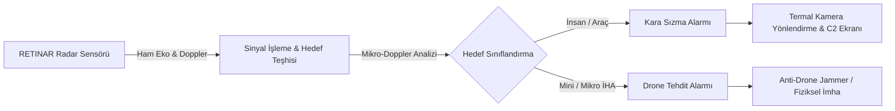

# 📡 Proje: RETINAR (Çevre ve Geniş Alan Gözetleme Radar Ailesi)

  
  
  
  

  

---

## 🛡️ Stratejik Tanım & Doktriner Öncelik
RETINAR Çevre Gözetleme Radar Ailesi, METEKSAN Savunma tarafından sınır güvenliği, kritik askeri ve endüstriyel tesislerin korunması ve asimetrik drone tehditlerine karşı geliştirilmiş gelişmiş bir radar ailesidir. Kompakt yapısı, düşük güç tüketimi ve taşınabilir mimarisi ile ön plana çıkan RETINAR; insan, kara aracı ve alçaktan uçan mini/mikro İHA'ları mikro-Doppler sinyal işleme algoritmaları sayesinde anında tespit ve teşhis eder.

TSK ve sınır birlikleri tarafından yoğun biçimde operasyonel olarak kullanılan RETINAR sistemleri, gece-gündüz ve her türlü meteorolojik şart altında 360 derece kesintisiz erken ihbar sağlayarak hudut güvenliğinde personelin can güvenliğini en üst düzeye çıkarmıştır.

---

## 📊 Kapsamlı Teknik Özellikler

| Model Parametresi | Retinar PTR (Taşınabilir) | Retinar FAR (Çevre Gözetleme) | Retinar OPUS (Entegre EO/Radar) | Retinar AESA (Drone Radarı) |
| :--- | :--- | :--- | :--- | :--- |
| **Radar Tipi** | Darbe-Doppler Portatif | Yüksek Hızlı Çevre Radarı | Radar + Termal Kamera Hibrit | Katı Hal AESA 3D Radar |
| **Yürüyen İnsan Menzili** | 4 km | 7 km | 6 km (Görsel Teyit) | 3 km |
| **Küçük Araç Menzili** | 8 km | 12 km | 10 km | 6 km |
| **Mini/Mikro İHA Menzili**| 2.5 km | 4 km | 3 km (Optik Kilit) | 5 km (RCS 0.01 m²) |
| **Kapsama Alanı** | 360° Sürekli Mekanik | 360° Mekanik / Sektör | 360° Kesintisiz Çift Eksen | 90°x90° Panel / 360° 4 Panel |
| **Ağırlık** | ~17 kg (Sırt Çantası Taşınabilir)| ~30 kg (Direk Üstü) | Entegre Kule Montajı | ~45 kg Sabit/Mobil Panel |
| **Güç Kaynağı** | Batarya (8+ Saat) / 24V DC | 24V DC / 220V Şebeke | Kesintisiz Güç Kaynağı | Askeri Güç Barası |

---

## 🧩 Alt Sistemler ve Elektronik Entegrasyonu
- **Mikro-Doppler Sinyal İşleme Ünitesi:** İnsan adımlarının kinetik ritmi, araç tekerlek dönme frekansı ve İHA pervane devirlerini ayrıştırarak sıfır yanlış alarm oranı sunar.
- **Entegre Elektro-Optik İstasyon (Retinar OPUS):** Radarın tespit ettiği koordinata otomatik yönlenen Cooled Termal Kamera ve Lazer Mesafe Ölçer.
- **Komuta Kontrol (C2) Arayüzü:** TSK Coğrafi Bilgi Sistemi (CBS) ve sınır fiziki güvenlik sistemleri (Aydınlatma, Akustik İkaz, Kule Silahları) ile tam entegrasyon.
- **RF Karıştırıcı (Jammer) Entegrasyonu:** Dron tespit edildiğinde sinyal bastırma kalkanını otomatik devreye sokan yönlü anten eşleşmesi.

---

## 🎯 Görev Profili ve Muharebe Senaryoları
- **Sınır Güvenliği:** Kaçakçılık, yasadışı sınır geçişleri ve terör unsurlarının sızma girişimlerinin sınır hattına varmadan tespiti.
- **Hava Üssü ve Karargah Korunması:** Kamikaze FPV dronlar ve gözetleme yapan döner kanatlı mini İHA'lara karşı 3B hava sahası kalkanı.
- **Konvoy ve İleri Üs Savunması:** Zırhlı araç üzerine monte edilerek hareket halinde veya intikal molasında anlık çevre emniyeti.

---

## 🌐 Sistem Mimarisi ve Güvenlik Çemberi

---

## 🚀 TRL Seviyesi ve Gelişim Yol Haritası (TRL 9)
- [x] Taşınabilir prototip tasarımı ve saha doğrulama testleri
- [x] TSK ve Jandarma Genel Komutanlığı sınır birliklerine seri teslimat
- [x] Retinar OPUS elektro-optik entegreli varyantın operasyonel hale gelmesi
- [x] Retinar AESA 3B drone tespit radarının kritik üslerde göreve başlaması
- [x] Dost ve müttefik ülkelere (NATO üyeleri dahil) geniş ölçekli ihracat

---

## 🔗 İç Dizin Navigasyonu
[⬅️ Üst Dizine](../README.md) | [🏛️ Dominion Hub](../../README.md) | [🏠 Ana Sayfa](../../../README.md)
