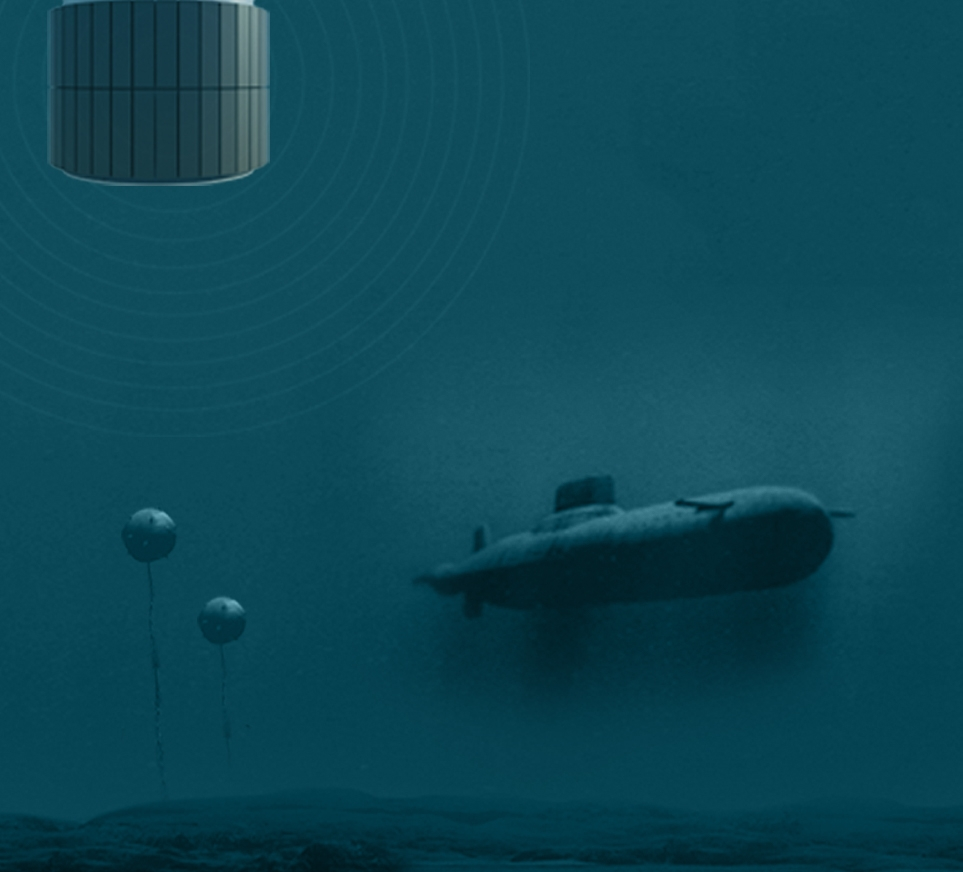
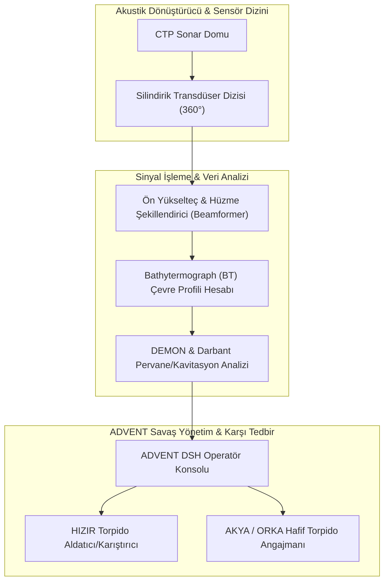

# 🌊 Proje: YAKAMOZ (Karinaya Monteli Denizaltı Savunma Harbi Sonarı)

  
  
  
  

  

---

## 🛡️ Stratejik Tanım & Doktriner Öncelik
YAKAMOZ Karinaya Monteli Sonar Sistemi, Türk Deniz Kuvvetleri'nin MİLGEM (Milli Gemi) programı kapsamında fırkateyn ve korvetlerimizin denizaltı savunma harbi (DSH) kabiliyetini sağlamak üzere METEKSAN Savunma tarafından geliştirilmiş milli sualtı akustik algılama omurgasıdır. Denizaltıların sessiz tahrik teknolojileriyle gizlendiği modern deniz muharebesinde YAKAMOZ, gemi karinasına yerleştirilen özel tasarımlı silindirik transdüser diziniyle denizaltıları, sualtı sızma araçlarını ve yaklaşan torpidoları uzak mesafelerden tespit eder.

YAKAMOZ ve gelişmiş versiyonu YAKAMOZ-2020; ADA sınıfı korvetlerimizde (TCG HEYBELİADA, TCG BÜYÜKADA, TCG BURGAZADA, TCG KINALIADA), İSTİF sınıfı fırkateynlerimizde (TCG İSTANBUL) ve Pakistan ile Ukrayna için inşa edilen MİLGEM gemilerinde standart sonar olarak hizmet vermektedir. Türkiye'yi dünyada kendi sonarını tasarlayıp üretebilen ve ihraç eden elit ülkeler ligine taşımıştır.

---

## 📊 Kapsamlı Teknik Özellikler

| Parametre | YAKAMOZ Standart (ADA Sınıfı) | YAKAMOZ-2020 (İSTİF & TF-2000) |
| :--- | :--- | :--- |
| **Çalışma Frekansı** | Orta Frekans (MF) Aktif / Pasif | Gelişmiş Çoklu Bantlı Orta Frekans |
| **Dizin Geometrisi** | Silindirik Akustik Transdüser Dizini | Modüler Silindirik Transdüser Mimarisi |
| **Kapsama Alanı** | 360° Kesintisiz Sualtı Taraması | 360° Çoklu Akustik Hüzme Oluşturma |
| **Aktif Yayın Modları** | CW (Sürekli Dalga), FM (Frekans Modülasyonu) | Optimize Edilmiş LFM, HFM ve Çoklu Darbe |
| **Pasif Dinleme** | Geniş Bant, Dar Bant ve DEMON Analizi | Gelişmiş Spektrogram ve Kavitasyon Tespiti |
| **Torpido Erken İhbar** | Entegre Akustik İhbar Algoritması | HIZIR Torpido Karşı Tedbir ile Doğrudan Bağlantı |
| **Dom Malzemesi** | Akustik Olarak Şeffaf Kompozit (CTP Dom) | Darbeye ve Hidrodinamik Basınca Dayanıklı Dome |
| **Savaş Yönetim Arayüzü**| GENESİS Entegrasyonu | ADVENT Savaş Yönetim Sistemi Yerel Düğümü |

---

## 🧩 Alt Sistemler ve Elektronik Entegrasyonu
- **Sualtı Akustik Transdüser Dizini:** Deniz suyuna dayanıklı piezoseramik elemanlardan oluşan yüksek hassasiyetli dönüştürücü dizisi.
- **Akustik Sinyal İşleme Kabinleri:** Su tabakalarının sıcaklık, tuzluluk ve basınç değişimlerine (BT profili) göre akustik dalga kırılımlarını hesaplayan yüksek güçlü işlemciler.
- **ADVENT SYS & HIZIR Entegrasyonu:** Algılanan torpido tehditlerinin anında ADVENT konsollarına ve HIZIR Torpido Karşı Tedbir aldatıcılarına aktarılması.
- **Kendi Gürültüsünü Bastırma (Self-Noise Cancellation):** Geminin kendi ana makine ve pervane kavitasyon seslerini filtreleyerek net sinyal üretme kabiliyeti.

---

## 🎯 Görev Profili ve Muharebe Senaryoları
- **Denizaltı Savunma Harbi (DSH / ASW):** İntikal halindeki deniz görev grubunun önünde denizaltı arama, takip ve ROKETSAN DSH Roketi / AKYA hafif torpido angajmanı.
- **Torpido Karşı Tedbir:** Düşman denizaltısından ateşlenen güdümlü torpidoyu rota başlangıcında tespit ederek gemi manevrası ve akustik aldatıcı fırlatma desteği.
- **Müttefik Görev Gruplarıyla Akustik İşbirliği:** Müşterek tatbikatlarda NATO sualtı akustik veri kütüphanesiyle tam uyum.

---

## 🌐 Sistem Mimarisi ve Sualtı Angajman Akışı

---

## 🚀 TRL Seviyesi ve Gelişim Yol Haritası (TRL 9)
- [x] Akustik transdüser laboratuvar imalatı ve havuz testleri
- [x] TCG HEYBELİADA üzerinde ilk deniz tecrübeleri ve kabulü
- [x] Dört adet MİLGEM ADA sınıfı korvette operasyonel muharebe kullanımı
- [x] İSTİF sınıfı fırkateynler için YAKAMOZ-2020 serisinin kalifikasyonu
- [x] Pakistan ve Ukrayna MİLGEM projelerine uluslararası ihracat teslimatları

---

## 🔗 İç Dizin Navigasyonu
[⬅️ Üst Dizine](../README.md) | [🏛️ Dominion Hub](../../README.md) | [🏠 Ana Sayfa](../../../README.md)
