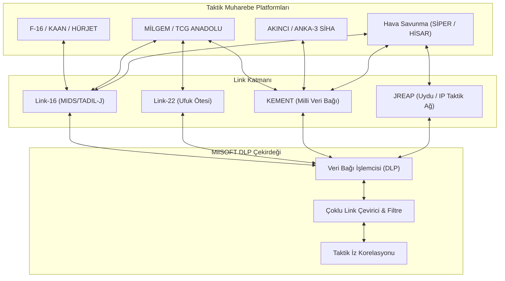

# 📡 Proje: Taktik Veri Linkleri (Tactical Data Links & DLP)

  
  
  
  

  

---

## 🛡️ Stratejik Tanım & Doktriner Öncelik
Taktik Veri Linkleri (Tactical Data Links - TDL) ve Veri Bağı İşlemcisi (Data Link Processor - DLP) çözümleri, modern Ağ Merkezli Harp (Network Centric Warfare) mimarisinin merkezi sinir sistemidir. Farklı platformların (uçak, helikopter, fırkateyn, denizaltı, hava savunma bataryası, kara karargahı) aynı taktik resmi görmesini, dost/düşman unsurları anlık paylaşmasını ve müşterek silah angajmanı icra etmesini sağlar.

MilSOFT, NATO standartlarındaki Link-11, Link-16, Link-22, JREAP (Joint Range Extension Applications Protocol) ve Türkiye'nin milli kriptolu Veri Bağı (KEMENT / Taktik Veri Ağı) protokollerini tamamen yerli ve milli imkanlarla geliştiren lider yazılım ve sistem evidir. MilSOFT'un DLP çözümü, bir linkten gelen bilgiyi başka bir link standardına dönüştürerek çoklu ağlar arası köprü vazifesi görür.

---

## 📊 Kapsamlı Teknik Özellikler

| Standart / Protokol | Frekans Bandı | Veri Hızı & İletim Türü | Menzil / Kapsama | Temel Kullanım Alanı |
| :--- | :--- | :--- | :--- | :--- |
| **Link-16 (TADIL-J)** | UHF (960 - 1215 MHz) | 28.8 - 238 kbps (TDMA Yapısı) | Görüş Hattı (LOS) ~300 nm | Muharip Jetler, HİK (AWACS), Fırkateynler |
| **Link-22 (NILE)** | HF / UHF Bandı | 1.8 - 10 kbps (Dinamik TDMA) | Ufuk Ötesi (BLOS) 1000+ nm | Stratejik Deniz Görev Grupları |
| **Link-11 (TADIL-A/B)** | HF / UHF Bandı | 1364 / 2250 bps | Ufuk Ötesi (HF) / Görüş Hattı | Miras Deniz ve Hava Platformları |
| **JREAP (A/B/C)** | Uydu / Seri / IP (Ethernet) | IP Tabanlı Yüksek Hız | Küresel (Küresel IP/Uydu Ağı) | Karargahlar Arası Taktik Resim |
| **Milli Veri Bağı (KEMENT)**| Milli Dalga Formu | Yüksek Hızlı Kriptolu Veri | Taktik Muharebe Sahası | SOM, ATMACA, SİHA ve Çelik Kubbe |
| **Çoklu Link DLP** | Hibrit | Çoklu Kanal Gerçek Zamanlı | Çoklu Taktik Alan | Veri Bağı İşlemcisi ve Link Çevirici |

---

## 🧩 Alt Sistemler ve Elektronik Entegrasyonu
- **Milli DLP (Data Link Processor):** Gelen taktik mesajları (J-Serisi, M-Serisi) parse eden, filtreleyen, iz korelasyonu yapan ve farklı linklere çapraz yönlendiren çekirdek işlemci.
- **Link-16 Terminal Arayüzü (MIDS-LVT):** F-16 ve Deniz platformlarındaki MIDS terminalleri ile MIL-STD-1553 ve Ethernet üzerinden haberleşme.
- **Taktik Yönlendirme ve Filtreleme Motoru:** Güvenlik ve gizlilik seviyelerine göre taktik verilerin hangi platformlara aktarılacağını denetleyen kriptolu güvenlik katmanı.
- **ADVENT & HAVA SOJ Uyumu:** Deniz ve hava savaş yönetim sistemleriyle taktik durumsal farkındalık entegrasyonu.

---

## 🎯 Görev Profili ve Muharebe Senaryoları
- **Müşterek Hava-Deniz Resmi:** HİK (Barış Kartalı) uçağının radarıyla gördüğü yüzlerce hedefi Link-16 üzerinden fırkateynlere ve hava savunma bataryalarına anında iletmesi.
- **Ufuk Ötesi Füze Güdümü:** Hedefi görmeyen bir platformun, başka bir İHA veya radarın KEMENT/Link üzerinden aktardığı hedef koordinatlarına SOM veya ATMACA ateşlemesi.
- **Elektronik Karıştırmaya Karşı Direnç:** Frekans atlamalı (Frequency Hopping) yapıyla düşman elektronik taarruzuna karşı kesintisiz komuta kontrol.

---

## 🌐 Sistem Mimarisi ve Çoklu Link Entegrasyonu

---

## 🚀 TRL Seviyesi ve Gelişim Yol Haritası (TRL 9)
- [x] Link-11 ve Link-16 milli yazılım kütüphanelerinin geliştirilmesi
- [x] TSK ve NATO tatbikatlarında interoperability (birlikte çalışabilirlik) doğrulaması
- [x] Türk Deniz Kuvvetleri ve Hava Kuvvetleri ana komuta merkezlerine teslimat
- [x] MİLGEM ve Barış Kartalı platformlarına entegre çoklu link DLP kullanımı
- [x] Dost ve müttefik ülkelere yazılım ve sistem ihracatı başarısı

---

## 🔗 İç Dizin Navigasyonu
[⬅️ Üst Dizine](../README.md) | [🏛️ Dominion Hub](../../README.md) | [🏠 Ana Sayfa](../../../README.md)
