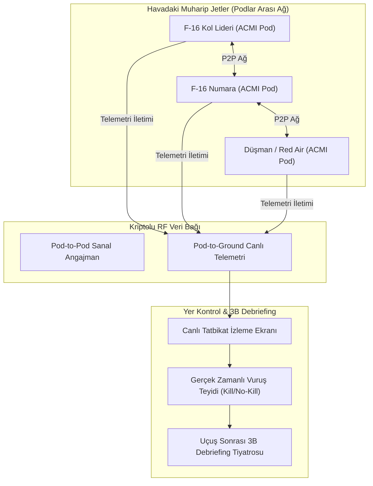

# ✈️ Proje: ACMI POD (Hava Muharebesi Manevra Enstrümantasyon Podu)

  
  
  
  

  

---

## 🛡️ Stratejik Tanım & Doktriner Öncelik
ACMI (Air Combat Maneuvering Instrumentation) Podu, SDT Uzay ve Savunma Teknolojileri tarafından muharip jet pilotlarının gerçek uçuş koşullarında hava-hava ve hava-yer muharebe eğitimlerini en yüksek gerçekçilik seviyesinde gerçekleştirmeleri için geliştirilmiş ileri bir harici pod sistemidir. Muharip uçakların kanat ucu füze raylarına (AIM-9 Sidewinder / Bozdoğan istasyonlarına) takılan pod, gerçek mühimmat harcamadan füzelerin güdüm algoritmalarını sanal olarak çalıştırır.

Türk Hava Kuvvetleri'nin dünyaca ünlü "Anadolu Kartalı" (Anatolian Eagle) uluslararası tatbikatlarında standart olarak kullanılan SDT ACMI sistemi; yüzlerce uçağın katıldığı devasa hava muharebelerinde her uçağın 3B konumunu, hızını, tetiğe basma anını ve sanal füze vuruşlarını milisaniyelik hassasiyetle yer kontrol istasyonuna aktararak uçuş sonrası 3 boyutlu analiz (debriefing) imkanı sunar.

---

## 📊 Kapsamlı Teknik Özellikler

| Parametre | Değer / Özellik | Operasyonel Karşılık |
| :--- | :--- | :--- |
| **Montaj Standardı** | AIM-9 / AIM-120 Kanat Ucu Standart Füze Rayı | Modifikasyonsuz hızlı tak-çalıştır |
| **Konumlandırma Hassasiyeti**| Santimetre Seviyesinde GPS + INS Entegrasyonu | Yüksek G altında kesintisiz telemetri |
| **Veri Bağı (Data Link)** | Yüksek Hızlı, Kriptolu RF Ağ Mimarisi | Podlar arası ve pod-yer istasyonu bağı |
| **Eşzamanlı Takip Kapasitesi**| 100+ Muharip Uçak ve Platform | Büyük ölçekli karma hava harekatı |
| **Sanal Silah Simülasyonu** | GÖKDOĞAN, BOZDOĞAN, AIM-120, AIM-9, Top | Gerçek mühimmat kinematiği simülasyonu |
| **Maksimum Manevra Limiti** | -3G ila +9G Muharebe Manevrası | Süpersonik uçuş şartlarına dayanıklı |
| **Kayıt Süresi** | 8+ Saat Dahili Katı Hal Kayıt Ünitesi | Tam uçuş verisinin kara kutu kaydı |

---

## 🧩 Alt Sistemler ve Aviyonik Entegrasyonu
- **Dahili Ataletsel Seyrüsefer ve GNSS Birimi:** Yüksek dinamikli askeri GPS/INS sensör paketi ile anlık tutum ve koordinat tayini.
- **Hava Veri Bilgisayarı Sensörleri:** Pod üzerindeki pitot tüpleri ve basınç algılayıcılarla bağımsız hücum açısı (AoA) ve Mach hızı ölçümü.
- **Gerçek Zamanlı Silah Simülasyon Motoru (Real-Time Kill Notification):** Pilot atış yaptığında hedefin vurulup vurulmadığını anında hesaplayarak pilota kask içi sesli ikaz iletir.
- **Yer Kontrol ve Debriefing İstasyonu:** Görev bitiminde pilotların uçuşlarını her açıdan 3B olarak yeniden izleyebileceği interaktif analiz yazılımı.

---

## 🎯 Görev Profili ve Muharebe Senaryoları
- **İt Dalaşı (WVR - Within Visual Range) Eğitimi:** Yüksek G kuvvetleri altında yakın hava muharebesinde pilot reaksiyonlarının ve nişan alma açılarının analizi.
- **Görüş Ötesi (BVR - Beyond Visual Range) Taktikleri:** Elektronik harp altında radar güdümlü uzun menzilli füze taktiklerinin denenmesi.
- **Uluslararası İhracat:** Pakistan Hava Kuvvetleri'nin JF-17 Block III filolarına ihraç edilerek başarısını küresel çapta kanıtlamıştır.

---

## 🌐 Sistem Mimarisi ve Gerçek Zamanlı Eğitim Ağı

---

## 🚀 TRL Seviyesi ve Gelişim Yol Haritası (TRL 9)
- [x] Pod aerodinamik yapısı ve kanat ucu mukavemet testlerinin tamamlanması
- [x] Anadolu Kartalı tatbikatlarında binlerce sorti uçuş tecrübesi (Combat Proven)
- [x] Türk Hava Kuvvetleri F-16 filolarında standart envanter sistemi olması
- [x] Pakistan Hava Kuvvetleri JF-17 uçakları için başarılı ihracat teslimatı
- [/] KAAN ve HÜRJET platformları için yeni nesil dahili gömülü ACMI kütüphanelerinin geliştirilmesi

---

## 🔗 İç Dizin Navigasyonu
[⬅️ Üst Dizine](../README.md) | [🏛️ Dominion Hub](../../README.md) | [🏠 Ana Sayfa](../../../README.md)
