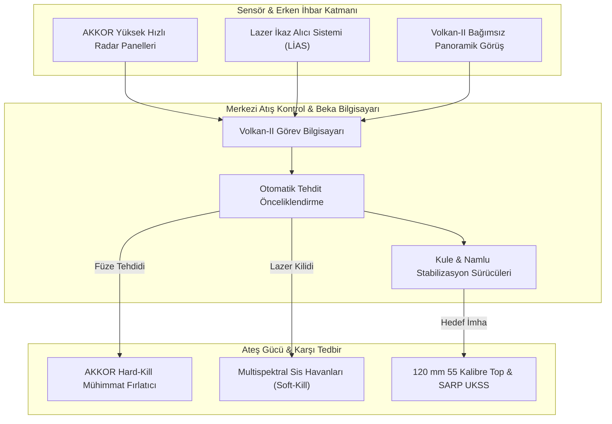

# 🚜 Proje: ALTAY (Yeni Nesil Ana Muharebe Tankı)

  
  
  
  

  

---

## 🛡️ Stratejik Tanım & Doktriner Öncelik
Yeni ALTAY, Türk Silahlı Kuvvetleri'nin modern asimetrik ve hibrit zırhlı muharebe doktrinlerine öncülük etmek üzere BMC Savunma ana yükleniciliğinde yeniden tasarlanmış 3. Nesil+ (Gen 3+) bir Ana Muharebe Tankıdır (AMT). Suriye, Ukrayna ve Karabağ muharebelerinden çıkarılan operasyonel dersler doğrultusunda baştan aşağı modernize edilen "Yeni ALTAY"; tanksavar güdümlü füzelerine (ATGM), kamikaze insansız hava araçlarına (FPV dronlar) ve gelişmiş zırh delici oklara (APFSDS) karşı dünyanın en üstün beka mimarisine kavuşturulmuştur.

Türkiye'nin zırhlı birliklerdeki yurtdışı ambargolarını kıran bu milli platform; ASELSAN AKKOR Aktif Koruma Sistemi, ROKETSAN gelişmiş modüler hibrit zırhı, ASELSAN Volkan-II Yeni Nesil Atış Kontrol Sistemi ve BMC POWER tarafından geliştirilen BATU 1500 BG milli güç grubu ile Türk Kara Kuvvetleri'nin yumruk gücünü temsil etmektedir.

---

## 📊 Kapsamlı Teknik Özellikler

| Parametre | Değer / Karakteristik | Operasyonel Detay |
| :--- | :--- | :--- |
| **Muharebe Ağırlığı** | ~65 Ton | Ağır modüler hibrit zırh paketi dahil |
| **Mürettebat** | 4 Personel | Komutan, Nişancı, Doldurucu, Sürücü |
| **Ana Silah** | 120 mm 55 Kalibre Yivsiz Top (Smoothbore) | MKE üretimi, yüksek basınçlı namlu |
| **Yardımcı Silahlar** | 1 x 12.7 mm SARP UKSS + 1 x 7.62 mm Eş Eksenli MT | Bağımsız komutan ve nişancı angajmanı |
| **Motor & Güç** | 1.500 BG (BMC POWER BATU Güç Grubu) | Yüksek torklu V12 su soğutmalı dizel |
| **Transmisyon** | Çapraz Tahrikli, 6 İleri 2 Geri Tam Otomatik | Pivot dönüş (kendi etrafında 360° dönüş) |
| **Azami Hız** | 65 - 70 km/s (Yol) / 45 km/s (Arazi) | Yüksek taktik ivmelenme kabiliyeti |
| **Operasyonel Menzil** | 450+ km | Dahili yakıt tankları ile |
| **Hendek Aşma / Meyil** | 3.0 m Hendek / %60 Dik Eğim / %30 Yan Eğim | Üstün arazi geçiş dinamikleri |

---

## 🧩 Alt Sistemler ve Aviyonik/Elektronik Entegrasyonu
- **AKKOR Aktif Koruma Sistemi:** Tankın kulesine entegre 4 adet radar paneli ile yaklaşan güdümlü tanksavar füzeleri havada tespit eder ve fiziksel parçacıklı karşı tedbir mühimmatıyla tanka çarpmadan imha eder (Hard-Kill).
- **ASELSAN Volkan-II Atış Kontrol Sistemi:** Komutan ve nişancı için bağımsız stabilize panoramik görüş, gece/gündüz termal kanallar, lazer mesafe ölçer ve otomatik hedef takip. "Hunter-Killer" kabiliyeti.
- **ROKETSAN Hibrit Zırh Modülü:** Bor karbür, gelişmiş kompozit plakalar ve reaktif zırh (ERA) katmanları ile şekilli çukur imlalı mühimmata ve tandem oklara karşı maksimum direnç.
- **Lazer İkaz Alıcı Sistemi (LİAS) & Sis Havanları:** Lazer güdümlü tehditleri algılayarak kuleyi otomatik tehdit yönüne çevirir ve koruyucu multispektral sis perdesi açar (Soft-Kill).
- **Sessiz Nöbet (APU - Yardımcı Güç Ünitesi):** Ana motor kapalıyken batarya ve yardımcı jeneratörle tankın tüm sensör ve silah sistemlerini çalıştırarak sıfır termal ve akustik izle pusu kurabilme.

---

## 🎯 Görev Profili ve Mühimmat Yelpazesi
- **Mühimmat Yelpazesi:** 120mm APFSDS-T (Kinetik Zırh Delici), HE-MP-T (Yüksek İnfilaklı Çok Amaçlı Parçacıklı), LAHAT tipi namludan atılan lazer güdümlü tanksavar füzeleri.
- **Meskun Mahal & Konvoy Himayesi:** Çatı seviyesindeki asimetrik tehditlere ve FPV dronlara karşı SARP UKSS ile 360 derece yakın savunma.
- **Ağ Destekli Muharebe:** TSK Taktik Veri Ağı üzerinden İHA'lardan, taktik gözetleme radarlarından ve piyade birliklerinden aktarılan hedeflere görüş dışı doğrudan atış.

---

## 🌐 Sistem Mimarisi ve Çok Katmanlı Savunma Ağı

---

## 🚀 TRL Seviyesi ve Gelişim Yol Haritası (TRL 9)
- [x] Prototip fazı, saha ve çöl testleri (10.000+ km zorlu arazi koşusu)
- [x] 2023 yılında "Yeni ALTAY" konfigürasyonunun TSK'ya test için teslimatı
- [x] Seri üretim tesislerinin kurulumu ve seri üretim hattının aktifleşmesi
- [x] BATU milli güç grubunun tank üzerinde entegrasyon ve saha testleri
- [/] BMC Ankara üretim merkezinden TSK zırhlı tugaylarına toplu seri teslimatlar

---

## 🔗 İç Dizin Navigasyonu
[⬅️ Üst Dizine](../README.md) | [🏛️ Dominion Hub](../../README.md) | [🏠 Ana Sayfa](../../../README.md)
