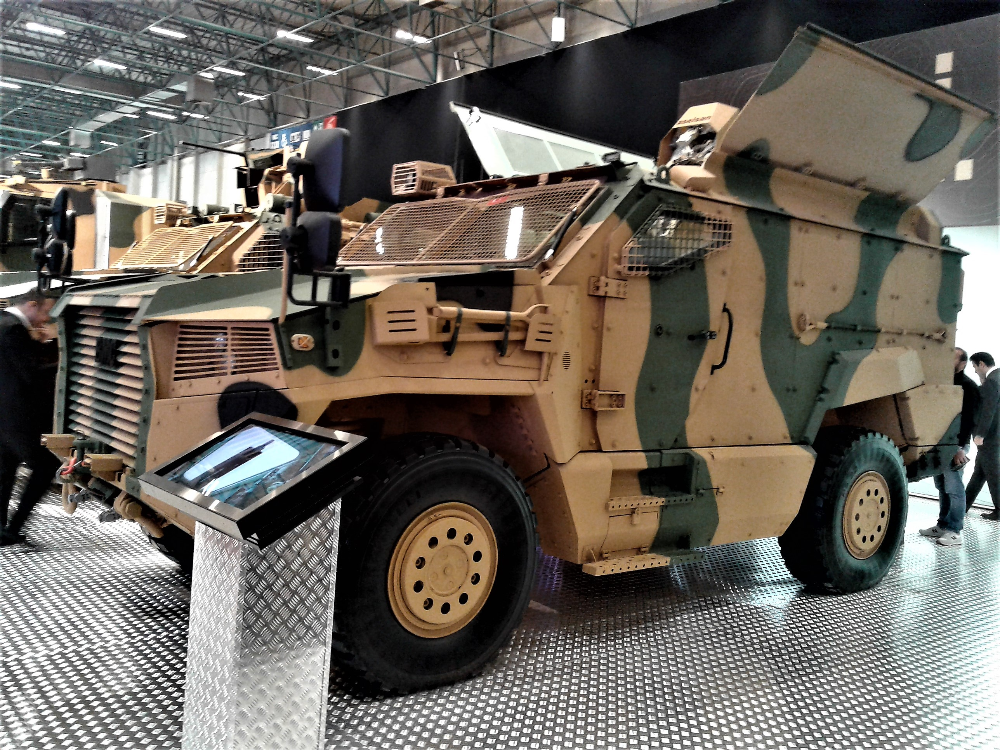
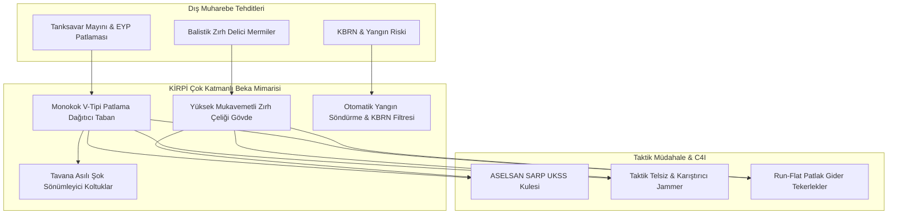

# 🦔 Proje: KİRPİ (Mayına Karşı Korumalı Taktik Araç - MRAP)

  
  
  
  

  

---

## 🛡️ Stratejik Tanım & Doktriner Öncelik
BMC KİRPİ, Türk Silahlı Kuvvetleri'nin terörle mücadele, sınır güvenliği ve sınır ötesi askeri harekatlarında intikal eden Mehmetçiğin can güvenliğini temin etmek amacıyla geliştirilmiş, muharebe sahalarında kendini kanıtlamış efsanevi bir Mayına Karşı Korumalı Araçtır (MRAP). Monokok zırhlı gövdesi ve patlama şok dalgalarını yanlara saptıran karakteristik "V" şeklindeki alt taban geometrisi sayesinde sınıfında dünyanın en yüksek beka standartlarına ulaşmıştır.

Suriye, Irak, Libya, Somali ve Ukrayna muharebe alanlarında ağır el yapımı patlayıcı (EYP) tuzaklarına ve tanksavar roketlerine maruz kalmasına rağmen içerisindeki personeli burnu bile kanamadan tahliye etmesiyle küresel savunma otoritelerince "Yürüyen Kale" unvanını almıştır. 2.000 adedi aşkın teslimatıyla TSK'nın omurgasını oluşturan KİRPİ, geniş ihracat başarısıyla da Türkiye'nin zırhlı kara aracı gücünü temsil eder.

---

## 📊 Kapsamlı Teknik Özellikler

| Parametre | Değer / Karakteristik | Operasyonel Avantaj |
| :--- | :--- | :--- |
| **Muharebe Ağırlığı** | ~19 - 20 Ton | Ağır balistik ve mayın zırhı dahil |
| **Personel Taşıma Kapasitesi**| 13 Personel (Sürücü, Komutan + 11 Tam Teçhizatlı Asker) | Geniş monokok iç hacim |
| **Motor & Güç** | 375 PS Cummins / BMC POWER Dizel Seçeneği | Yüksek tork ve tırmanma gücü |
| **Azami Hız** | 105 km/s | Otoyol ve stabilizede yüksek sürat |
| **Operasyonel Menzil** | 800 - 1.000 km | Lojistik ikmale ihtiyaç duymadan intikal |
| **Mayın & Patlama Koruması** | STANAG 4569 Seviye 4a/4b Mayın ve EYP Koruması | Ağır patlayıcılara karşı tam beka |
| **Balistik Koruma** | STANAG 4569 Seviye 3 Balistik Zırh | Zırh delici piyade mermilerine direnç |
| **Tırmanma & Eğim** | %60 Meyil Tırmanma / %30 Yan Eğim | Dağlık coğrafyada kesintisiz hareket |

---

## 🧩 Alt Sistemler ve Elektronik Entegrasyonu
- **V-Tabanlı Monokok Gövde:** Şasiye bağımlı olmadan tek parça zırhlı çelikten üretilen kabin yapısı, patlamanın enerjisini tabandan yanlara defeder.
- **Mayın Şok Emici Koltuklar:** Tavana ve yan duvarlara asılı, tabanla teması olmayan hidrolik sönümlemeli personel koltukları.
- **ASELSAN SARP UKSS:** Araç içinden joystick ve ekranla kontrol edilen 12.7 mm makineli tüfek veya 40 mm bomba atar kulesi.
- **Otomatik Yangın Söndürme Sistemi:** Motor kompartımanı, personel kabini ve teker yuvalarında milisaniyeler içinde alev algılayıp gaz püskürten koruma.
- **KBRN Filtre Sistemi:** Kimyasal, biyolojik, radyolojik ve nükleer harp ajanlarına karşı pozitif basınçlı hava filtreleme.
- **Merkezi Lastik Şişirme (CTIS) & Run-Flat:** Patlak gider dolgulu tekerlekler ile tüm lastikler isabet alsa dahi 50 km güvenli intikal.

---

## 🎯 Görev Profili ve Muharebe Senaryoları
- **Konvoy Koruma ve Birlik İntikali:** Terör riski yüksek intikal yollarında birliklerin güvenli transferi.
- **Sınır Karakolu Lojistik Destek:** Dağlık ve izole üs bölgelerine personel ve mühimmat sevkiyatı.
- **Ambulans ve Sıhhi Tahliye:** Yaralı personeli muharebe sahasından zırhlı koruma altında tahliye eden özel revir varyantı.
- **Patlayıcı İmha (METİ):** Bomba imha uzman timleri için robot ve dedektör taşıyan özel harekat konfigürasyonu.

---

## 🌐 Beka ve Güvenlik Mimarisi

---

## 🚀 TRL Seviyesi ve Gelişim Yol Haritası (TRL 9)
- [x] Tasarım, prototip üretimi ve zorlu mayın patlatma testleri
- [x] TSK ve Emniyet Genel Müdürlüğü envanterine 2.000+ adet teslimat
- [x] Gerçek savaş ortamlarında operasyonel tescil (Suriye, Libya, Somali)
- [x] Tunus, Katar, Somali ve dost ülkelere yüzlerce adet ihracat
- [x] KİRPİ II varyantının geliştirilmesine temel teşkil eden mimari başarı

---

## 🔗 İç Dizin Navigasyonu
[⬅️ Üst Dizine](../README.md) | [🏛️ Dominion Hub](../../README.md) | [🏠 Ana Sayfa](../../../README.md)
