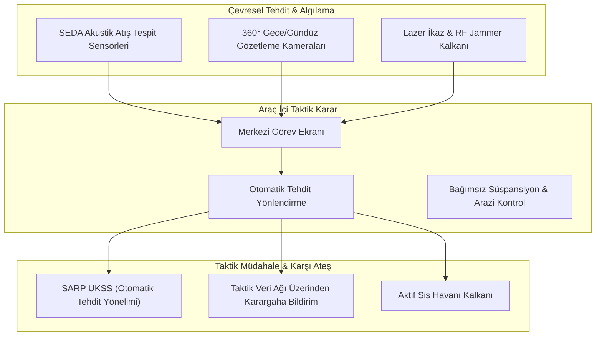

# 🦔 Proje: KİRPİ II (Yeni Nesil Bağımsız Süspansiyonlu MRAP)

  
  
  
  

  

---

## 🛡️ Stratejik Tanım & Doktriner Öncelik
KİRPİ II, efsanevi Kirpi platformunun muharebe sahasından elde edilen yüz binlerce saatlik operasyonel geri bildirimler ışığında en modern zırh, süspansiyon ve elektronik mimari ile donatılmış ikinci neslidir. En kritik yeniliklerden biri olan **Tam Bağımsız Süspansiyon Sistemi**, aracın en zorlu engebeli arazilerdeki hızını ve manevra yeteneğini dramatik ölçüde artırırken, içerideki personelin yorgunluğunu minimize eden üstün bir sürüş konforu sağlamıştır.

Artırılmış balistik koruma paketleri, geliştirilmiş iklimlendirme sistemleri, entegre C4ISR haberleşme omurgası ve ASELSAN SEDA akustik atış yeri tespit sistemiyle donatılan KİRPİ II; yalnızca bir zırhlı personel taşıyıcı değil, aynı zamanda hareketli bir taktik komuta ve erken uyarı merkezidir.

---

## 📊 Kapsamlı Teknik Özellikler

| Parametre | Değer / Özellik | Standart & Geliştirme |
| :--- | :--- | :--- |
| **Süspansiyon Tipi** | Bağımsız Helezon Yaylı ve Amortisörlü Süspansiyon | Her tekerde bağımsız arazi uyumu |
| **Muharebe Yüklü Ağırlık** | ~20 - 21 Ton | Yüksek koruma zırh kiti dahil |
| **Kapasite** | 13 Personel (Sürücü, Komutan + 11 Personel) | Ergonomik mayın korumalı koltuklar |
| **Motor & İtki** | 375 PS Yüksek Torklu Askeri Dizel Motor | BMC POWER yerli motor uyumlu |
| **Azami Hız** | 105+ km/s | Arazide önceki nesle göre %40 daha hızlı |
| **Menzil** | 800+ km | Genişletilmiş yakıt rezervi |
| **Mayın Koruması** | STANAG 4569 Seviye 4a/4b Mayın & EYP | Geliştirilmiş V-taban mimarisi |
| **Balistik Koruma** | STANAG 4569 Seviye 3+ Modüler Kompozit Zırh | Güçlendirilmiş cam ve çelik gövde |

---

## 🧩 Alt Sistemler ve Durumsal Farkındalık Entegrasyonu
- **Bağımsız Süspansiyon Sistemi:** Dört tekerleğin zeminle temasını sürekli kılarak zorlu arazide devrilme riskini ortadan kaldırır.
- **ASELSAN SEDA (Akustik Atış Yeri Tespit Sistemi):** Araca doğru ateşlenen keskin nişancı veya piyade tüfeği mermilerinin ses dalgalarını analiz ederek atıcının koordinatını ve mesafesini milisaniyede ekranda gösterir.
- **ASELSAN SARP Uzaktan Komutalı Silah Sistemi:** Termal kameralı ve lazer mesafe ölçerli 12.7 mm makineli tüfek / 40 mm otomatik bomba atar.
- **Entegre Jammer (RF Karıştırıcı):** Telsiz veya cep telefonuyla uzaktan patlatılmak istenen EYP düzeneklerini araca yaklaşmadan bloke eder.
- **360° Durumsal Farkındalık Kameraları:** Aracın dört bir yanına yerleştirilmiş gündüz/gece kameraları ile personelin kapak açmadan çevreyi izlemesi.

---

## 🎯 Görev Profili ve Çok Amaçlı Konfigürasyonlar
- **Taktik Muharebe Devriyesi:** Asimetrik çatışma bölgelerinde düşman pusu ve mayın tuzaklarını etkisiz kılarak devriye icrası.
- **Komuta Kontrol Aracı:** Çoklu taktik telsizler, dijital harita masaları ve uydu haberleşme terminalleriyle donatılmış tabur/tugay komuta aracı.
- **İleri Hava Kontrolörü (FAC):** Hava ve topçu ateş desteğini koordine eden lazer işaretleyicili özel harekat konfigürasyonu.
- **Sıhhi Tahliye Varyantı:** Sahra koşullarında yoğun bakım standartlarında acil müdahale imkanı sunan donanımlı ambulans.

---

## 🌐 Sistem Mimarisi ve Durumsal Farkındalık Entegrasyonu

---

## 🚀 TRL Seviyesi ve Gelişim Yol Haritası (TRL 9)
- [x] Bağımsız süspansiyon entegrasyonu ve prototip doğrulama testleri
- [x] TSK ve Jandarma birliklerine geniş ölçekli seri üretim teslimatları
- [x] SEDA ve yeni nesil elektronik harp jammer sistemlerinin sahada doğrulanması
- [x] İhracat pazarlarında başarılı görev icrası ve teslimatlar
- [/] BMC POWER yerli TUNA/AZRA güç ünitesi entegrasyonunun seri hatta yaygınlaştırılması

---

## 🔗 İç Dizin Navigasyonu
[⬅️ Üst Dizine](../README.md) | [🏛️ Dominion Hub](../../README.md) | [🏠 Ana Sayfa](../../../README.md)
