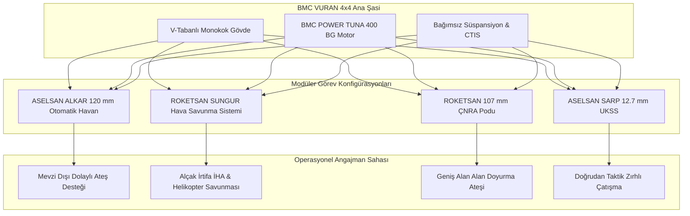

# 🛡️ Proje: VURAN (4x4 Çok Amaçlı Zırhlı Taktik Araç)

  
  
  
  

  

---

## 🛡️ Stratejik Tanım & Doktriner Öncelik
BMC VURAN, taktik tekerlekli zırhlı araç segmentinde yüksek manevra kabiliyeti, çeviklik ve modüler silah taşıma kapasitesini üst düzey balistik ve mayın korumasıyla harmanlayan 4x4 Çok Amaçlı Zırhlı Araçtır (MPAV). KİRPİ'ye kıyasla daha hafif ve kompakt boyutları sayesinde dar sokaklı meskun mahal operasyonlarında, sınır devriyelerinde ve ani müdahale görevlerinde üstün bir operasyonel esneklik sunar.

VURAN'ın en belirgin stratejik üstünlüğü, modüler mimarisi sayesinde farklı silah sistemleri için ideal bir taşıyıcı platform olmasıdır. ASELSAN 120 mm ALKAR Havan Sistemi, ROKETSAN 107 mm Çok Namlulu Roketatar (ÇNRA) ve ROKETSAN SUNGUR Alçak İrtifa Hava Savunma Füzesi gibi stratejik silah sistemleriyle donatılan VURAN, taktik sahrada küçük birliklerin vurucu gücünü çarpan etkisiyle katlamıştır.

---

## 📊 Kapsamlı Teknik Özellikler

| Parametre | Değer / Özellik | Notlar & Varyantlar |
| :--- | :--- | :--- |
| **Tekerlek Konfigürasyonu** | 4x4 Sürekli Dört Çeker | Bağımsız süspansiyon ve kilitli diferansiyel |
| **Muharebe Ağırlığı** | ~16 Ton | Yüksek koruma zırhı ve silah istasyonu dahil |
| **Kapasite** | 9 Personel (Sürücü, Komutan + 7 Personel) | Monokok ergonomik kabin |
| **Motor & Güç** | 360 - 400 PS (BMC POWER TUNA Yerli Motor Seçeneği) | Sıralı askeri turboşarjlı dizel |
| **Azami Sürat** | 110 km/s | Yüksek taktik intikal hızı |
| **Operasyonel Menzil** | 600+ km | Geniş operasyon çapı |
| **Tırmanma & Meyil** | %60 Dik Eğim / %30 Yan Eğim / 0.8 m Su Geçişi | Zorlu arazi ve nehir yatağı aşabilme |
| **Zırh Standartları** | STANAG 4569 Balistik ve Mayın Koruma Seviyesi | V-taban ve kompozit yan paneller |

---

## 🧩 Alt Sistemler ve Modüler Silah Entegrasyonları
- **ALKAR 120 mm Havan Entegrasyonu:** Aracın arkasına yerleştirilen otomatik namlu yönlendirmeli ve mermi doldurmalı döner tablalı 120 mm yivli/yivsiz havan sistemi.
- **SUNGUR Hava Savunma Varyantı:** İki adet çiftli lançer ile toplam 4 adet SUNGUR kızılötesi güdümlü hava savunma füzesi ve 360 derece dönebilen cayro-stabilize optronik nişangah.
- **107 mm ÇNRA Varyantı:** ROKETSAN üretimi güdümlü/güdümsüz 107 mm çok namlulu roketatar podu ile anlık yoğun ateş baskısı.
- **ASELSAN SARP UKSS:** 7.62 mm veya 12.7 mm makineli tüfek entegreli uzaktan komutalı stabilize silah sistemi.
- **KBRN Koruma & Otomatik Söndürme:** Tam otomatik personel ve motor kompartımanı yangın bastırma sistemi.

---

## 🎯 Görev Profili ve Muharebe Senaryoları
- **Meskun Mahal Çatışmaları:** Zırhlı koruma altında sokak aralarında terör yuvalarına karşı hassas doğrudan atış desteği.
- **Hareket Halinde İntikal Güvenliği:** Askeri konvoyların öncü ve artçı keşif unsuru olarak hava ve pusu tehditlerine karşı korunması.
- **Mobil Topçu Ateş Desteği (VURAN-ALKAR):** "Ateş Et ve Mevzi Değiştir" (Shoot & Scoot) doktriniyle birkaç saniyede mevzilenip atış yaparak karşı batarya ateşinden kaçma.

---

## 🌐 Modüler Platform Entegrasyon Mimarisi

---

## 🚀 TRL Seviyesi ve Gelişim Yol Haritası (TRL 9)
- [x] 4x4 platform tasarımı, balistik ve mayın testlerinin başarıyla tamamlanması
- [x] TSK, Jandarma ve Sahil Güvenlik envanterine yüzlerce adet teslimat
- [x] ALKAR 120mm havan ve SUNGUR hava savunma entegre varyantlarının kalifikasyonu
- [x] BMC POWER TUNA motoru entegrasyonu ile yerlilik oranının azamiye çıkarılması
- [x] Kosova, El Salvador ve dost ülkelere yapılan uluslararası ihracat teslimatları

---

## 🔗 İç Dizin Navigasyonu
[⬅️ Üst Dizine](../README.md) | [🏛️ Dominion Hub](../../README.md) | [🏠 Ana Sayfa](../../../README.md)
