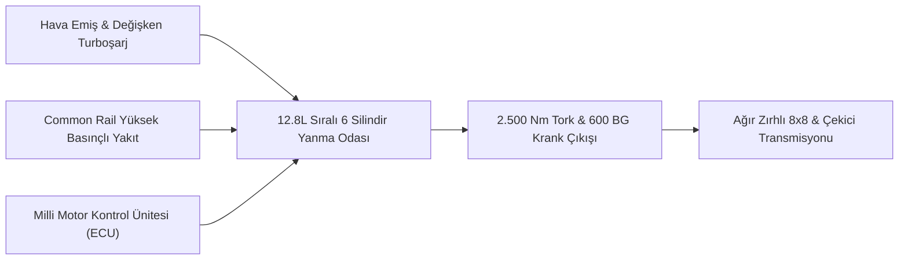

# ⚙️ Proje: BMC POWER AZRA (600 BG Askeri Dizel Motor)

  
  
  
  

  

---

## 🛡️ Stratejik Tanım & Doktriner Öncelik
BMC POWER AZRA, Türk Kara Kuvvetleri'nin ağır zırhlı muharebe araçları, 8x8 taktik tekerlekli zırhlı araçlar, tank kurtarıcı ve taşıyıcı platformlarının güç ihtiyacını milli imkanlarla karşılamak üzere geliştirilmiş 600 beygir gücünde (441 kW) yüksek performanslı bir askeri dizel motordur. Ağır zırh yükleri altında zorlu çöl ve dağ arazisinde operasyon icra eden taktik araçlar için hayati önem taşıyan yüksek torku kesintisiz sunar.

Yurtdışı güç ünitesi tedarik kısıtlamalarını ve ambargolarını bertaraf etmek amacıyla tamamen yerli mühendislik mimarisiyle tasarlanan AZRA; Common Rail yüksek basınçlı yakıt püskürtme sistemi, değişken geometrili turboşarjı ve milli elektronik motor kontrol ünitesi (ECU) ile Türkiye'nin ağır askeri motor ligindeki bağımsızlığının teminatıdır.

---

## 📊 Kapsamlı Teknik Özellikler

| Parametre | Değer / Karakteristik | Mühendislik Notları |
| :--- | :--- | :--- |
| **Maksimum Güç** | 600 BG (441 kW) @ 2100 RPM | Yüksek güç yoğunluğu |
| **Maksimum Tork** | 2.500 Nm @ 1200 - 1500 RPM | Düşük devirde azami çekiş gücü |
| **Motor Mimarisi** | Sıralı 6 Silindir (Inline-6), 4 Zamanlı Dizel | Dengeli, düşük titreşimli yapı |
| **Silindir Hacmi** | 12.8 Litre | Ağır zırhlı şasilere uyumlu hacim |
| **Aspirasyon** | Turboşarjlı ve Ara Soğutuculu (Intercooler) | Yüksek irtifa güç kaybını önleyici |
| **Yakıt Enjeksiyonu** | Common Rail Doğrudan Elektronik Enjeksiyon | Düşük yakıt sarfiyatı ve temiz yanma |
| **Soğutma Mimarisi** | Su Soğutmalı, Ağır Hizmet Tipi Radyatör | +52°C çöl sıcağında kaynamayan termal sistem |
| **Çalışma Sıcaklık Aralığı**| -32°C ile +52°C Askeri Çevre Şartları | Ön ısıtmasız soğuk marş kabiliyeti |

---

## 🧩 Alt Sistemler ve Elektronik Kontrol Entegrasyonu
- **Milli Motor Kontrol Ünitesi (ECU):** Yanma odası basıncını, enjeksiyon zamanlamasını ve turbo basıncını anlık optimize eden milli yazılımlı elektronik kontrol beyni.
- **Askeri Alternatör ve Elektrik Sistemi:** 28V yüksek akımlı askeri jeneratör ile aracın üzerindeki radar, telsiz ve jammer sistemlerini kesintisiz besleme.
- **Ağır Hizmet Karter ve Yağlama:** %60 dik eğim ve %30 yan eğimde dahi yağ basıncını düşürmeden motorun yağlanmasını sağlayan kuru/ıslak karter yapısı.
- **CAN-Bus Askeri Veri Arayüzü:** Araç gösterge paneli ve taktik komuta konsollarıyla tam entegre hata teşhis ve telemetri yayını.

---

## 🎯 Uygulama Platformları ve Görev Alanları
- **8x8 Taktik Tekerlekli Zırhlı Araçlar:** Ağır zırhlı personel taşıyıcılar ve kule entegreli muharebe araçları.
- **Tank Kurtarıcı ve Taşıyıcı Araçlar:** 70 tonluk ana muharebe tanklarını taşıyan çok dingilli ağır çekiciler.
- **Zırhlı İstihkam ve Köprücü Tanklar:** Ağır engelleri aşmak için yüksek itki gücü gerektiren özel istihkam platformları.

---

## 🌐 Sistem Mimarisi ve Güç Üretim Akışı

---

## 🚀 TRL Seviyesi ve Gelişim Yol Haritası (TRL 8)
- [x] Kavramsal ve detay tasarım, 3B akışkanlar mekaniği analizleri
- [x] Motor blok dökümü, işleme ve laboratuvar montajının tamamlanması
- [x] Dinamometre testlerinde 600 BG güç ve 2.500 Nm tork değerlerinin tescili
- [x] Askeri çevre dayanıklılık (soğuk oda ve sıcak testleri) icrası
- [/] Zırhlı araç üzerinde yol ve dayanıklılık testleri ile seri üretim hazırlığı

---

## 🔗 İç Dizin Navigasyonu
[⬅️ Üst Dizine](../README.md) | [🏛️ Dominion Hub](../../README.md) | [🏠 Ana Sayfa](../../../README.md)
