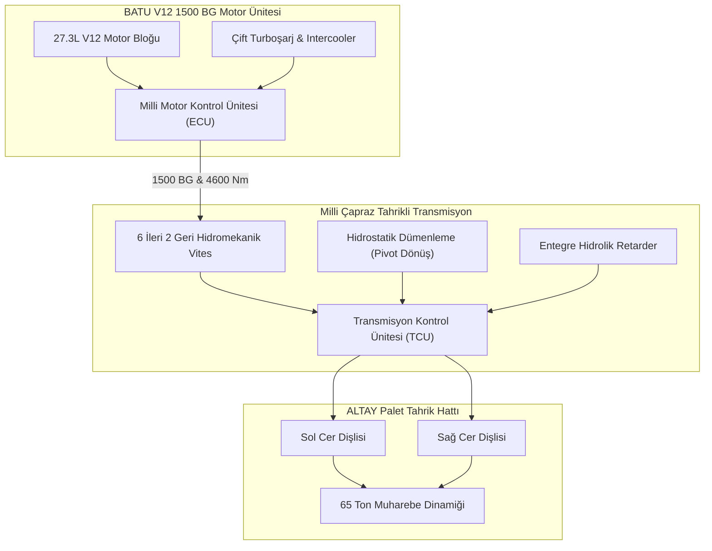

# 🚜 Proje: BATU (1500 BG Tank Güç Grubu - Motor & Transmisyon)

  
  
  
  

  

---

## 🛡️ Stratejik Tanım & Doktriner Öncelik
BATU Güç Grubu (Powerpack); Yeni ALTAY Ana Muharebe Tankı'nın ve geleceğin ağır paletli muharebe araçlarının kalbini oluşturan, Türkiye'nin savunma sanayi tarihindeki en kritik teknolojik atılımlarından biridir. 12 silindirli, V tipi 1500 beygirlik dizel motor ile bu motora entegre milli çapraz tahrikli (cross-drive) tam otomatik hidromekanik transmisyonun tek bir kompakt güç paketi halinde birleştirilmesinden oluşur.

Yabancı ülkelerin Türkiye'ye uyguladığı tank motoru ve transmisyon ambargolarını kökünden çözen BATU; 65+ tonluk ağır bir ana muharebe tankını en zorlu çamur, kum, dik rampa ve hendek koşullarında yüksek çeviklik ve ivmelenmeyle hareket ettirir. Dünyada kendi tank güç grubunu sıfırdan tasarlayıp üretebilen 5-6 ülkeden biri olan Türkiye, BATU ile zırhlı kara platformlarında tam bağımsızlığını ilan etmiştir.

---

## 📊 Kapsamlı Teknik Özellikler

| Parametre | Değer / Karakteristik | Mühendislik Standardı |
| :--- | :--- | :--- |
| **Maksimum Motor Gücü** | 1.500 BG (1.103 kW) @ 2700 RPM | Yüksek güç yoğunluklu V12 mimari |
| **Maksimum Tork** | 4.600 Nm @ 1600 - 1800 RPM | 65 tonluk gövdeyi anında fırlatan tork |
| **Motor Tipi** | V12 Turboşarjlı ve Ara Soğutuculu Su Soğutmalı | Kompakt kule altı gövde yerleşimi |
| **Silindir Hacmi** | 27.3 Litre | Yüksek deplasmanlı askeri dizel |
| **Transmisyon Tipi** | Çapraz Tahrikli (Cross-Drive) Hidromekanik | 6 İleri, 2 Geri Tam Otomatik |
| **Direksiyon Kabiliyeti** | Kademesiz Hidrostatik Direksiyon | Pivot Dönüş (Tankın yerinde 360° dönüşü) |
| **Toplam Güç Paketi Ağırlığı**| ~5.500 kg (Motor + Transmisyon + Soğutma) | Entegre monoblok güç paketi |
| **Çevre Koşulları Dayanımı** | -32°C ile +52°C Sıcaklık Aralığı | Askeri MIL-STD-810G kalifikasyonu |

---

## 🧩 Alt Sistemler ve Elektronik Güç Mimarisi
- **Çapraz Tahrikli Transmisyon:** Sağ ve sol paletlere bağımsız tork aktarımı yaparak tankın dar sokaklarda veya siperlerde kendi ekseni etrafında dönmesini (pivot) sağlayan ileri mekanizma.
- **Milli ECU (Motor Kontrol Ünitesi) & TCU (Transmisyon Kontrol Ünitesi):** BMC POWER mühendislerince geliştirilen, vites geçişlerini, tork konvertörünü ve yakıt püskürtmesini mikro-saniyelerde senkronize eden çift çekirdekli kontrolörler.
- **Entegre Hidrolik Retarder (Fren Sistemi):** Tankın yüksek hızlardan aniden durmasını sağlayan ve dik yokuşlardan inerken fren balatalarını aşınmadan koruyan sıvı fren sistemi.
- **Ağır Hizmet Soğutma Paketi:** Tankın arkasındaki ızgaralardan yüksek debili hava çeken, toz ve çamura dayanıklı fan grubu.

---

## 🎯 Muharebe Avantajları ve Harekat Dinamikleri
- **Yüksek Taktik İvmelenme:** Düşman tanksavar füzesi tespit edildiğinde siperden çıkıp atış yapma ve birkaç saniyede tekrar geri çekilme (Shoot & Scoot).
- **Hızlı Sahra Değişimi:** Güç paketi modüler tasarımı sayesinde muharebe sahasında vinç yardımıyla 30-45 dakika içinde sökülüp yenisiyle değiştirilebilir.
- **Düşük Termal İz:** Özel egzoz soğutma ve yönlendirme kanalları ile düşman termal kameralarının tankı uzaktan tespit etmesini güçleştirir.

---

## 🌐 BATU Güç Grubu Entegrasyon Mimarisi

---

## 🚀 TRL Seviyesi ve Gelişim Yol Haritası (TRL 8)
- [x] V12 motor bloğu ve transmisyon kavramsal tasarımı ve alt parça üretimi
- [x] Test bremzesinde motorun ilk ateşlemesi ve 1.500 BG güç eşiğinin aşılması
- [x] Çapraz tahrikli transmisyon ile motorun entegre test kulesinde çalıştırılması
- [x] Yeni ALTAY tankı prototipine montajı ve saha hareket testlerinin başlaması
- [/] Dayanıklılık koşularının tamamlanması ve seri üretim tanklara entegrasyonu

---

## 🔗 İç Dizin Navigasyonu
[⬅️ Üst Dizine](../README.md) | [🏛️ Dominion Hub](../../README.md) | [🏠 Ana Sayfa](../../../README.md)
