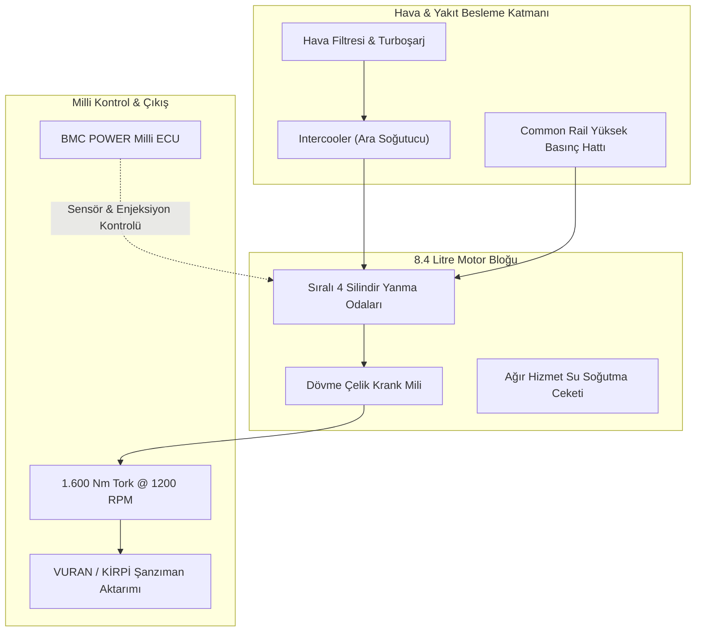

# ⚙️ Proje: BMC POWER TUNA (400 BG Askeri Dizel Motor)

  
  
  
  

  

---

## 🛡️ Stratejik Tanım & Doktriner Öncelik
BMC POWER TUNA, Türk Silahlı Kuvvetleri ve Emniyet Teşkilatı'nın taktik tekerlekli zırhlı araç filosunda (BMC VURAN 4x4, BMC KİRPİ 4x4) motor alanında tam bağımsızlık sağlamak üzere seri üretimine başlanmış 400 beygir gücünde (294 kW) milli askeri dizel motordur. Türkiye'nin seri üretime geçen ilk yerli ve milli askeri motoru olma unvanını taşır.

Geliştirme ve kalifikasyon süreçlerinde on binlerce kilometrelik aşırı sıcak, aşırı soğuk ve ağır arazi testlerinden başarıyla geçen TUNA; zırhlı araçların yüksek ivmelenme, dik yokuş tırmanma ve engebeli arazide yüksek tork üretme ihtiyaçlarını yabancı tedarikçilere bağımlı kalmaksızın karşılamaktadır. Yüzlerce adet TUNA motoru TSK ve Jandarma envanterindeki zırhlı araçlara monte edilmiş olup sahada aktif görev icra etmektedir.

---

## 📊 Kapsamlı Teknik Özellikler

| Parametre | Değer / Özellik | Standart Karşılık |
| :--- | :--- | :--- |
| **Maksimum Güç** | 400 BG (294 kW) @ 2100 RPM | Yüksek verimli termal çevrim |
| **Maksimum Tork** | 1.600 Nm @ 1200 - 1500 RPM | Düşük devirde yüksek çekiş |
| **Silindir Dizilimi** | Sıralı 4 Silindir (Inline-4) | Kompakt motor bölmesi montajı |
| **Silindir Hacmi** | 8.4 Litre | Optimize edilmiş deplasman |
| **Aspirasyon** | Turboşarjlı ve Ara Soğutuculu | Değişken basınç kontrolü |
| **Kuru Ağırlık** | ~850 kg | Hafif ve dayanıklı döküm gövde |
| **Çalışma Sıcaklıkları** | -32°C (Ön ısıtmasız) ila +52°C | Aşırı iklim koşullarına tam uyum |
| **Hedef Platformlar** | BMC VURAN (4x4), BMC KİRPİ (4x4), Taktik Kamyonlar | TSK standart taktik araçları |

---

## 🧩 Alt Sistemler ve Elektronik Mimari
- **Milli ECU (Motor Kontrol Ünitesi):** BMC POWER tarafından geliştirilen gömülü yazılımlarla motorun enjeksiyon haritasını, tork eğrisini ve yakıt basıncını optimize eder.
- **Common Rail Yüksek Basınç Pompası:** 1.800+ bar basınçta çalışan elektronik püskürtme sistemi ile zorlu koşullarda temiz yanma ve düşük egzoz emisyonu.
- **Askeri Elektrik Aksamı:** 24V çift alternatör sistemi ile araca monte edilen telsiz, silah kulesi ve elektronik harp sistemlerini besleme.
- **Düşük Akustik ve Termal İmza:** Ses yalıtımlı blok tasarımı ve optimize edilmiş egzoz manifold yapısı ile termal hedeflenmeyi azaltma.

---

## 🎯 Muharebe Sahası Performansı ve Güvenilirlik
- **Soğuk Marş Kabiliyeti:** Doğu Anadolu ve sınır ötesi kış şartlarında (-32°C) harici ısıtıcıya ihtiyaç duymadan ilk marşta çalışma.
- **Yüksek Güvenilirlik (MTBF):** Ağır titreşim, toz ve su geçişlerine dayanıklı sızdırmazlık standartları.
- **Lojistik Kolaylık:** Milli yedek parça zinciri ile TSK kademelerinde hızlı ve kesintisiz bakım onarım imkanı.

---

## 🌐 Mekanik ve Elektronik Motor Mimarisi

---

## 🚀 TRL Seviyesi ve Gelişim Yol Haritası (TRL 9)
- [x] Motor tasarım, simülasyon ve prototip test fazlarının tamamlanması
- [x] Laboratuvar ortamında binlerce saatlik dayanıklılık ve kalifikasyon testleri
- [x] BMC VURAN 4x4 araçları üzerinde zorlu arazi sürüş testlerinin icrası
- [x] Seri üretim bandının devreye alınması ve TSK teslimatlarının başlaması
- [x] Türk Silahlı Kuvvetleri ve Jandarma envanterinde aktif muharebe kullanımı

---

## 🔗 İç Dizin Navigasyonu
[⬅️ Üst Dizine](../README.md) | [🏛️ Dominion Hub](../../README.md) | [🏠 Ana Sayfa](../../../README.md)
