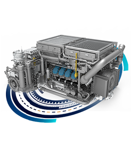
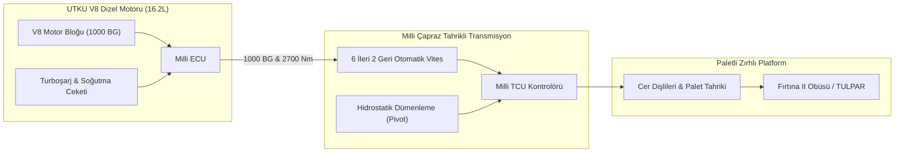

# ⚙️ Proje: UTKU (1000 BG ZMA Güç Grubu - Motor & Transmisyon)

  
  
  
  

  

---

## 🛡️ Stratejik Tanım & Doktriner Öncelik
UTKU Güç Grubu (Powerpack); Türk Kara Kuvvetleri'nin modern zırhlı muharebe araçları (ZMA), yeni nesil paletli hafif tankları (KAPLAN MT), TULPAR ve T-155 Fırtına Kundağı Motorlu Obüsleri için geliştirilmiş 1.000 beygir gücünde (735 kW) milli güç paketidir. 8 silindirli, V tipi turboşarjlı bir dizel motor ile çapraz tahrikli (cross-drive) hidromekanik tam otomatik bir transmisyonun entegrasyonundan oluşur.

40 tona kadar olan paletli zırhlı muharebe platformlarının yabancı güç grubu kısıtlamalarına maruz kalmadan üretilmesini ve modernize edilmesini sağlayan UTKU; yüksek torku, pivot dönüş kabiliyeti ve kompakt boyutlarıyla Türk zırhlı birliklerinin taktik hareket kabiliyetini zirveye taşımaktadır.

---

## 📊 Kapsamlı Teknik Özellikler

| Parametre | Değer / Karakteristik | Tasarım Kriteri |
| :--- | :--- | :--- |
| **Maksimum Güç** | 1.000 BG (735 kW) @ 2700 RPM | Yüksek güç/ağırlık oranı |
| **Maksimum Tork** | 2.700 Nm | Hızlı ivmelenme ve tırmanma |
| **Motor Konfigürasyonu** | V8 Turboşarjlı Su Soğutmalı Dizel | Kompakt V açılı motor bloğu |
| **Silindir Hacmi** | 16.2 Litre | Optimize edilmiş deplasman |
| **Transmisyon** | Çapraz Tahrikli, 6 İleri 2 Geri Tam Otomatik | Hidrostatik dümenleme ve frenleme |
| **Dönüş Yeteneği** | Kendi Etrafında 360° Pivot Dönüş | Dar alan manevra esnekliği |
| **Hedef Platform Ağırlığı** | 30 ila 45 Ton Arası Paletli Araçlar | Fırtına II, TULPAR, KAPLAN MT |
| **Çalışma Şartları** | -32°C ile +52°C Sıcaklık Aralığı | MIL-STD-810G uyumlu |

---

## 🧩 Alt Sistemler ve Güç Aktarım Mimarisi
- **Milli Çapraz Tahrikli Transmisyon:** Paletlere farklı hız ve yön vererek aracın dar siperlerde, ormanlık ve kentsel alanlarda manevra yapmasını sağlayan transmisyon.
- **Entegre Retarder:** Uzun inişlerde ve acil frenlemelerde sürtünmesiz hidrolik frenleme yaparak mekanik frenleri koruyan sistem.
- **Milli ECU & TCU:** Motor ve transmisyonun birbiriyle anlık haberleşerek vites geçişlerinde güç kesintisini sıfıra indiren yerli kontrol üniteleri.
- **Modüler Soğutma Grubu:** Zırhlı araç üst gövdesine entegre, yüksek debili hidrolik tahrikli fanlar ve ısı eşanjörleri.

---

## 🎯 Uygulama Alanları ve Doktriner Faydalar
- **Fırtına II Kundağı Motorlu Obüs:** 45 tonluk devasa obüsün atış mevzisine hızla girmesi ve atış sonrası karşı batarya ateşinden önce mevzi terk etmesi.
- **Yeni Nesil Zırhlı Muharebe Araçları (ZMA):** Ağır kuleli ve zırhlı piyade muharebe araçlarının tank birlikleriyle aynı hızda intikal edebilmesi.
- **KAPLAN MT (Orta Ağırlık Sınıfı Tank):** İhracat pazarlarında üçüncü ülkelerin motor vetolarını aşarak serbest satış kabiliyeti.

---

## 🌐 Sistem Mimarisi ve Entegrasyon Akışı

---

## 🚀 TRL Seviyesi ve Gelişim Yol Haritası (TRL 8)
- [x] V8 motor ve çapraz tahrikli transmisyon tasarım doğrulaması
- [x] Motor prototipinin ilk çalıştırması ve 1000 BG güç eşiğinin aşılması
- [x] Transmisyon entegrasyonu ve test bremzesinde uzun süreli yük koşuları
- [x] Zırhlı araç şasisine entegrasyon ve hareket testlerinin başlatılması
- [/] Paletli araç kabul testlerinin icrası ve seri üretime geçiş hazırlığı

---

## 🔗 İç Dizin Navigasyonu
[⬅️ Üst Dizine](../README.md) | [🏛️ Dominion Hub](../../README.md) | [🏠 Ana Sayfa](../../../README.md)
