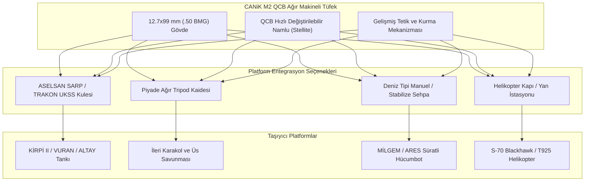

# 🔫 Proje: CANiK M2 QCB (12.7x99 mm Ağır Makineli Tüfek)

  
  
  
  

  

---

## 🛡️ Stratejik Tanım & Doktriner Öncelik
CANiK M2 QCB (Quick Change Barrel), Samsun Yurt Savunma (SYS) bünyesindeki CANiK tarafından geliştirilen, NATO standardı 12.7x99 mm (.50 BMG) mühimmat kullanan ağır makineli tüfektir. Türkiye'nin uzun yıllar müttefik ülkelerden tedarik etmekte zorlandığı ve ambargolara konu olan efsanevi Browning M2 platformunu modern malzeme teknolojisi, hassas işleme toleransları ve yenilikçi kaplama yöntemleriyle yeniden üreten CANiK, TSK'nın dışa bağımlılığını tamamen ortadan kaldırmıştır.

Dünyada 12.7 mm ağır makineli tüfeği seri olarak üretebilen 5 ülkeden biri olan Türkiye, CANiK M2 QCB ile yalnızca kendi kara, deniz ve hava platformlarının ihtiyacını karşılamakla kalmamış; İngiltere, Ukrayna ve onlarca müttefik ülkeye ihraç ederek küresel pazarda büyük bir ihracat başarısına imza atmıştır.

---

## 📊 Kapsamlı Teknik Özellikler

| Parametre | Değer / Özellik | Standart & Avantaj |
| :--- | :--- | :--- |
| **Kalibre** | 12.7 x 99 mm NATO (.50 BMG) | Zırh delici, yangın çıkarıcı mühimmat |
| **Çalışma Prensibi** | Kısa Geri Tepmeli (Short Recoil Operated) | Güvenilir ve tutukluk yapmayan mekanizma |
| **Atış Sürati** | 450 - 650 Atım / Dakika | Kararlı ve kontrollü ateş gücü |
| **Etkili Menzil** | 1.800 metre | Nokta hedeflere hassas angajman |
| **Azami Menzil** | 6.800 metre | Alan baskılama ve uzak menzil tesiri |
| **Namlu Değişimi** | QCB (Hızlı Namlu Değişimi) | Saniyeler içinde kilit ve boşluk ayarsız değişim |
| **Namlu Ömrü** | 20.000+ Atım (Özel Stellite Kaplama) | Standart M2 namlularının 2 katı ömür |
| **Toplam Ağırlık** | ~38 kg (Gövde + Namlu) | Standart tripod ve UKSS montaj uyumlu |

---

## 🧩 Alt Sistemler ve Platform Entegrasyonu
- **Quick Change Barrel (QCB) Mekanizması:** Yoğun muharebe anında aşırı ısınan namlunun kilit ayarı (headspace) gerektirmeksizin saniyeler içinde değiştirilebilmesi.
- **Özel Alaşımlı Namlu Teknolojisi:** CANiK'in patentli namlu kaplama ve derin delme teknolojisi sayesinde sürekli seri atışlarda dahi yiv-set bozulmasını engelleyen yapı.
- **UKSS & Taret Entegrasyonu:** ASELSAN SARP, UNIROBOTICS TRAKON ve ASELSAN SERDAR gibi uzaktan komutalı silah kulelerine sıfır titreşimli montaj.
- **Optik & Gece Görüş Rayları:** MIL-STD-1913 Picatinny rayları ile termal dürbün, refleks nişangah ve lazer işaretleyici takılabilme.

---

## 🎯 Muharebe Rolleri ve Kullanım Yelpazesi
- **Zırhlı Kara Araçları:** ALTAY, KİRPİ, VURAN, COBRA II ve PARS araçlarının tavan savunma silahı.
- **Hızlı Hücumbotlar & Savaş Gemileri:** DSH görevlerinde kıyı hedeflerine ve asimetrik intihar botlarına karşı yakın savunma.
- **Helikopter Kapı Montajı:** AS532 Cougar ve S-70 Blackhawk helikopterlerinde kapı makineli tüfeği (Door Gunner).
- **Piyade Tripod Desteği:** İleri üs bölgelerinde ve mevzilerde 1.800 metreden düşman araç ve tahkimatlarını imha kabiliyeti.

---

## 🌐 Modüler Platform Entegrasyon Şeması

---

## 🚀 TRL Seviyesi ve Gelişim Yol Haritası (TRL 9)
- [x] Tasarım, metalurjik Ar-Ge ve kalifikasyon testleri
- [x] NATO standartlarında zorlu çöl, çamur ve dayanıklılık testlerinin tamamlanması
- [x] TSK ve Emniyet Teşkilatı envanterine binlerce adetlik seri teslimat
- [x] İngiltere, Ukrayna ve 20'den fazla ülkeye geniş ölçekli ihracat
- [x] M2F (daha yüksek atış hızlı uçak/helikopter varyantı) modelinin seriye alınması

---

## 🔗 İç Dizin Navigasyonu
[⬅️ Üst Dizine](../README.md) | [🏛️ Dominion Hub](../../README.md) | [🏠 Ana Sayfa](../../../README.md)
