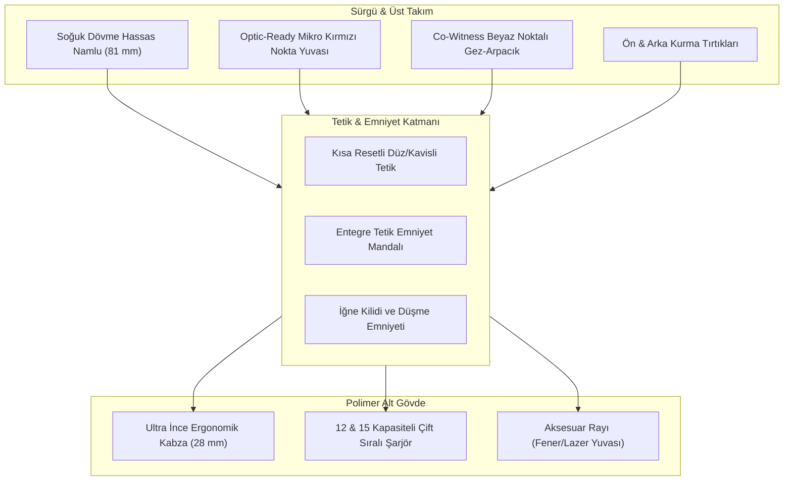

# 🔫 Proje: CANİK METE MC9 (Mikro Kompakt Tabanca)

  
  
  
  

  

---

## 🛡️ Stratejik Tanım & Doktriner Öncelik
CANİK METE MC9, Samsun Yurt Savunma (SYS) tarafından özel operasyon birimleri, sivil kolluk kuvvetleri, VIP yakın koruma personeli ve gizli taşıma (Concealed Carry) ihtiyaçları için geliştirilmiş 9x19 mm kalibreli mikro kompakt polimer tabancadır. Yalnızca 28 mm inceliğe sahip ultra kompakt gövdesine rağmen, çift sıralı 12+1 ve 15+1 şarjör kapasitesi sunarak sınıfında çığır açmıştır.

ABD sivil ve kolluk pazarında "Yılın Tabancası" ödülünü kazanan METE MC9; fabrika çıkışı "Optic-Ready" mikro refleks nişangah (Micro Red Dot) montaj yuvası, 100% Co-Witness nişan hattı ve hafifletilmiş iğne vuruşlu (striker-fired) tetik mekanizmasıyla modern tabanca mühendisliğinin ulaştığı en üst seviyeyi temsil eder. 50.000 atımlık askeri dayanıklılık testlerini arızasız tamamlamıştır.

---

## 📊 Kapsamlı Teknik Özellikler

| Parametre | Değer / Karakteristik | Ergonomik Karşılık |
| :--- | :--- | :--- |
| **Kalibre** | 9 x 19 mm Parabellum (NATO Standardı) | Yaygın mühimmat uyumu |
| **Toplam Uzunluk** | 155 mm (6.1 inç) | Gizli taşımaya tam uyumlu boyut |
| **Namlu Boyu** | 81 mm (3.18 inç) | Yüksek hassasiyetli soğuk dövme namlu |
| **Gövde Genişliği**| 28 mm (1.1 inç) Ultra İnce Profil | Giysi altında sıfır baskı/iz |
| **Ağırlık (Boş)** | 603 gram | Yorulmadan tüm gün taşıma konforu |
| **Şarjör Kapasitesi**| 12+1 (Düz Taban) / 15+1 (Uzatılmış Taban) | Sınıfının en yüksek ateş gücü |
| **Tetik Sistemi** | Kısa Resetli İğne Vuruşlu (Striker-Fired) | Hassas ve hızlı mükerrer atış |
| **Nişangahlar** | 3 Noktalı Beyaz Gez-Arpacık + Optic-Ready | Co-witness mekanik & optik eşleşmesi |

---

## 🧩 Alt Sistemler ve Tasarım İnovasyonları
- **100% Co-Witness Optik Montajı:** Mikro refleks (Red Dot) nişangah doğrudan sürgüye entegre edilir; optik arızalansa veya pili bitse dahi mekanik gez ve arpacık görüş çizgisini korur.
- **Çift Taraflı Sürgü Mandalı & Değiştirilebilir Şarjör Kilidi:** Hem sağ hem sol el kullanıcılarına tam uyum sağlayan iki elli (ambidextrous) ergonomi.
- **Modüler Arka Kabza Sırtlıkları (Backstrap):** Farklı el boyutlarına sahip kullanıcılar için değiştirilebilir kabza sırtlığı paketi.
- **Sahra Söküm Kolaylığı:** Özel sökme pimi ve iç mekanizma mimarisi ile alet gerektirmeden saniyeler içinde sökülüp temizlenebilme.

---

## 🎯 Kullanım Alanları ve Muharebe Senaryoları
- **Gizli Operasyon ve İstihbarat Timleri:** Sivil kıyafet altında hiçbir çıkıntı yapmadan taşınabilen operasyonel güç.
- **Havacılık ve Pilot Yedek Silahı:** Kokpit içerisinde dar hacimde pilotların acil savunma tabancası.
- **Askeri ve Kolluk Yedek Silahı (Backup Gun):** Ana servis tabancasının yanında çizme veya yelek içi ikincil güvence silahı.

---

## 🌐 Ergonomik ve Mekanik Bileşen Mimarisi

---

## 🚀 TRL Seviyesi ve Gelişim Yol Haritası (TRL 9)
- [x] Ultra ince mikro kompakt kavramsal tasarım ve simülasyonları
- [x] 50.000 atımlık askeri kalifikasyon ve düşme testlerinin başarısı
- [x] Türk güvenlik güçleri ve özel operasyon birimlerine teslimat
- [x] ABD pazarında "Yılın Tabancası" ödülü ve yüz binlerce adetlik ihracat
- [x] Kompanzatörlü ve dişli namlulu özel taktik versiyonların seri üretimi

---

## 🔗 İç Dizin Navigasyonu
[⬅️ Üst Dizine](../README.md) | [🏛️ Dominion Hub](../../README.md) | [🏠 Ana Sayfa](../../../README.md)
