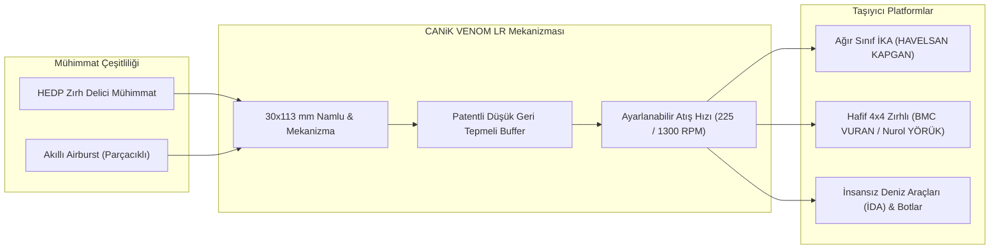

# 🔫 Proje: CANiK VENOM LR (30x113 mm Düşük Geri Tepmeli Otomatik Top)

  
  
  
  

  

---

## 🛡️ Stratejik Tanım & Doktriner Öncelik
CANiK VENOM LR (Low Recoil), Samsun Yurt Savunma'nın (SYS) İngiltere merkezli köklü orta kalibre silah üreticisi AEI Systems firmasını satın almasıyla milli savunma ekosistemimize kazandırılan 30x113 mm kalibreli devrimsel bir otomatik toptur. Geleneksel 30 mm topların yarattığı devasa geri tepme kuvvetini patentli hidropnömatik ve yaylı sönümleme teknolojisiyle minimize eden VENOM LR; hafif 4x4 zırhlı araçlara, insansız kara araçlarına (İKA) ve deniz kulelerine 30 mm'lik tahrip gücünü entegre edebilmektedir.

Piyade tüfekleri ve 12.7 mm makineli tüfeklerin etkisiz kaldığı beton siperler, hafif zırhlı muharebe araçları ve asimetrik drone tehditlerine karşı geliştirilen VENOM LR; programlanabilir akıllı hava patlamalı (Airburst) mühimmat atabilme kabiliyetiyle modern harp sahasının en ölümcül taktik silahlarından biridir.

---

## 📊 Kapsamlı Teknik Özellikler

| Parametre | Değer / Karakteristik | Operasyonel Avantaj |
| :--- | :--- | :--- |
| **Kalibre** | 30 x 113 mm NATO Standardı | Yüksek parça tesirli ve zırh delici mühimmat |
| **Çalışma Mekanizması** | Elektrikli Sürüşlü Döner Kilitli Otomatik Top | Tutukluk yapmayan harici tahrik |
| **Ayarlanabilir Atış Sürati**| 225 Atım/Dk (Tekil/Kontrollü) veya 1.200 - 1.350 Atım/Dk | Hedefe göre ayarlanabilir yangın gücü |
| **Geri Tepme Kuvveti** | < 7 - 9 kN (Düşük Geri Tepme - Low Recoil) | Hafif araç şasilerini sarsmayan yapı |
| **Etkili Menzil** | 2.000 - 2.500 metre | Geniş taktik etki alanı |
| **Ağırlık** | ~85 - 95 kg (Oldukça hafif) | İKA ve hafif kulelere tam uyum |
| **Mühimmat Besleme** | Sağ veya Sol Bağlantılı Mayonlu Besleme | Çift yönlü esnek entegrasyon |
| **Mühimmat Tipleri** | HEI (Yüksek İnfilaklı Yangın), HEDP (Çift Amaçlı Zırh Delici), Airburst | Çok yönlü hedef angajmanı |

---

## 🧩 Alt Sistemler ve İleri Entegrasyon
- **Düşük Geri Tepme Sönümleyicisi (Buffer):** 30 mm atışın yarattığı şok dalgasını emerek hafif platformların dengesini ve atış hassasiyetini koruyan patentli tampon mimarisi.
- **Akıllı Mühimmat Programlayıcı:** Namlu ucuna takılan programlama halkası ile Airburst (havada patlayan) mermilerin sütre arkasındaki veya havadaki dronun önünde patlamasını sağlama.
- **İnsansız Kara Aracı (İKA) Entegrasyonu:** HAVELSAN KAPGAN ve BARKAN gibi ağır ve orta sınıf İKA'lara monte edilerek uzaktan kumandalı ölümcül otonom güç oluşturma.
- **Deniz Stabilize Kuleleri:** UNIROBOTICS ve ASELSAN deniz kuleleriyle donatılarak hücumbotlar ve insansız deniz araçlarında (İDA) kullanım.

---

## 🎯 Görev Profili ve Muharebe Senaryoları
- **Siper ve Meskun Mahal Temizliği:** Duvar veya beton siper arkasına gizlenmiş keskin nişancı ve roket mevzilerini delinebilir zırh delici mühimmatla imha etme.
- **Anti-Drone (C-UAS) Savunması:** Kamikaze FPV dronları ve döner kanatlı İHA sürülerini havada parçalanan akıllı mühimmat bulutuyla düşürme.
- **Hafif Zırhlı Birlik Angajmanı:** BTR ve BMP sınıfı hafif zırhlı araçları 2.000 metreden delerek devre dışı bırakma.

---

## 🌐 Otomatik Top Entegrasyon ve Sönümleme Şeması

---

## 🚀 TRL Seviyesi ve Gelişim Yol Haritası (TRL 9)
- [x] Satın alma sonrası İngiltere ve Türkiye üretim altyapısının entegrasyonu
- [x] Kalifikasyon ve poligon atış testlerinin tamamlanması
- [x] HAVELSAN KAPGAN ağır sınıf insansız kara aracına başarılı entegrasyon ve atışlar
- [x] Seri üretim bandının Samsun ve Birleşik Krallık tesislerinde devreye alınması
- [/] Türk Silahlı Kuvvetleri'nin hafif zırhlı ve İKA platformlarına toplu teslimatlar

---

## 🔗 İç Dizin Navigasyonu
[⬅️ Üst Dizine](../README.md) | [🏛️ Dominion Hub](../../README.md) | [🏠 Ana Sayfa](../../../README.md)
