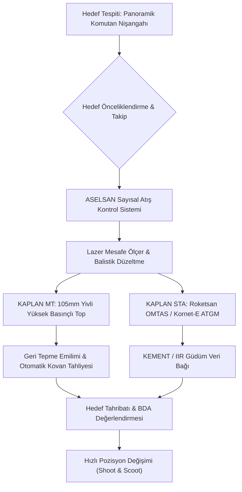

# 🐯 Proje: KAPLAN (KAPLAN MT & KAPLAN STA)

[

<p align="center">
  
</p>
](https://en.wikipedia.org/wiki/Technology_readiness_level)
[](../../README.md)
[](../README.md)
[](../README.md)


> **"Ağır tankların adım atamadığı engebeli ve sulak coğrafyalarda zırhlı süvari üstünlüğü: Yüksek ateş gücü, amfibi beka ve stratejik çeviklik."**

---

## 🛡️ Stratejik Tanım & Doktriner Öncelik

KAPLAN Zırhlı Muharebe Aracı ailesi, Türk savunma sanayiinin paletli zırhlı muharebe araçları alanında ulaştığı olgunluk seviyesinin küresel ölçekteki temsilcisidir. FNSS ve Endonezyalı PT Pindad ortaklığıyla geliştirilen **KAPLAN MT (Modern Medium Weight Tank - Harimau)**, Türkiye'nin ihraç ettiği ilk tank sınıfı paletli muharebe aracı unvanına sahiptir. 60+ tonluk Ana Muharebe Tanklarının (AMT) yüksek ağırlıkları sebebiyle geçemediği köprüler, bataklık zeminler ve dağlık Güneydoğu Asya coğrafyasında 105mm yivli topun tahrip gücünü üstün manevra yeteneğiyle birleştirir.

Ailenin diğer stratejik kolu olan **KAPLAN-10 STA (Silah Taşıyıcı Araç)** ise Türk Kara Kuvvetleri Komutanlığı'nın tanksavar doktrininde devrim yaratmıştır. Amfibi kabiliyetiyle hiçbir hazırlık yapmadan su engellerini aşabilen KAPLAN STA, kuleye entegre Roketsan OMTAS ve KORNET-E güdümlü tanksavar füzeleriyle düşman zırhlı birliklerine karşı asimetrik avcı rolü üstlenmektedir. Düşük silueti, gelişmiş termal nişangahları ve yüksek güç/ağırlık oranıyla modern muharebe sahasının çevik vurucu gücüdür.

---

## 📊 Kapsamlı Teknik Özellikler Tablosu

| Parametre | KAPLAN MT (Harimau) | KAPLAN-10 STA |
| :--- | :--- | :--- |
| **Platform Sınıfı** | Orta Ağırlık Sınıfı Tank (3. Nesil+) | Amfibi Paletli Silah Taşıyıcı Araç |
| **Muharebe Ağırlığı** | 30.000 - 35.000 kg (Balistik kitleye bağlı) | 14.500 - 16.000 kg |
| **Uzunluk / Genişlik / Yükseklik** | 7.0 m (Gövde) / 3.2 m / 2.7 m | 5.6 m / 3.0 m / 2.3 m (Düşük Siluet) |
| **Mürettebat Kapasitesi** | 3 Personel (Komutan, Nişancı, Sürücü) | 4 Personel (Komutan, Nişancı, Sürücü, Doldurucu) |
| **Motor & İtki Sistemi** | 711 BG Dizel Motor + Tam Otomatik Şanzıman | 375+ BG Dizel Motor + Çift Arka Su Jeti |
| **Güç / Ağırlık Oranı** | 20 - 24 BG/ton | 24 - 26 BG/ton |
| **Azami Karayolu Hızı** | 70 km/sa | 65 km/sa |
| **Amfibi Hızı (Suda)** | Hazırlıksız derin sulardan geçiş (sığ geçiş) | 6.5 - 7.0 km/sa (Yüzebilen tasarım) |
| **Harekat Sığası (Menzil)** | 450+ km | 525+ km |
| **Ana Silah Sistemi** | 105mm CMI Cockerill 3105 Yüksek Basınçlı Top | FNSS Yalman / OMTAS & Kornet-E Kulesi |
| **İkincil Silah** | 7.62mm Eş Eksenli MT + 12.7mm UKSS Opsiyonu | 7.62mm Makinalı Tüfek (Kuleye Eşeksenli) |
| **Balistik & Mayın Beka** | STANAG 4569 Seviye 4/5 + Mayın Seviye 4 | STANAG 4569 Balistik ve Mayın Koruma |

---

## 🔄 Sistem Mimarisi & Görev Akışı



---

## 🧩 Alt Sistemler ve Aviyonik/Elektronik Entegrasyonu

- **Sayısal Atış Kontrol Sistemi:** Komutan ve nişancı için bağımsız çift eksenli stabilize termal/gündüz görüş optikleri ve lazer mesafe ölçer (LRF) ile kesintisiz "Hunter-Killer" kabiliyeti.
- **Kule Otomasyonu:** KAPLAN MT'de tam otomatik döner tamburlu mühimmat besleyici (Autoloader); mürettebatı kule sepetindeki mühimmat infilakından izole eden zırhlı bölme ve patlama kapakları.
- **Tanksavar Kule Entegrasyonu (KAPLAN STA):** FNSS öz kaynaklarıyla tasarlanan Uzaktan Komutalı Tanksavar Kulesi (UKTK), zırh altından güdümlü mermi ateşleme ve elektro-optik takip imkanı.
- **Aktif Koruma ve Beka:** PULAT / AKKOR Aktif Koruma Sistemi (APS) donanım hazırlığı, Lazer İkaz Alıcıları (LWR) ve tehdit yönüne otomatik sis havanı salvosu tetikleme.
- **Durumsal Farkındalık:** Gövde çevresine yerleştirilmiş 360° panoramik gündüz/termal kameralar (YAMGÖZ) ve entegre C4ISR Kara Taktik Veri Bağı terminalleri.

---

## 🎯 Görev Profili, Muharebe Senaryoları & Mühimmat Yelpazesi

### Görev Profilleri
- **Orta Sınıf Tank Görevleri:** Zorlu ormanlık arazi, nehir vadileri, adalar arası intikal ve zayıf altyapılı köprü geçişlerinde piyade birliklerine doğrudan ateş desteği.
- **Asimetrik Zırhlı Avcı (STA):** Düşman tank taarruzlarını derinlikte karşılama, geçit ve boğaz hatlarında pusu kurarak tanksavar füzeleriyle zırhlı kolları imha etme.
- **Amfibi Geçiş Harekatı:** KAPLAN-10 ile sulu engellerden yüzerek karşı kıyı başını tutma ve köprübaşı güvenliğini sağlama.

### Mühimmat Yelpazesi
- **105mm Standart & Gelişmiş NATO Mühimmatı:** APFSDS (Zırh Delici Sabot), HE-T (Yüksek İnfilaklı Parçacıklı), HESH (Ezici Başlıklı) ve Namludan Atılan GLATGM Tanksavar Füzeleri.
- **Güdümlü Tanksavar Füzeleri (STA):** Roketsan OMTAS (IIR Güdümlü, At-Unut / At-Güncelle) ve Kornet-E (Lazer Hat Güdümlü).

---

## 🚀 TRL Seviyesi ve Gelişim Yol Haritası

```
[TRL 1-6] ➔ [TRL 7: Prototip Kalifikasyonu] ➔ [TRL 8: TSK ve Endonezya Saha Testleri] ➔ [TRL 9: Seri Üretim & Aktif Envanter]
```

- [x] **KAPLAN MT (Harimau):** Ortak geliştirme, tropikal iklim dayanıklılık ve atış kalifikasyonlarının tamamlanması (TRL 9).
- [x] **Endonezya Ordusu Teslimatları:** İlk parti seri üretim araçların Endonezya Silahlı Kuvvetleri'ne teslimi ve ortak montaj hattının devreye alınması.
- [x] **KAPLAN STA:** TSK Silah Taşıyıcı Araçlar Projesi kapsamında Kara Kuvvetleri envanterine yüzlerce aracın teslim edilmesi ve sınır ötesi harekatlarda aktif kullanımı.
- [ ] **KAPLAN ALPHA Entegrasyonu:** Hibrit tahrik mimarisi, yapay zeka destekli otonom rota takibi ve insansız kule modernizasyon paketleri.

---

## 🔗 Bağlantılar ve Dizin Navigasyonu

[⬅️ Üst Dizine](../README.md) | [🏛️ Dominion Hub](../../README.md) | [🏠 Ana Sayfa](../../../README.md)
