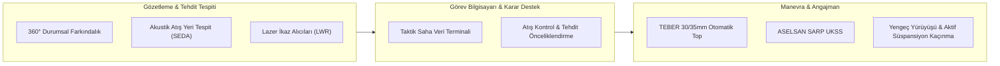

# 🐆 Proje: PARS (PARS III, IV & ALPHA 6x6 / 8x8)

[

<p align="center">
  
</p>
](https://en.wikipedia.org/wiki/Technology_readiness_level)
[](../../README.md)
[](../README.md)
[](../README.md)


> **"Tekerlekli zırhlı muharebe araçlarında küresel çeviklik standardı: Bütün akslardan yönlendirme, hidropnömatik süspansiyon ve yengeç yürüyüşü ile sınır tanımayan taktik mobilite."**

---

## 🛡️ Stratejik Tanım & Doktriner Öncelik

PARS Taktik Tekerlekli Zırhlı Araç (TTZA) ailesi, FNSS mühendisliğinin dünya çapında askeri literatüre kazandırdığı en gelişmiş zırhlı platform mimarilerinden biridir. 6x6 ve 8x8 konfigürasyonlarında geliştirilen PARS III, PARS IV ve yeni nesil **PARS ALPHA**, yüksek hareket kabiliyeti, modüler koruma katmanları ve üstün ateş gücü ile donatılmıştır. Malezya Silahlı Kuvvetleri için üretilen **AV8 Gempita (257+ adet)** ve Umman Kraliyet Ordusu envanterine giren yüzlerce PARS aracıyla Türk savunma sanayiinin en büyük kara ihracat başarılarından birine imza atmıştır.

PARS platformunun doktriner üstünlüğü; tüm tekerleklerden bağımsız tahrik ve yönlendirme sistemine (all-wheel steering) dayanır. Bu yetenek araca dar sokaklarda dahi minimum dönüş yarıçapı ve çapraz eksende kayma (yengeç yürüyüşü) imkanı kazandırır. TSK Özel Kuvvetler Komutanlığı ve Jandarma Genel Komutanlığı için üretilen **PARS IV 6x6 Özel Operasyonlar Aracı**, asimetrik EYP tehditlerine karşı dünyadaki en yüksek mayın ve balistik koruma seviyelerinden birine sahiptir.

---

## 📊 Kapsamlı Teknik Özellikler Tablosu

| Parametre | PARS III / IV 6x6 | PARS III / IV 8x8 | PARS ALPHA 8x8 (Yeni Nesil) |
| :--- | :--- | :--- | :--- |
| **Aks Konfigürasyonu** | 6x6 Tüm Akslardan Çekiş | 8x8 Tüm Akslardan Çekiş | 8x8 Bağımsız Cer / Hibrit Opsiyonu |
| **Muharebe Ağırlığı** | 25.000 - 28.000 kg | 30.000 - 34.000 kg | 35.000+ kg |
| **Motor Gücü** | 500 - 550 BG Turbo Dizel | 600 - 700 BG Turbo Dizel | 711+ BG Güç Paketi |
| **Güç / Ağırlık Oranı** | 20 - 22 BG/ton | 20 - 23 BG/ton | 21 - 24 BG/ton |
| **Azami Hız** | 100 km/sa (Karayolu) | 100+ km/sa | 115 km/sa |
| **Menzil (Harekat Sığası)**| 700+ km | 800+ km | 800+ km |
| **Süspansiyon Mimarisi**| Bağımsız Hidropnömatik | Bağımsız Hidropnömatik | Aktif Sönümlemeli Hidropnömatik |
| **Dönüş & Manevra** | Tüm akslardan yönlendirme | Tüm akslardan yönlendirme | Yengeç Yürüyüşü & Minimum Yarıçap |
| **Mürettebat + Birlik** | 3 + 6-8 Personel | 3 + 9-11 Personel | 3 + 9-10 Personel |
| **Ana Kule / Silah** | 12.7mm/40mm UKSS / 25mm Kule | 30mm/35mm TEBER Kulesi | 35mm/40mm İnsansız Kule + ATGM |
| **Beka Standartları** | STANAG 4569 Seviye 4 Mayın/Balistik| STANAG 4569 Seviye 4b/5 | Modüler Seramik Kompozit + APS |

---

## 🔄 Sistem Mimarisi & Görev Akışı



---

## 🧩 Alt Sistemler ve Aviyonik/Elektronik Entegrasyonu

- **TEBER-30 / TEBER-35 Kule Sistemi:** FNSS üretimi iki kişilik veya insansız kule; 30mm/35mm çift beslemeli otomatik top, bağımsız komutan/nişancı termal görüşü ve hunter-killer kabiliyeti.
- **Akustik Atış Yeri Tespit Sistemi (ASELSAN SEDA):** Keskin nişancı veya roket atışlarının yönünü ve koordinatını anında hesaplayarak silah kulesini otomatik tehdide yönlendirme.
- **Hidropnömatik Süspansiyon & Yükseklik Kontrolü:** Araç gövdesini operasyon ihtiyacına göre alçaltıp yükseltebilme, su geçişinde yükselme, mevzilenmede silueti küçültme ve eğimli arazide ufuk çizgisi dengeleme.
- **Merkezi Lastik Şişirme Sistemi (CTIS) & Run-Flat:** Sürücü kabininden zemin sertliğine göre (kum, çamur, kar, asfalt) lastik basınçlarını dinamik ayarlama ve patlak lastikle 50 km ilerleyebilme.
- **KBRN Koruması:** Pozitif basınçlı iklimlendirme ve NBC filtreleme ünitesi sayesinde kimyasal/biyolojik serpintili alanlarda zırh altı operasyon.

---

## 🎯 Görev Profili, Muharebe Senaryoları & Mühimmat Yelpazesi

### Görev Profilleri
- **Mekanize Piyade İntikali ve Ateş Desteği:** Düşman tahkimatlarına karşı zırhlı birliklerin öncülüğünü yapma, piyadeyi güvenle muharebe alanına ulaştırma ve 30mm kule ile ağır ateş baskısı kurma.
- **Özel Operasyonlar ve Meskun Mahal:** PARS IV 6x6 konfigürasyonu ile meskun mahallerde pusu ve el yapımı patlayıcı tuzaklarını bertaraf ederek nokta terör operasyonlarını icra etme.
- **Zırhlı Keşif ve Komuta Kontrol:** Radar ve mast üzeri elektro-optik donanımlarla cephe hattı gerisinde ileri gözetleme ve sahra komuta merkezi olarak görev yapma.

### Mühimmat Yelpazesi
- **30x173 mm & 35 mm Otomatik Top Mühimmatı:** APFSDS-T (Zırh Delici Sabot), HEI (Yüksek İnfilaklı Yangın), Parçacıklı Programlanabilir Hava Savunma (Airburst).
- **Tanksavar Mühimmatı:** Kule yanına entegre OMTAS veya Kornet-E füzeleri.
- **İkincil Ateş Gücü:** 12.7mm M2 Browning, 7.62mm FN MAG ve 40mm Otomatik Bombaatar mühimmatları.

---

## 🚀 TRL Seviyesi ve Gelişim Yol Haritası

```
[TRL 1-6] ➔ [TRL 7: Prototip ve Askeri Kalifikasyon] ➔ [TRL 8: İhracat ve TSK Kabul Testleri] ➔ [TRL 9: Küresel Seri Üretim & Muharebe Deneyimi]
```

- [x] **PARS III 6x6 / 8x8 Seri Üretimi:** Umman Kraliyet Ordusu ve Malezya Silahlı Kuvvetleri'ne tam teslimat (TRL 9).
- [x] **PARS IV 6x6 TSK Özel Kuvvetler Teslimatı:** TSK kabul testlerinin tamamlanarak sahada aktif göreve alınması.
- [x] **PARS IV 8x8 Yeni Nesil ZMA:** TSK Yeni Nesil Araç İhtiyacı doğrultusunda geliştirilen modelin kalifikasyonu.
- [ ] **PARS ALPHA 8x8 Küresel Lansmanı & Seri Üretimi:** Dünya pazarında en üst segment zırhlı araç ihalelerine sunum ve hibrit cer testleri.

---

## 🔗 Bağlantılar ve Dizin Navigasyonu

[⬅️ Üst Dizine](../README.md) | [🏛️ Dominion Hub](../../README.md) | [🏠 Ana Sayfa](../../../README.md)
