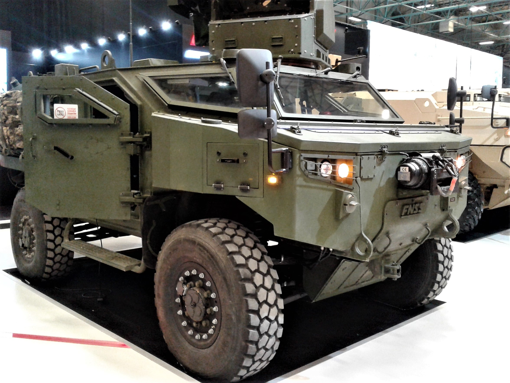
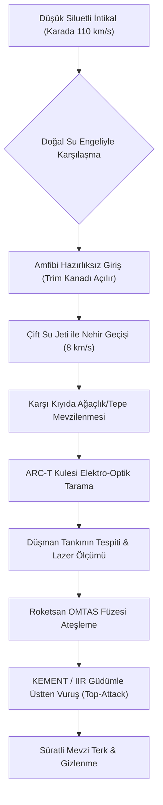

# 🎯 Proje: PARS 4x4 (Amfibi Silah Taşıyıcı Araç - STA)

[](https://en.wikipedia.org/wiki/Technology_readiness_level)
[](../../README.md)
[](../README.md)
[](../README.md)

<p align="center">
  
</p>

> **"Düşük siluet, sıfır hazırlıkla amfibi yüzebilirlik ve arkadan motor yerleşimiyle zırhlı avcısı: Pusu doktrininin tekerlekli süvarisi."**

---

## 🛡️ Stratejik Tanım & Doktriner Öncelik

PARS 4x4, Türk Kara Kuvvetleri Komutanlığı'nın Silah Taşıyıcı Araçlar (STA) Projesi kapsamında FNSS tarafından geliştirilmiş, dünyadaki muadillerinden radikal mühendislik çözümleriyle ayrılan amfibi bir tanksavar platformudur. Aracın en ayırt edici özelliği, motor ve güç grubunun gövdenin arkasında konumlandırılmış olmasıdır. Bu tasarım, sürücü ve komutana benzersiz bir ön görüş açısı ve son derece alçak bir gövde silueti sağlarken, amfibi seyir esnasında ağırlık merkezini mükemmel dengeler.

Doktriner olarak PARS 4x4, düşman ana muharebe tanklarının ve zırhlı birliklerinin öncü unsurlarını arazi engebelerini kullanarak pusuya düşürmek, nehir ve göl gibi doğal su engellerini köprü beklemeden aşmak ve füzelerini ateşledikten sonra hızla mevzi değiştirmek (hit-and-run) üzere kurgulanmıştır. FNSS öz kaynaklarıyla tasarlanan Uzaktan Komutalı Tanksavar Kulesi (ARC-T / UKTK) sayesinde mürettebat zırhlı kabinden çıkmadan 4 km+ menzildeki hedefleri hassasiyetle imha eder.

---

## 📊 Kapsamlı Teknik Özellikler Tablosu

| Parametre | Değer | Açıklama |
| :--- | :--- | :--- |
| **Platform Sınıfı** | 4x4 Taktik Tekerlekli Amfibi Zırhlı Araç | Silah Taşıyıcı / Zırhlı Keşif |
| **Muharebe Ağırlığı** | 12.000 - 14.000 kg | Görev yüküne göre optimize edilmiş |
| **Boyutlar (U x G x Y)** | 5.5 m / 2.5 m / 1.9 m (Kulesiz gövde) | Olağanüstü düşük siluet |
| **Motor Yerleşimi** | Arkadan Konumlu Turbo Dizel Motor | 250+ BG / Mükemmel ağırlık dengesi |
| **Azami Karayolu Hızı**| 110 km/sa | Otoban ve taktik intikal hızı |
| **Suda Yüzme Hızı** | 6.5 - 8.0 km/sa | Çift arka su jeti ile sıfır hazırlıklı amfibi |
| **Harekat Sığası** | 700+ km | Uzun menzilli otonom devriye kapasitesi |
| **Mürettebat** | 4 Personel | Komutan, Nişancı, Sürücü, Doldurucu/Gözcü |
| **Tırmanma Yeteneği** | %70 Dik Meyil, %40 Yan Eğim | 40 cm dik engel, 80 cm hendek aşma |
| **Silah Donanımı** | FNSS UKTK / ARC-T İnsansız Kule | 2x OMTAS veya 2x KORNET-E + 7.62mm MT |
| **Sensör Paketi** | Termal Kamera + Gündüz TV + LRF | 360° Durumsal Farkındalık Kameraları |
| **Beka Seviyesi** | STANAG 4569 Balistik & Mayın Korumalı | V-tabanlı gövde, mayın sönümleyici koltuklar |

---

## 🔄 Sistem Mimarisi & Görev Akışı



---

## 🧩 Alt Sistemler ve Aviyonik/Elektronik Entegrasyonu

- **FNSS ARC-T Uzaktan Komutalı Tanksavar Kulesi:** Zırh koruması altında iki adet tanksavar füzesi (OMTAS veya KORNET) taşıyan, bağımsız termal nişangahlı, iki eksenli stabilize silah istasyonu.
- **Çift Su Jeti İtki Sistemi:** Suya giriş anında otomatik devreye giren yüksek debili yönlendirilebilir çift su jeti sayesinde akıntılı sularda dahi yüksek rota hakimiyeti.
- **Arkadan Motor Mimarisi:** Ön kabinde motor sıcaklığının oluşturduğu termal izin ve motor bloğu kör noktalarının yok edilmesi; sürücü için 180 dereceden geniş panoramik görüş.
- **Entegre Kurtarma Vinci:** Araç ön kısmına gizlenmiş hidrolik vinç ile en zorlu bataklık arazilerde dahi kendi kendini kurtarma kabiliyeti.
- **KBRN & İklimlendirme:** Pozitif hava basıncı sistemi ile nükleer, biyolojik ve kimyasal tehdit içeren sahalarda personele tam koruma.

---

## 🎯 Görev Profili, Muharebe Senaryoları & Mühimmat Yelpazesi

### Görev Profilleri
- **Öncü Zırhlı Keşif:** Düşman savunma hatlarının derinliklerine düşük radar ve görsel siluetle sızarak koordinat toplama.
- **Tanksavar Pusu Timi:** Düşman zırhlı taburlarının ana ikmal ve intikal koridorlarında nehir kenarı veya tepe sırtlarında gizlenerek ilk darbeyi indirme.
- **Hızlı Reaksiyon & Flank Emniyeti:** Dost mekanize birliklerin kanatlarını düşman çevirme manevralarına karşı süratle kapatma.

### Mühimmat Entegrasyonu
- **Roketsan OMTAS:** Kızılötesi Arayıcı Başlıklı (IIR), tandem zırh delici harp başlıklı, 4 km menzilli at-unut tanksavar füzesi.
- **KORNET-E:** SACLOS lazer ışını demeti güdümlü, 5.5 km menzilli ağır tanksavar füzesi.
- **Yakın Savunma Silahı:** Kuleye koaksiyel entegre 7.62mm FN MAG / PMT-76 makineli tüfek.

---

## 🚀 TRL Seviyesi ve Gelişim Yol Haritası

```
[TRL 1-6] ➔ [TRL 7: Kalifikasyon Testleri] ➔ [TRL 8: TSK Amfibi & Atış Doğrulama] ➔ [TRL 9: Envanterde Aktif Seri Üretim]
```

- [x] **Kavramsal Tasarım ve Prototip İmalatı:** Arkadan motorlu radikal mimarinin doğrulanması (TRL 7).
- [x] **STA Projesi Kalifikasyonu:** Zorlu nehir geçiş ve tanksavar füze atış testlerinin %100 başarıyla tamamlanması.
- [x] **TSK Envanterine Giriş:** Kara Kuvvetleri Komutanlığı tanksavar taburlarına yüzlerce PARS 4x4 teslimi (TRL 9).
- [ ] **İnsansız Varyant & İhracat:** Otonom güzergah takibi yapabilen insansız PARS 4x4 geliştirme çalışmaları ve dost/müttefik ülkelere ihracat süreci.

---

## 🔗 Bağlantılar ve Dizin Navigasyonu

[⬅️ Üst Dizine](../README.md) | [🏛️ Dominion Hub](../../README.md) | [🏠 Ana Sayfa](../../../README.md)