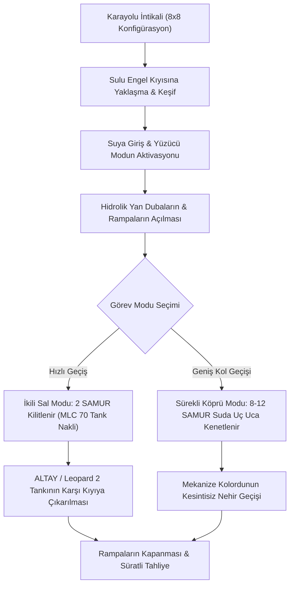

# 🌉 Proje: FNSS SAMUR (Seyyar Yüzücü Hücum Köprüsü - SYHK)

[](https://en.wikipedia.org/wiki/Technology_readiness_level)
[](../../README.md)
[](../README.md)
[](../README.md)


> **"Nehirleri dakikalar içinde otoyola çeviren milli istihkam dehasi: Ağır tank birliklerine sulu engellerde kesintisiz taarruz sürekliliği."**

---

## 🛡️ Stratejik Tanım & Doktriner Öncelik

FNSS SAMUR (Seyyar Yüzücü Hücum Köprüsü - SYHK), Türk Silahlı Kuvvetleri'nin sulu engellerden süratle geçiş harekatını icra edebilmesi amacıyla tamamen milli imkanlarla tasarlanmış ve üretilmiş stratejik bir amfibi istihkam platformudur. Modern harp sahasında nehirler, göller ve geniş su kanalları; taarruz eden zırhlı birliklerin hızını kesen en kritik doğal engellerdir. SAMUR, 8x8 taktik tekerlekli yapısıyla karada yüksek hızla intikal eden, suya girdiği anda gövdesindeki yan dubaları hidrolik olarak açarak hem bir feribota (sal) hem de çoklu birleşerek yüz metrelerce uzunluğunda yüzen bir köprüye dönüşen eşsiz bir mühendislik harikasıdır.

SAMUR sistemi, MLC 70 (Military Load Class 70) sınıfındaki dünyanın en ağır ana muharebe tanklarını (ALTAY, Leopard 2A4 vb.) üzerinde taşıyabilecek mukavemete sahiptir. İki SAMUR aracının birbirine kilitlenmesiyle oluşturulan "İkili Sal" sistemi, bir ana muharebe tankını bir dakikadan az sürede karşı kıyıya ulaştırabilirken; 12 adet SAMUR aracının suda uç uca bağlanmasıyla yaklaşık 150 metre uzunluğunda devasa bir köprü 25 dakika içinde operasyonel hale getirilebilmektedir.

---

## 📊 Kapsamlı Teknik Özellikler Tablosu

| Parametre | Değer | Operasyonel Karşılığı |
| :--- | :--- | :--- |
| **Platform Türü** | Amfibi Seyyar Yüzücü Hücum Köprüsü | 8x8 Bağımsız Süspansiyonlu Zırhlı Gövde |
| **Muharebe Ağırlığı** | 36.000 kg | Suda yüzebilir alüminyum alaşımlı gövde |
| **Boyutlar (U x G x Y)** | 13.0 m / 3.5 m / 4.1 m | Karayolu ve köprüleme ölçüleri |
| **Motor & Güç** | 522 BG Turboşarjlı Dizel Motor | Yüksek tork ve su tahrik gücü |
| **Suda İtki Sistemi** | Çift Yönlendirilebilir Su Jeti | 360° dönebilen pompaj pervaneleri |
| **Azami Karayolu Hızı**| 50 km/sa | Asfalt ve stabilize yol intikali |
| **Suda Seyir Hızı** | 2.8 m/sn (~10 km/sa) | Akıntılı sularda yüksek mukavemet |
| **Yük Taşıma Kapasitesi**| MLC 70 (Paletli) / MLC 85 (Tekerlekli) | En ağır tankları taşıma sertifikası |
| **Mürettebat** | 3 Personel | Komutan, Sürücü, Operatör/Makinist |
| **Köprü Kurulum Süresi**| ~25 Dakika (12 Araç / 150 Metre) | Dünyadaki en hızlı köprüleme süreleri |
| **İkili Sal Kilitlenme** | < 1 Dakika | 2 araçlık feribot modu |
| **Beka & Donanım** | STANAG balistik koruma, KBRN, otomatik yangın söndürme, kendini kurtarma vinci |

---

## 🔄 Sistem Mimarisi & Görev Akışı



---

## 🧩 Alt Sistemler ve Aviyonik/Elektronik Entegrasyonu

- **360 Derece Dönebilen Su Jetleri:** SAMUR'un suda kendi ekseni etrafında dönebilmesini, akıntıya karşı sabit durabilmesini ve diğer SAMUR araçlarına milimetrik hassasiyetle yanaşmasını sağlayan bağımsız hidrojet kontrol sistemi.
- **Otomatik Seviyeleme ve Balast Sistemi:** Araç üzerine ağır tank bindiğinde oluşan batma ve denge değişimlerini saniyeler içinde dengeleyen hidrolik süspansiyon ve hava körükleri.
- **Entegre Kilit ve Rampa Otomasyonu:** Araçların suda birbirine yaklaşması esnasında hidrolik çenelerle kenetlenen ve araçlar arası geçiş yolunu oluşturan ağır hizmet mafsal kilitleri.
- **KBRN Pozitif Basınçlı Kabin:** Kimyasal, biyolojik ve nükleer serpinti bölgelerinde personelin maskesiz operasyon yapabilmesini sağlayan iklimlendirmeli koruma sistemi.
- **Merkezi Lastik Şişirme (CTIS) & Dört Aks Dümenleme:** Dik nehir yataklarından çıkarken 8 tekerleğin tamamının yönlenmesi ve lastik basıncının çamurlu kıyıya göre ayarlanması.

---

## 🎯 Görev Profili, Muharebe Senaryoları & Mühimmat Yelpazesi

### Görev Profilleri
- **Nehir Aşma Harekatı:** Düşman savunma hatlarının gerisine sarkmak için nehir ve su kanallarını hızla aşarak sürpriz taarruz baskını oluşturma.
- **Stratejik Lojistik Köprü:** Sabit köprülerin düşman hava unsurları veya topçusu tarafından imha edildiği durumlarda ikmal konvoylarına alternatif geçit sağlama.
- **Doğal Afet ve Kurtarma:** Sel ve su baskınlarında sivil araçların, yardım tırlarının ve iş makinelerinin karşı kıyılara geçirilmesi.

### Operasyonel Donanım
- **Kendini Kurtarma:** 20 ton çekme kapasiteli ağır hizmet tipi tamburlu kurtarma vinci.
- **Yakın Savunma:** Kabin üzerine monte edilebilen 7.62mm makineli tüfek ve sis havanı fırlatıcıları.

---

## 🚀 TRL Seviyesi ve Gelişim Yol Haritası

```
[TRL 1-6] ➔ [TRL 7: Prototip Nehir Testleri] ➔ [TRL 8: TSK Kabul & Kalifikasyon] ➔ [TRL 9: Tam Seri Üretim & Envanter]
```

- [x] **Tasarım ve Prototip İmalatı:** Türk mühendislerince sıfırdan amfibi köprü aracı geliştirilmesi (TRL 7).
- [x] **TSK Nehir Geçiş Tatbikatları:** Meriç ve Fırat nehirlerinde gerçek muharebe koşullarında MLC 70 tank geçiş testlerinin başarıyla icrası.
- [x] **Kara Kuvvetleri Envanterine Teslimat:** İstihkam birliklerine seri üretim teslimatlarının tamamlanması (TRL 9).
- [ ] **Modernizasyon & Yeni Nesil SAMUR II:** Hafifletilmiş titanyum-kompozit alaşımlar ve otonom kenetlenme sensörlerinin entegrasyonu.

---

## 🔗 Bağlantılar ve Dizin Navigasyonu

[⬅️ Üst Dizine](../README.md) | [🏛️ Dominion Hub](../../README.md) | [🏠 Ana Sayfa](../../../README.md)
