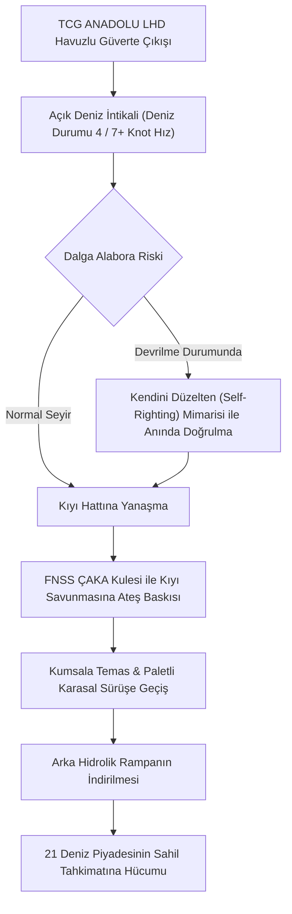

# 🌊 Proje: ZAHA (Zırhlı Amfibi Hücum Aracı - MAV)

[](https://en.wikipedia.org/wiki/Technology_readiness_level)
[](../../README.md)
[](../README.md)
[](../README.md)


> **"Açık deniz dalgalarından sahil tahkimatına uzanan zırhlı çıkarma gücü: Kendini düzelten gövde yapısı ve ÇAKA kulesi ile TCG ANADOLU'nun mızrak ucu."**

---

## 🛡️ Stratejik Tanım & Doktriner Öncelik

ZAHA (Zırhlı Amfibi Hücum Aracı / MAV - Marine Assault Vehicle), Türk Deniz Kuvvetleri Komutanlığı'nın amfibi harekat kabiliyetini küresel ligin en üst basamağına taşıyan, FNSS tarafından geliştirilmiş stratejik bir taarruz platformudur. Dünyada bu sınıfta muharebe aracı tasarlayıp üretebilen sadece iki ülkeden (ABD - AAV7 ve Türkiye - ZAHA) biri olan Türkiye, ZAHA ile çok maksatlı amfibi hücum gemisi **TCG ANADOLU (L400)** ve gelecekteki TCG TRAKYA'nın vurucu gücünü oluşturmuştur.

Amfibi çıkarma doktrininde en kritik safha; havuzlu çıkarma gemisinden denize inildiği andan kıyıya ayak basılan ana kadar geçen süredir. ZAHA, Deniz Durumu 4 (Sea State 4) gibi son derece hırçın açık deniz dalgalarında dengesini koruyabilen, alabora olma (devrilme) durumunda su altında dahi kendi kendini düzelten (self-righting) eşsiz bir hidrodinamik mimariye sahiptir. Karaya ulaştığında paletleri üzerinde 70 km/sa hıza çıkabilen araç, 21 tam teçhizatlı deniz piyadesini düşman ateşinden koruyarak doğrudan hedef hattına indirir.

---

## 📊 Kapsamlı Teknik Özellikler Tablosu

| Parametre | Değer | Açıklama |
| :--- | :--- | :--- |
| **Platform Sınıfı** | Zırhlı Amfibi Hücum Aracı (Paletli Çıkarma Aracı) | Personel Taşıyıcı, Komuta, Kurtarma |
| **Muharebe Ağırlığı** | ~30.000 kg | Amfibi yüzebilirlik balistik zırh dengesi |
| **Boyutlar (U x G x Y)** | 8.3 m / 3.3 m / 3.6 m | LHD havuz güverteye tam uyumlu |
| **Motor & Güç** | 600 BG Yüksek Performanslı Dizel Motor | Güçlü karasal ve denizel itki |
| **Deniz İtki Sistemi** | Çift Yüksek Debili Su Jeti | Arkada konumlu yönlendirilebilir nozullar |
| **Azami Karayolu Hızı**| 70 km/sa | Paletli intikal sürati |
| **Suda Yüzme Hızı** | 7+ Knot (~13 km/sa) | Sınıfının en hızlı deniz çıkarma araçlarından |
| **Mürettebat + Birlik** | 3 Mürettebat + 21 Deniz Piyadesi | Toplam 24 personel kapasitesi |
| **Deniz Durumu Kabiliyeti**| Deniz Durumu 4 (Sea State 4) | Sert dalgalarda seyir ve çıkarma |
| **Beka & Güvenlik** | Alabora Önleme / Kendini Düzelten Gövde | Korozyona dayanıklı zırh alüminyum gövde |
| **Silah Donanımı** | FNSS ÇAKA Uzaktan Komutalı Kule | 12.7mm M2 MT + 40mm Otomatik Bombaatar |

---

## 🔄 Sistem Mimarisi & Görev Akışı



---

## 🧩 Alt Sistemler ve Aviyonik/Elektronik Entegrasyonu

- **FNSS ÇAKA Uzaktan Komutalı Kule (UKK):** ZAHA için özel tasarlanmış kule sistemi; 12.7mm (.50 kalibre) ağır makineli tüfek ve 40mm otomatik bombaatarı aynı anda taşır. Termal kamera, gündüz kamerası ve lazer mesafe ölçer ile deniz dalgalanmalarına karşı çift eksenli tam stabilize atış yapar.
- **Korozyon Dirençli Askeri Alüminyum Gövde:** Tuzlu deniz suyunun korozyon etkisine karşı özel alaşımlı marin tipi zırh alüminyumundan imal edilmiş, balistik ve mayın patlamalarına karşı seramik kompozit ek zırhlarla takviye edilmiş gövde.
- **Yüksek Debili Sintine ve Tahliye Pompaları:** Olası gövde hasarlarında veya aşırı dalgalarda içeri girebilecek deniz suyunu anında tahliye eden yüksek kapasiteli acil sintine tahliye mimarisi.
- **Gelişmiş Seyrüsefer & C4I Entegrasyonu:** LHD gemisinden kıyı koordinatlarını şifreli veri bağıyla alan, GPS karartması durumunda ataletsel navigasyonla hedef kumsala yönelen çıkarma yönetim yazılımı.

---

## 🎯 Görev Profili, Muharebe Senaryoları & Mühimmat Yelpazesi

### Görev Profilleri
- **Amfibi Taarruz ve Kıyı Başı Tutma:** Açık denizdeki LHD gemisinden fırlatılarak düşman işgalindeki adalara veya kıyı sahillerine ilk dalga taarruzu icra etme.
- **Zırhlı Komuta ve Kurtarma:** ZAHA Komuta aracı varyantı ile çıkarma harekatını kıyıdan yönetme; Kurtarma varyantı ile hasarlı amfibi araçları açık denizden ve kumsaldan çekip kurtarma.
- **İç Güvenlik ve Nehir Geçişleri:** Delta bölgelerinde, bataklıklarda ve lagünlerde zırhlı devriye ve muharip intikal.

### Mühimmat Yelpazesi
- **12.7x99 mm NATO (.50 Cal):** Zırh delici (AP) ve yangın mühimmatları.
- **40x53 mm Yüksek Hızlı Bombaatar:** Parçacıklı ve zırh delici mühimmat (düşman piyade mevzileri ve hafif tahkimatlara karşı alan doyurma).

---

## 🚀 TRL Seviyesi ve Gelişim Yol Haritası

```
[TRL 1-6] ➔ [TRL 7: Açık Deniz & Devrilme Testleri] ➔ [TRL 8: TCG ANADOLU Entegrasyonu] ➔ [TRL 9: Amfibi Tugay Envanterinde]
```

- [x] **Deniz Durumu 4 ve Self-Righting Testleri:** Aracın denizde ters dönüp kendi kendine düzelme testinin dünyada sayılı ülke başarısıyla doğrulanması (TRL 8).
- [x] **TCG ANADOLU Kabul ve Havuz Testleri:** LHD havuz güvertesinden denize iniş ve geri biniş operasyonlarının başarıyla icrası.
- [x] **Türk Deniz Kuvvetleri Amfibi Deniz Piyade Tugayı Teslimatı:** 27 adet ZAHA'nın (Personel, Komuta ve Kurtarma konfigürasyonlarında) envantere kabulü (TRL 9).
- [ ] **Küresel İhracat:** Güneydoğu Asya ve Orta Doğu donanmalarının çıkarma gemileri için ihraç programları.

---

## 🔗 Bağlantılar ve Dizin Navigasyonu

[⬅️ Üst Dizine](../README.md) | [🏛️ Dominion Hub](../../README.md) | [🏠 Ana Sayfa](../../../README.md)
