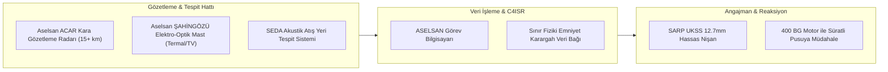

# 🚜 Proje: Katmerciler HIZIR (4x4 Taktik Tekerlekli Zırhlı Araç)

[

<p align="center">
  
</p>
](https://en.wikipedia.org/wiki/Technology_readiness_level)
[](../../README.md)
[](../README.md)
[](../README.md)


> **"Sınıfının en güçlü 400 beygirlik motoruyla dik yamaçları ve sınır hatlarını fetheden çevik zırhlı: ATEŞ mobil gözetleme projesinin çelik omurgası."**

---

## 🛡️ Stratejik Tanım & Doktriner Öncelik

Katmerciler HIZIR, Türk Silahlı Kuvvetleri'nin ve müttefik ülke ordularının yüksek yoğunluklu çatışma bölgelerinde, sınır güvenliğinde ve asimetrik terör tehditlerinin yoğun olduğu coğrafyalarda görev yapması amacıyla geliştirilmiş 4x4 Taktik Tekerlekli Zırhlı Muharebe Aracıdır (TTZA / MRAP). HIZIR'ı küresel muadillerinden ayıran en belirgin doktriner avantajı; 400 beygir gücündeki devasa motorudur. Bu yüksek güç/ağırlık oranı, aracın tam muharebe yükü ve 9 personelle dahi dik dağ yamaçlarında bayılmadan (%70 dik eğim tırmanma) harekat icra edebilmesini sağlar.

HIZIR platformu, TSK'nın sınır fiziki güvenlik sistemlerini modernize eden **ATEŞ (Mobil Sınır Gözetleme Sistemi)** projesinin taşıyıcı omurgası olarak seçilmiştir. ASELSAN'ın elektro-optik kameraları, kara gözetleme radarları ve atış yeri tespit sistemleriyle donatılan HIZIR ATEŞ araçları, Türkiye'nin doğu ve güney sınırlarında yasa dışı sınır geçişlerini, kaçakçılık faaliyetlerini ve terör sızmalarını 7/24 otonom olarak denetlemektedir. Araç ayrıca Kenya, Gambiya ve Ruanda ordularına ihraç edilerek Afrika'daki terörle mücadele operasyonlarında aktif rol üstlenmiştir.

---

## 📊 Kapsamlı Teknik Özellikler Tablosu

| Parametre | Değer | Taktik Önemi |
| :--- | :--- | :--- |
| **Aks Konfigürasyonu** | 4x4 Daimi Dört Çeker | Ağır hizmet kilitli diferansiyeller |
| **Azami Yüklü Ağırlık** | 16.000 kg | Balistik kitle ve görev faydalı yükü |
| **Motor & Güç** | 400 BG Turboşarjlı Dizel Motor | Sınıfının en yüksek güç/ağırlık oranı |
| **Tork Kapasitesi** | 1.550 Nm @ 1400 d/d | Çamur ve dik yamaçta kesintisiz çekiş |
| **Azami Karayolu Hızı**| 120 km/sa | Süratli intikal ve kaçınma manevrası |
| **Harekat Sığası** | 700+ km | Uzun menzilli sınır devriyesi |
| **Tırmanma Yeteneği** | %70 Dik Meyil, %30 Yan Eğim | 100 cm su geçişi, 45 cm dik engel |
| **Taşıma Kapasitesi** | 9 Personel (Sürücü, Komutan + 7 Tim) | Ergonomik mayın korumalı koltuklar |
| **Beka Standardı** | STANAG 4569 Balistik ve Mayın Koruma | V-tabanlı monokok zırh çeliği gövde |
| **Silah Seçenekleri** | ASELSAN SARP UKSS / Manuel Zırhlı Kule | 12.7mm MT, 7.62mm MT veya 40mm Bombaatar |
| **Sensörler (ATEŞ)** | Aselsan ŞAHİNGÖZÜ OD + ACAR Radarı | Termal/TV FLIR, LRF, Kara Radarı, SEDA |

---

## 🔄 Sistem Mimarisi & Görev Akışı



---

## 🧩 Alt Sistemler ve Aviyonik/Elektronik Entegrasyonu

- **HIZIR ATEŞ Sınır Güvenlik Sensör Mastı:** Teleskopik mast üzerine yerleştirilmiş ASELSAN ŞAHİNGÖZÜ-OD elektro-optik keşif sistemi ve ACAR Kara Gözetleme Radarı sayesinde araç dururken ve gizlenmişken sınır hattındaki en ufak insan veya araç hareketini 15 km'den tespit edebilme.
- **ASELSAN SARP Uzaktan Komutalı Silah Sistemi:** Araç içerisinden joystick ve monitörle yönlendirilen, gece/gündüz görüşlü ve balistik hesaplayıcılı stabilize kule.
- **V-Şekilli Patlama Sönümleyici Gövde:** El yapımı patlayıcıların ve tanksavar mayınlarının patlama dalgasını kabin altına sıkıştırmayıp yanlara saptıran monokok çelik gövde geometrisi.
- **Merkezi Lastik Şişirme ve Run-Flat:** Şoför mahallinden hava basıncı yönetilen, mermi isabetinde dahi jant üzerinde 50 km intikal sağlayan balistik tekerlek yapısı.
- **KBRN & Yangın Bastırma:** Otomatik kabin ve motor içi yangın algılama/söndürme tüpleri ile zehirli gaz filtreleme üniteleri.

---

## 🎯 Görev Profili, Muharebe Senaryoları & Mühimmat Yelpazesi

### Görev Profilleri
- **Sınır Hattı Mobil Gözetleme (ATEŞ):** Yasa dışı göç, kaçakçılık ve sınır ötesi terörist sızmalarını yüksek irtifalı elektro-optik sensörlerle gözetleme ve anında müdahale.
- **Konvoy Koruma ve Devriye:** Tehlikeli intikal yollarında öncü emniyet aracı olarak EYP tuzaklarına karşı birlikleri koruma.
- **Zırhlı Ambulans ve Komuta Kontrol:** Geniş iç hacmi sayesinde yaralı tahliye veya sahra harekat merkezi konfigürasyonlarında görev yapma.

### Mühimmat Donanımı
- **12.7x99 mm (.50 BMG):** Zırhlı hedeflere ve meskun mahal mevzilerine karşı ağır tahribat.
- **7.62x51 mm NATO:** Yakın tehdit piyade unsurlarına karşı noktasal hassas ateş.
- **40 mm Bombaatar Mühimmatı:** Sütre arkasına gizlenmiş terör unsurlarına karşı sütre gerisi alan imhası.

---

## 🚀 TRL Seviyesi ve Gelişim Yol Haritası

```
[TRL 1-6] ➔ [TRL 7: Balistik & Mayın Patlatma Testleri] ➔ [TRL 8: ATEŞ Projesi Entegrasyonu] ➔ [TRL 9: Sınırda Aktif Görev & İhracat]
```

- [x] **Tasarım ve Ağır Saha Testleri:** 400 BG motor ve V-gövde patlatma testlerinin NATO STANAG sertifikasyonuyla tamamlanması (TRL 8).
- [x] **ATEŞ Mobil Sınır Güvenliği Teslimatı:** TSK sınır birliklerine Aselsan sensör entegreli HIZIR ATEŞ araçlarının teslimatı ve aktif sınır devriyesi (TRL 9).
- [x] **Afrika İhracatı (Kenya, Gambiya, Ruanda):** Yurt dışı orduların terörle mücadele birliklerine yüzlerce araçlık ihracat teslimatları.
- [ ] **HIZIR II Modernizasyonu:** Yeni nesil dijital sürücü kokpiti, hibrit zırh paketleri ve insansız kule entegrasyonu.

---

## 🔗 Bağlantılar ve Dizin Navigasyonu

[⬅️ Üst Dizine](../README.md) | [🏛️ Dominion Hub](../../README.md) | [🏠 Ana Sayfa](../../../README.md)
