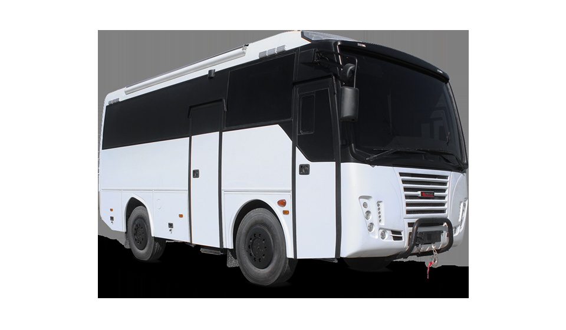
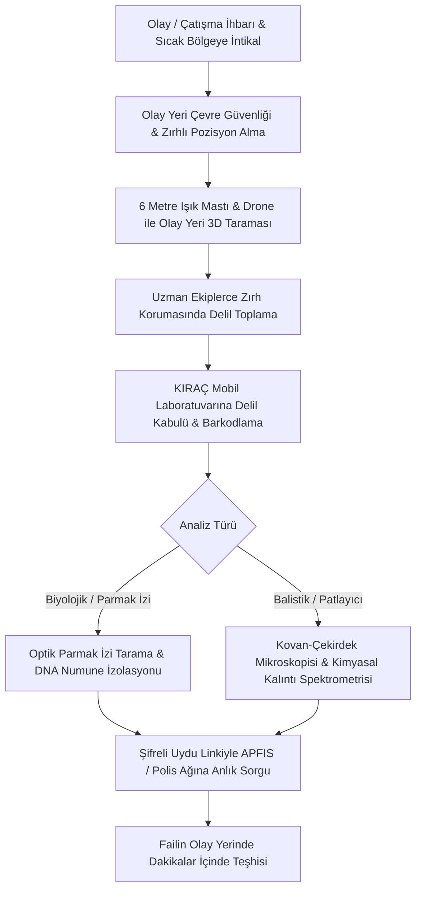

# 🚔 Proje: Katmerciler KIRAÇ (Yeni Nesil Kriminal İnceleme Aracı)

[](https://en.wikipedia.org/wiki/Technology_readiness_level)
[](../../README.md)
[](../README.md)
[](../README.md)

<p align="center">
  
</p>

> **"Sıcak çatışma sahasında adli tıbbın ve kriminal bilimin mobil kalesi: Olay yerinde delil analizini dijitalleştiren dünyanın öncü kriminal zırhlısı."**

---

## 🛡️ Stratejik Tanım & Doktriner Öncelik

Katmerciler KIRAÇ, Emniyet Genel Müdürlüğü Kriminal Daire Başkanlığı ve Jandarma Genel Komutanlığı'nın operasyonel ihtiyaçları doğrultusunda Savunma Sanayii Başkanlığı (SSB) koordinesinde geliştirilmiş, dünyada benzeri bulunmayan **Yeni Nesil Kriminal İnceleme Aracıdır**. Asimetrik terör saldırıları, meskun mahal çatışmaları, bombalı eylemler ve organize suç olayları sonrasında delillerin bozulmadan, hızla ve güvenli bir ortamda toplanıp olay yerinde incelenmesi adli adaletin sağlanmasında hayati öneme sahiptir.

KIRAÇ; 4x4 zırhlı ve zırhsız versiyonlarıyla adli kolluk birimlerine olay mahalline yüksek süratle intikal etme, terör riski altındaki sıcak sahalarda zırh koruması altında çalışma ve araç içerisindeki tam teşekküllü mobil laboratuvarda parmak izi, DNA/biyolojik numune, balistik kovan ve kimyasal patlayıcı artıklarını anında analiz etme imkanı tanır. Olay yerinde elde edilen bulgular, araç üzerindeki şifreli uydu bağlantısıyla doğrudan merkezi adli veri tabanlarına (APFIS / UYAP) aktarılarak faillerin dakikalar içinde tespit edilmesini sağlar.

---

## 📊 Kapsamlı Teknik Özellikler Tablosu

| Parametre | Zırhlı KIRAÇ (4x4) | Zırhsız / Görev Tipi KIRAÇ |
| :--- | :--- | :--- |
| **Araç Tipi** | 4x4 Taktik Balistik Korumalı Kriminal Laboratuvar | 4x4 / 4x2 Mobil Olay Yeri İnceleme |
| **Mürettebat Kapasitesi**| 4 - 6 Uzman Olay Yeri İnceleme ve Adli Personel | 4 - 6 Uzman Personel |
| **Motor & Şanzıman** | 300+ BG Turbo Dizel Motor + Otomatik Şanzıman | Yüksek Verimli Dizel Motor |
| **Azami Hız** | 110 km/sa | 130 km/sa |
| **Harekat Sığası** | 700+ km | 800+ km |
| **Balistik Koruma** | STANAG 4569 Kinetik Mühimmat & El Bombası Koruması | Standart Araç Gövdesi |
| **Mobil Laboratuvar** | HEPA Filtreli Negatif Basınçlı İnceleme Kabini | Biyolojik & Kimyasal Analiz Tezgahı |
| **Delil Saklama** | İklimlendirmeli, Şifreli Kriminal Saklama Dolapları | Sıcaklık Kontrollü Delil Kasaları |
| **Aydınlatma Mastı** | 360° Dönebilen 6 Metre Teleskopik LED Işık Kulesi | Yüksek Güçlü Projektör Mastı |
| **Keşif Donanımı** | Araç Üstü Entegre Mini İHA / Drone İstasyonu | 360° Panoramik Çevre Kameraları |
| **Bilişim Altyapısı** | Mobil APFIS Parmak İzi Okuyucu, Uydu Linki | LTE / 4G Şifreli Adli Ağ Bağlantısı |

---

## 🔄 Sistem Mimarisi & Görev Akışı



---

## 🧩 Alt Sistemler ve Aviyonik/Elektronik Entegrasyonu

- **Entegre Mobil Adli Laboratuvar:** HEPA filtreli, steril hava sirkülasyonuna sahip, biyolojik ve kimyasal delillerin dış ortamdan kontamine olmadan incelenmesini sağlayan izole kabin bölümü.
- **Teleskopik Işık ve Gözetleme Kulesi:** Gece şartlarında veya elektrik altyapısının çöktüğü afet/patlama bölgelerinde 50 metre yarıçapındaki alanı gündüz gibi aydınlatan pnömatik kontrollü LED projektör mastı ve yüksek çözünürlüklü 4K panoramik kamera.
- **Taktik Olay Yeri Drone İstasyonu:** Araç tavanından otomatik kalkış yapabilen, olay yerinin hava fotoğraflarını çekerek saniyeler içinde 3 boyutlu olay yeri krokisini çıkaran keşif İHA'sı.
- **Şifreli Uydu ve LTE İletişim Terminali:** Operasyon bölgesinde GSM şebekesi olmasa dahi kesintisiz çalışan askeri standartta güvenli veri bağı; mobil kriminal laboratuvar sonuçlarını karargaha canlı aktarır.
- **Balistik Cam ve Run-Flat Güvenliği:** Olay yeri inceleme sürerken olası ikinci bir saldırı veya keskin nişancı ateşine karşı personeli ve toplanan delilleri koruyan zırhlı kabin yapısı.

---

## 🎯 Görev Profili, Muharebe Senaryoları & Mühimmat Yelpazesi

### Görev Profilleri
- **Terör Eylemi ve Patlama Sonrası Kriminal İnceleme:** Bombalı saldırı veya çatışma mahallerinde patlayıcı türünü, fünye artıklarını ve parmak izlerini olay yerinde tespit etme.
- **Meskun Mahal Operasyonel Desteği:** Güvenlik kuvvetlerinin icra ettiği süpürme ve temizleme harekatlarının hemen ardından sıcak temas bölgelerindeki adli kanıtları güvenceye alma.
- **Afet ve Toplu Kimliklendirme (DVI):** Deprem, uçak kazası veya büyük yangın felaketlerinde kimlik tespiti ve delil muhafaza merkezi olarak görev yapma.

### Güvenlik Donanımı
- **Göz Yaşartıcı Gaz Tahliye & Filtreleme:** Dışarıdan gelebilecek gaz saldırılarına karşı kabin hava basınç koruması.
- **Zırhlı Kabin:** STANAG balistik seviyesinde hafif silah mermilerine ve şarapnele dayanıklı çelik gövde.

---

## 🚀 TRL Seviyesi ve Gelişim Yol Haritası

```
[TRL 1-6] ➔ [TRL 7: Prototip ve Mobil Laboratuvar Kalifikasyonu] ➔ [TRL 8: EGM & Jandarma Saha Kabulü] ➔ [TRL 9: Tam Ölçekli Seri Üretim & Envanter]
```

- [x] **Ar-Ge ve Sistem Entegrasyonu:** Adli tıp gereksinimlerinin zırhlı araç ergonomisiyle birleştirilmesi (TRL 7).
- [x] **Emniyet ve Jandarma Kabul Testleri:** KIRAÇ araçlarının zorlu arazi ve laboratuvar fonksiyonel testlerinin tamamlanması (TRL 8).
- [x] **Seri Üretim ve Envantere Giriş:** Emniyet Genel Müdürlüğü Kriminal Daire Başkanlığı'na ve Jandarma birimlerine onlarca zırhlı/zırhsız KIRAÇ teslimatı (TRL 9).
- [ ] **Yapay Zeka Destekli Adli Spektrometre:** Sahada spektral analiz yapan yapay zeka yazılımlarının KIRAÇ laboratuvar sistemine entegrasyonu.

---

## 🔗 Bağlantılar ve Dizin Navigasyonu

[⬅️ Üst Dizine](../README.md) | [🏛️ Dominion Hub](../../README.md) | [🏠 Ana Sayfa](../../../README.md)