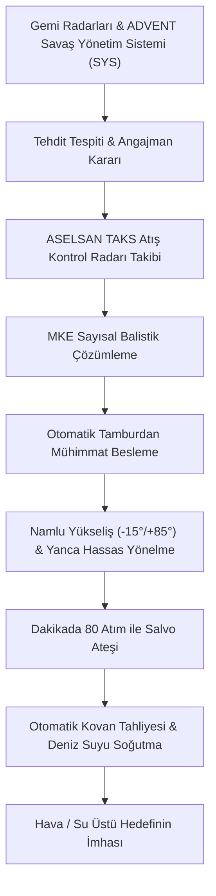

# 🛳️ Proje: MKE 76/62 mm Milli Deniz Topu

[](https://en.wikipedia.org/wiki/Technology_readiness_level)
[](../../README.md)
[](../README.md)
[](../README.md)


> **"Açık denizlerde ambargoları parçalayan milli mühendislik şaheseri: Dakikada 80 mermiyle su üstü, kıyı ve hava hedeflerine karşı milli ateş kalkanı."**

---

## 🛡️ Stratejik Tanım & Doktriner Öncelik

MKE 76/62 mm Milli Deniz Topu, Makine ve Kimya Endüstrisi A.Ş. (MKE) ana yükleniciliğinde, Türk Deniz Kuvvetleri'nin yabancı kaynaklı tedarik ambargoları ve yüksek maliyetli yurt dışı lisans bağımlılıklarını tamamen ortadan kaldırmak amacıyla milli imkanlarla geliştirilmiş stratejik bir deniz topçu sistemidir. Dünyada bu kalibre ve atış süratinde deniz topu üretebilen yalnızca 4-5 ülkeden biri haline gelen Türkiye, MKE Milli Deniz Topu ile kritik bir egemenlik eşiğini aşmıştır.

Sistem; MİLGEM Ada Sınıfı Korvetler, HİSAR Sınıfı Açık Deniz Karakol Gemileri (ADKG - TCG AKHİSAR ve TCG KOÇHİSAR) ile İ-Sınıfı fırkateynlerin baş bataryası olarak görev yapmaktadır. Dakikada 80 atım yapabilen kompakt kubbeli mimarisi, su üstü harbinden hava savunmasına ve kara bombardımanına kadar çok katmanlı muharebe spektrumunda donanmanın birincil namlulu silah gücüdür. HAVELSAN ADVENT Savaş Yönetim Sistemi (SYS) ve ASELSAN TAKS atış kontrol radarlarıyla tam entegre çalışmaktadır.

---

## 📊 Kapsamlı Teknik Özellikler Tablosu

| Parametre | Değer | Operasyonel Karşılığı |
| :--- | :--- | :--- |
| **Kalibre & Namlu Boyu**| 76 mm / 62 Kalibre | Yüksek namlu çıkış hızı ve yiv yapısı |
| **Atış Sürati** | 80 Atım / Dakika (Maksimum) | Hava hedeflerine karşı yüksek doyurma |
| **Standart Menzil** | 16.000 Metre (Klasik HE Mühimmat) | Su üstü ve kıyı hedefleri |
| **Genişletilmiş Menzil** | 20.000+ Metre (Gelişmiş Mühimmat) | Derinlikte sahil tahkimatı vurma |
| **Toplam Sistem Ağırlığı**| ~7.500 kg (Mühimmatsız) | Hafifletilmiş kompakt kubbe yapısı |
| **Namlu Yükseliş Açısı**| -15° ila +85° | Hava savunma ve su üstü tam kapsama |
| **Hazır Mühimmat Kapasitesi**| 80 Adet (Döner Tambur Besleme) | Kesintisiz salvo atış yeteneği |
| **Namlu Soğutma Mimarisi**| Deniz Suyu Ceketli + Tatlı Su Yıkama | Aşırı ısınmayı önleyen kapalı devre sistem |
| **Hedef Tipleri** | Su Üstü Harp Gemileri, Kıyı Hedefleri, İHA ve Alçaktan Uçan Füzeler | Çok rollü deniz topu |
| **Atış Kontrol Entegrasyonu**| HAVELSAN ADVENT SYS & ASELSAN TAKS / AKR | Sayısal tam otomatik hedefleme |

---

## 🔄 Sistem Mimarisi & Görev Akışı



---

## 🧩 Alt Sistemler ve Aviyonik/Elektronik Entegrasyonu

- **ADVENT SYS & TAKS Entegrasyonu:** Geminin harekat merkezindeki konsollardan tek tuşla hedefe kilitlenebilen, optik ve radar izleme kanallarından gelen telemetriyi anlık balistik düzeltmeyle birleştiren tam otonom komuta zinciri.
- **Otomatik Döner Mühimmat Tamburu:** Güverte altındaki cephanelikten kubbe içine dikey asansörle mermi transferi yapan ve dakikada 80 mermiyi hatasız namluya süren çift yönlü besleme mekanizması.
- **Düşük Radar Kesit Alanlı (RCS) Kubbe:** Modern fırkateynlerin stealth (görünmezlik) geometrisine uygun olarak açılı kompozit malzemelerden üretilmiş radar soğurucu dış kalkan.
- **Namlu İçi Soğutma ve Ömür Uzatma:** Yoğun atış serilerinde namlunun aşırı ısınıp şişmesini ve aşınmasını engelleyen dış ceketli soğutma ve korozyon önleyici kaplama teknolojisi.
- **Manuel Acil Durum Konsolu:** Gemi elektrik veya ağ altyapısının hasar görmesi halinde top kubbesi içinden optik vizörle manuel nişan ve ateşleme imkanı.

---

## 🎯 Görev Profili, Muharebe Senaryoları & Mühimmat Yelpazesi

### Görev Profilleri
- **Su Üstü Harbi (SUH):** Düşman hücumbotları, korvetleri ve karakol gemilerine karşı hızlı salvo atışlarıyla üst yapı ve sensör tahribatı yapma.
- **Kıyı Bombardımanı ve Amfibi Destek:** Çıkarma birliklerinin kıyıya emniyetle ayak basabilmesi için kıyı tahkimatlarını, makineli tüfek yuvalarını ve lojistik depoları 20 km mesafeden dövme.
- **Nokta Hava Savunması:** Gemiyi hedef alan seyir füzelerine ve intihar dronlarına karşı yüksek atış hızında parçacıklı mühimmat bulutu oluşturma.

### Mühimmat Yelpazesi
- **76mm Yüksek İnfilaklı (HE / HE-PD):** Çarpma veya yaklaşma tapalı su üstü ve kıyı hedefleri için tahrip mühimmatı.
- **Parçacıklı Hava Savunma Mühimmatı:** Füzeler ve İHA'lar için zaman ayarlı akıllı yakınlık tapalı mermi.

---

## 🚀 TRL Seviyesi ve Gelişim Yol Haritası

```
[TRL 1-6] ➔ [TRL 7: Kara Poligonu Atış Kalifikasyonu] ➔ [TRL 8: Gemi Entegrasyonu & Liman/Deniz Testleri] ➔ [TRL 9: Donanma Hizmetinde]
```

- [x] **Tasarım ve Kara Atış Testleri:** Karapınar Atış Poligonu'nda 80 rpm hız ve basınç testlerinin başarıyla icrası (TRL 7).
- [x] **Liman ve Seyir Testleri:** TCG BEYKOZ korvetinde icra edilen deniz atışlı testleriyle sistemin gemi stabilitesine tam uyumunun kanıtlanması (TRL 8).
- [x] **HİSAR Sınıfı Gemilere Kabul:** TCG AKHİSAR ve TCG KOÇHİSAR Açık Deniz Karakol Gemilerine entegre edilerek resmi askeri envantere girişi (TRL 9).
- [ ] **Güdümlü Mühimmat Entegrasyonu:** Namludan atılan güdümlü akıllı 76mm mühimmatların geliştirilmesi ve menzilin 30+ km'ye çıkarılması.

---

## 🔗 Bağlantılar ve Dizin Navigasyonu

[⬅️ Üst Dizine](../README.md) | [🏛️ Dominion Hub](../../README.md) | [🏠 Ana Sayfa](../../../README.md)
