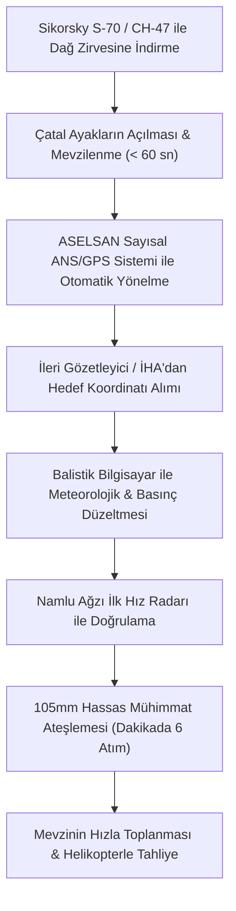

# 🚜 Proje: MKE BORAN (105mm Havadan Taşınabilir Hafif Obüs)

[

<p align="center">
  
</p>
](https://en.wikipedia.org/wiki/Technology_readiness_level)
[](../../README.md)
[](../README.md)
[](../README.md)


> **"Kartalların yuvasına helikopterle inen komando ateşi: 1 dakikada mevzilenen, GPS ve atış bilgisayarıyla ilk atımda hedefi vuran hafif topçu mucizesi."**

---

## 🛡️ Stratejik Tanım & Doktriner Öncelik

MKE BORAN, Türk Silahlı Kuvvetleri'nin dağlık, engebeli ve kara yoluyla ulaşımı imkansız sınır ötesi harekat bölgelerinde komando ve piyade birliklerine kesintisiz, hızlı ve ölümcül topçu desteği sağlamak amacıyla MKE ve ASELSAN iş birliğiyle geliştirilmiş **105mm Havadan Taşınabilir Hafif Çekili Obüstür**. 1.780 kg'lık toplam sistem ağırlığıyla kendi sınıfında dünyanın en hafif ve en teknolojik obüs sistemlerinden biridir.

Geleneksel sahra toplarının mevzilenmesi, yönlendirilmesi ve atışa hazırlanması dakikalarca süren ağır fiziksel iş gücü ve ölçüm gerektirirken; BORAN, üzerine entegre edilmiş **ASELSAN Sayısal Atış Kontrol Sistemi**, Ataletsel Navigasyon Sistemi (ANS/KKS) ve Namlu Ağzı İlk Hız Radarı sayesinde helikopter kancasından çözüldükten sonra 60 saniyeden kısa sürede atışa hazır hale gelir. Dürbün veya harici nirengi noktasına ihtiyaç duymadan, GPS koordinatlarına otomatik yönelerek ilk atımda hedefi tam isabetle imha eder.

---

## 📊 Kapsamlı Teknik Özellikler Tablosu

| Parametre | Değer | Taktik Avantajı |
| :--- | :--- | :--- |
| **Çap / Namlu Kalibresi**| 105 mm / 30 Kalibre | Yüksek manevra ve standart mühimmat uyumu |
| **Toplam Sistem Ağırlığı**| 1.780 kg | Sikorsky S-70 helikopteriyle harici yük taşıma |
| **Azami Atış Menzili** | 17+ km (Roket Destekli Mühimmat ile) | Derinlikteki terör sığınaklarına erişim |
| **Atış Hızı** | Dakikada 6 Atım (Sürekli) | Yüksek ateş baskısı ve alan doyurma |
| **Mevzilenme Süresi** | < 1 Dakika (60 Saniye) | Havadan indirildiği anda anında atış |
| **Mevzi Terk Süresi** | < 1 Dakika | Karşı topçu ateşinden korunma sürati |
| **Yükseliş Açı Aralığı** | -3° ila +70° | Dik vadi ve dağ zirvelerini ateş altına alma |
| **Taşıma Seçenekleri** | Sikorsky S-70 kancasında, CH-47 kabininde, 4x4 araç arkasında çekili | Olağanüstü stratejik mobilite |
| **Mürettebat** | 5 Personel | Yarı otomatik mekanizmayla düşük iş gücü |
| **Atış Kontrol Donanımı**| Sayısal Balistik Bilgisayar, ANS, Namlu Ağzı Radarı, Lazer Mesafe Ölçer | Otonom ilk atımda vuruş garantisi |

---

## 🔄 Sistem Mimarisi & Görev Akışı



---

## 🧩 Alt Sistemler ve Aviyonik/Elektronik Entegrasyonu

- **ASELSAN BORAN Atış Kontrol Sistemi (AKS):** Gece ve gündüz şartlarında elektro-optik nişangahıyla doğrudan ve dolaylı atış yapabilen, balistik çözümlemeleri rüzgar ve hava basıncına göre anlık hesaplayan dijital bilgisayar.
- **Namlu Ağzı İlk Hız Radarı (Muzzle Velocity Radar):** Namludan çıkan her bir merminin hızını milisaniye seviyesinde ölçerek bir sonraki atış için düzeltme parametresi üreten akıllı radar sensörü.
- **Ataletsel Navigasyon ve GPS Ünitesi:** Pusula veya harici nirengiye gerek kalmadan obüsün dünya üzerindeki tam konumunu ve namlu bakış açısını milimetre hassasiyetinde belirleme.
- **Yarı Otomatik Kama ve Hidropnömatik Geri Tepme:** Merminin ateşlenmesinin ardından boş kovanı otomatik atan ve geri tepme kuvvetini şasiye aktarmadan sönümleyen hidrolik amortisör mimarisi.

---

## 🎯 Görev Profili, Muharebe Senaryoları & Mühimmat Yelpazesi

### Görev Profilleri
- **Hava Hücum Harekatı:** Komando tugaylarının helikopterlerle düşman hatlarının gerisine veya sarp dağ zirvelerine indirildiği operasyonlarda anında yakın ateş desteği.
- **Sınır ve Üs Bölgesi Savunması:** Sarp sınır karakollarında konuşlandırılarak sızma girişiminde bulunan terör unsurlarına karşı hızlı reaksiyon ateşi.
- **Hızlı İntikal ve Pusu:** Taktik tekerlekli hafif araçların arkasında hızla taşınarak hedefe darbe indirilip çekilme.

### Mühimmat Yelpazesi
- **105mm Yüksek İnfilaklı Mühimmat (M1 HE):** Personel ve tahkimatlara karşı parça tesirli temel mühimmat.
- **Roket Destekli Uzatılmış Menzilli Mühimmat (RAP):** 17+ km menzile ulaşabilen itkili mermi.
- **Aydınlatma ve Sis Mühimmatı:** Gece harekatlarında hedef alanını aydınlatma ve dost unsurlara duman perdesi oluşturma.

---

## 🚀 TRL Seviyesi ve Gelişim Yol Haritası

```
[TRL 1-6] ➔ [TRL 7: Helikopter Nakil & Zorlu Arazi Testleri] ➔ [TRL 8: TSK Kalifikasyonu] ➔ [TRL 9: Seri Üretim & İhracat]
```

- [x] **Tasarım ve Hafifletme Fazı:** Çelik-alaşım optimizasyonuyla 1.780 kg hedef ağırlığa ulaşılması (TRL 7).
- [x] **TSK Kabul ve Helikopter İndirme Testleri:** S-70 helikopteri kancasında dağlık arazilere taşınarak icra edilen test atışlarının tam başarıyla sonuçlanması (TRL 8).
- [x] **Kara Kuvvetleri Teslimatları ve İhracat:** TSK topçu taburlarına seri üretim teslimatları ve Bangladeş ile Kosova ordularına resmi ihracat başarısı (TRL 9).
- [ ] **Akıllı Mühimmat Uyumluluğu:** 105mm güdüm kiti takılmış akıllı mermilerin BORAN balistik yazılımına entegrasyonu.

---

## 🔗 Bağlantılar ve Dizin Navigasyonu

[⬅️ Üst Dizine](../README.md) | [🏛️ Dominion Hub](../../README.md) | [🏠 Ana Sayfa](../../../README.md)
