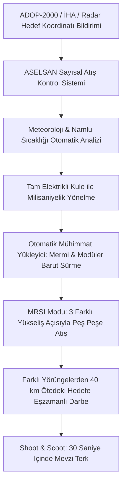

# ⛈️ Proje: T-155 FIRTINA II (Yeni Nesil Kundağı Motorlu Obüs)

[](https://en.wikipedia.org/wiki/Technology_readiness_level)
[](../../README.md)
[](../README.md)
[](../README.md)


> **"Kara Kuvvetleri'nin çelik yumruğu: 40+ km menzilde tek bir obüsten aynı anda hedefe düşen ölümcül mermiler ve yerli UTKU güç grubuyla durdurulamaz kudret."**

---

## 🛡️ Stratejik Tanım & Doktriner Öncelik

T-155 FIRTINA II, Türk Kara Kuvvetleri Komutanlığı'nın sahadaki en büyük ateş gücü olan efsanevi FIRTINA obüslerinin, modern muharebe sahası ihtiyaçları ve sınır ötesi harekatlarda edinilen tecrübeler ışığında tepeden tırnağa dijitalleştirilmiş ve güçlendirilmiş yeni nesil kundağı motorlu obüs (KMO) versiyonudur. MKE (Silah ve mühimmat), ASFAT (1. Ana Bakım Fabrikası üretimi) ve ASELSAN (Atış kontrol ve kule elektronikleri) ortaklığında üretilen platform, Türk topçusunun caydırıcılık zirvesidir.

FIRTINA II'nin birinci nesil FIRTINA'ya kıyasla en büyük doktriner sıçraması; hidrolik kule ve namlu yönlendirme sistemlerinin yerini tamamen **elektrikli takat sistemlerinin** almasıdır. Bu sayede yangın riski sıfıra indirilmiş, kule dönüş ve hedefe kilitlenme hızı iki katına çıkarılmıştır. Yenilenen otomatik mühimmat doldurma sistemi, mühimmat ikmalini tamamen mekanikleştirirken; **MRSI (Eşzamanlı Çoklu Vuruş)** yeteneği sayesinde tek bir FIRTINA II obüsünden farklı açılarla fırlatılan 3 mermi, 40 km uzaktaki hedefin üzerine aynı saniyede düşerek yıkıcı bir baskın etkisi yaratır.

---

## 📊 Kapsamlı Teknik Özellikler Tablosu

| Parametre | Değer | Muharebe Değeri |
| :--- | :--- | :--- |
| **Namlu Çapı & Kalibresi**| 155 mm / 52 Kalibre | Yüksek menzil ve üstün balistik basınç |
| **Muharebe Ağırlığı** | ~48.000 kg (48 Ton) | Ağır zırhlı paletli şasi |
| **Azami Atış Menzili** | 40+ km (MOD 274 HE-BB Mühimmat) / 30 km (Standart M107) | Derin taarruz ve stratejik hedef imhası |
| **Ani Atım Sürati** | 15 Saniyede 3 Atım | Şok baskın ateşi |
| **Azami Atım Sürati** | Dakikada 6 - 8 Atım | Kesintisiz alan tahribatı |
| **Sürekli Atım Sürati** | Dakikada 2 Atım | Saatlerce süren kesintisiz destek ateşi |
| **Motor & Güç Paketi** | 1.000 BG Dizel (BMC Power UTKU Güç Grubu entegre) | Ağır arazide yüksek hareketlilik |
| **Azami Hız & Menzil** | 65 km/sa / 400+ km | Paletli kundağı motorlu intikal |
| **Mürettebat** | 4 Personel (Komutan, Sürücü, Nişancı, Doldurucu) | Otomasyon sayesinde azaltılmış mürettebat |
| **Kule Tahrik Mimarisi**| Tamamen Elektrikli Servo Takat Sistemi | Hidrolik arıza ve yangın riskine son |
| **İkincil Savunma Silahı**| ASELSAN SARP 12.7mm UKSS | Yakın piyade ve dron tehditlerine karşı |
| **İklimlendirme** | KBRN Korumalı Tam Otomatik Klima Sistemi | -32°C ila +55°C tam operasyonel kabiliyet |

---

## 🔄 Sistem Mimarisi & Görev Akışı



---

## 🧩 Alt Sistemler ve Aviyonik/Elektronik Entegrasyonu

- **ASELSAN Yeni Nesil Atış Kontrol Sistemi:** Ataletsel navigasyon, balistik hesaplayıcı, namlu yönlendirme ve mühimmat yönetimini entegre eden merkezi komuta beyni. ADOP-2000 Taktik Ateş Destek Otomasyon Sistemiyle tam ağ tabanlı harp uyumu.
- **Otomatik Mühimmat Besleme ve Yükleme Ünitesi:** Mermiyi ve modüler sevk barutunu insan eli değmeden kovan yatağına süren, yükleme süresini dramatik biçimde kısaltan elektrikli doldurucu.
- **BMC POWER UTKU Güç Grubu:** Yabancı motor ve transmisyon ambargolarına son veren, Türkiye'nin ilk 1.000 beygirlik yerli ve milli V8 motor ve kros-tahrik şanzımanı.
- **ASELSAN SARP UKSS Entegrasyonu:** Kule tavanına yerleştirilen uzaktan komutalı silah sistemi sayesinde, obüs mevzideyken yaklaşan tanksavar avcı timleri ve intihar dronları kabin içinden 12.7mm mühimmatla etkisiz hale getirilir.
- **Gövde İçi İklimlendirme ve KBRN Koruma:** Çöl sıcağında ve dondurucu kış şartlarında elektronik cihazların ve personelin ideal sıcaklıkta kalmasını sağlayan klima ve nükleer/biyolojik gaz arıtma filtresi.

---

## 🎯 Görev Profili, Muharebe Senaryoları & Mühimmat Yelpazesi

### Görev Profilleri
- **Karşı Batarya Ateşi (Counter-Battery):** Düşman topçu ve çok namlulu roketatar bataryalarının atış yaptığı konumu tespit edip radar koordinatlarıyla saniyeler içinde imha etme.
- **Manevra Birliklerine Yakın Ateş Desteği:** İlerleyen dost tank ve mekanize birliklerin önündeki sığınak, tahkimat ve mayın tarlalarını 40 km mesafeden yerle bir etme.
- **MRSI Eşzamanlı Darbe:** Düşman komuta kademesine veya toplanma alanına hava sahasında süzülen 3 mermiyi aynı anda düşürerek sığınaklara kaçma fırsatı tanımadan tam imha sağlama.

### Mühimmat Yelpazesi
- **MOD 274 HE-BB (Base Bleed):** Dip gazı ünitesiyle hava sürtünmesini azaltan ve 40+ km menzile ulaşan yüksek tahripli parçacıklı mermi.
- **M107 Standart HE:** 18 - 30 km menzilli standart sahra topçu mühimmatı.
- **MKE Modüler Barut Sistemi:** Namlu içi basıncı yıpratmadan maksimum çıkış hızına ulaştıran yanıcı kovanlı barut modülleri.

---

## 🚀 TRL Seviyesi ve Gelişim Yol Haritası

```
[TRL 1-6] ➔ [TRL 7: Elektrikli Kule & Atış Kalifikasyonu] ➔ [TRL 8: TSK Teslimatları & UTKU Entegrasyonu] ➔ [TRL 9: Sahada Seri Üretim & Operasyon]
```

- [x] **Elektrikli Kule ve Otomatik Doldurucu Kalifikasyonu:** Prototip üzerinden atışlı testlerin başarıyla doğrulanması (TRL 8).
- [x] **TSK Envanterine Giriş & Seri Üretim:** Kara Kuvvetleri Komutanlığı'na ilk parti T-155 FIRTINA II obüslerinin teslim edilmesi ve sınır ötesi harekatlarda aktif ateş desteği sağlaması (TRL 9).
- [x] **BMC Power UTKU Motor Entegrasyonu:** Yerli güç grubunun obüs şasisi üzerindeki hareket ve atış testlerinin icrası.
- [ ] **Güdümlü Mühimmat ve Çelik Kubbe Ağı:** Lazer/GPS güdümlü 155mm akıllı topçu mühimmatlarının FIRTINA II ile tam otonom kullanımı.

---

## 🔗 Bağlantılar ve Dizin Navigasyonu

[⬅️ Üst Dizine](../README.md) | [🏛️ Dominion Hub](../../README.md) | [🏠 Ana Sayfa](../../../README.md)
