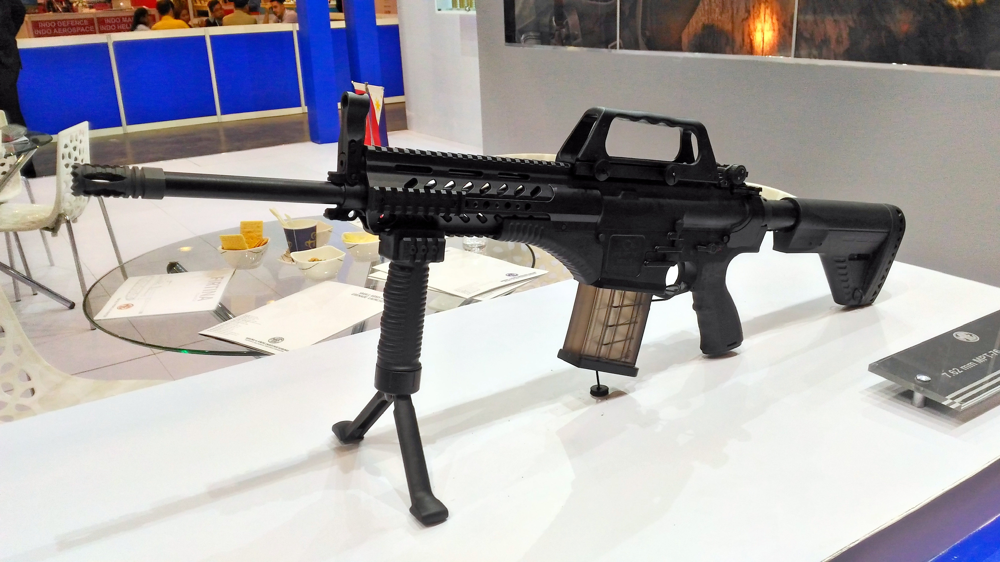
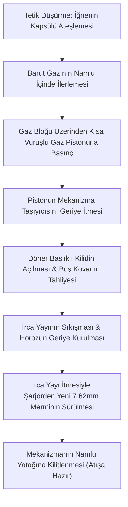

# 🔫 Proje: MPT-76 & MPT-76 MH (Milli Piyade Tüfeği)

[](https://en.wikipedia.org/wiki/Technology_readiness_level)
[](../../README.md)
[](../README.md)
[](../README.md)

<p align="center">
  
</p>

> **"NATO standartlarının en ağır 42 dayanıklılık testini sıfır hatayla geçen dünyadaki tek tüfek: Mehmetçiğin çamurda, karda ve fırtınada asla tutukluk yapmayan çelik iradesi."**

---

## 🛡️ Stratejik Tanım & Doktriner Öncelik

MPT-76 (Milli Piyade Tüfeği), Türk Silahlı Kuvvetleri'nin, Jandarma Genel Komutanlığı'nın ve Emniyet Genel Müdürlüğü'nün yarım asırlık G-3 ve AK-47 bağımlılığını sona erdirerek Mehmetçiğe muharebe sahasında tam bağımsız yerli ateş gücü kazandıran bir dönüm noktası projesidir. Makine ve Kimya Endüstrisi A.Ş. (MKE) mühendislerince sıfırdan tasarlanan MPT-76; NATO standartlarının öngördüğü dondurucu soğuk (-40°C), çöl sıcağı (+50°C), balçık çamur, yoğun toz fırtınası, tuzlu su spreyi ve serbest düşme gibi en ağır **42 zorlu testin tamamını sıfır hatayla geçen dünyadaki tek piyade tüfeğidir**.

7.62x51 mm NATO mühimmatının durdurucu tahrip gücünü, modern AR-15 ergonomisi ve güvenilir kısa vuruşlu gaz piston çalışma prensibiyle birleştiren MPT-76; sahada edinilen operasyonel geri bildirimlerle **MPT-76 MH (Milli Piyade Tüfeği Hafifletilmiş)** versiyonuna evrilmiştir. Ağır namlu somunları ve gövde alaşımlarının optimize edilmesiyle ağırlığı 3.75 kg seviyesine çekilen tüfek, modern piyadenin en çevik ve ölümcül yakın muharebe enstrümanıdır.

---

## 📊 Kapsamlı Teknik Özellikler Tablosu

| Parametre | MPT-76 (Standart) | MPT-76 MH (Hafifletilmiş) |
| :--- | :--- | :--- |
| **Kalibre** | 7.62 x 51 mm NATO | 7.62 x 51 mm NATO |
| **Çalışma Sistemi** | Kısa Vuruşlu Gaz Pistonlu, Döner Başlıklı Kilit | Kısa Vuruşlu Gaz Pistonlu Sistem |
| **Boş Ağırlık** | 4.100 gram | 3.750 gram (Hafifletilmiş gövde) |
| **Namlu Boyu** | 406 mm (16 inç) / 6 yiv-set | 406 mm (16 inç) Soğuk Dövme Çelik |
| **Etkili Menzil** | 600 Metre | 600 Metre |
| **Azami Menzil** | 3.800 Metre | 3.800 Metre |
| **Atış Hızı** | ~700 mermi / dakika | ~700 mermi / dakika |
| **Namlu Çıkış Hızı** | 800 m/sn | 800 m/sn |
| **Şarjör Kapasitesi**| 20 Mermi (Darbeye Dayanıklı Şeffaf Kompozit) | 20 Mermi Kompozit Şarjör |
| **Dipçik Mimarisi** | 12 Kademeli Ayarlanabilir Teleskopik Dipçik | Ergonomik Hafifletilmiş Dipçik |
| **Aksesuar Rayı** | MIL-STD-1913 Picatinny Dört Yönlü Ray | Entegre M-LOK & Picatinny Arayüzü |
| **Dayanıklılık Testi**| 42/42 NATO Askeri Test Başarısı | 42/42 NATO Askeri Test Başarısı |

---

## 🔄 Sistem Mimarisi & Görev Akışı



---

## 🧩 Alt Sistemler ve Aviyonik/Elektronik Entegrasyonu

- **Kısa Vuruşlu Gaz Piston Mekanizması:** Gaz artıklarının ve kurumun mekanizma gövdesine girmesini engelleyen, yüksek ısıyı namlu önünde tahliye ederek tutukluk riskini sıfırlayan güvenilir çalışma mimarisi.
- **Soğuk Dövme Çelik Namlu:** MKE Kırıkkale tesislerinde üretilen, 15.000+ atım namlu ömrüne sahip, yüksek sıcaklıkta dahi balistik dağılım kararlılığını koruyan yüksek mukavemetli namlu.
- **Optik ve Termal Entegrasyon:** Gövde üstü Picatinny rayına takılan ASELSAN A940 4x Büyütmeli Dürbün, KILIÇ Gece Görüş Dürbünü ve DORUK Termal Silah Nişangahı ile 24 saat kesintisiz hedef angajmanı.
- **Bombaatar ve Aksesuar Arayüzü:** Namlu altına takılabilen 40mm AK40-GL tamburlu bombaatar, lazer hedef noktalayıcılar ve taktik fener donanımları.
- **Çift Taraflı Kullanım:** Hem sağ hem de sol elini kullanan personel için gövdenin her iki yanında bulunan şarjör mandalı, kurma kolu ve atış modu seçici mandalı.

---

## 🎯 Görev Profili, Muharebe Senaryoları & Mühimmat Yelpazesi

### Görev Profilleri
- **Standart Piyade Muharebesi:** Açık arazide, siper savaşında ve sınır ötesi harekatlarda 600 metreye kadar düşman unsurlarını yüksek kinetik enerjiyle saf dışı bırakma.
- **Meskun Mahal ve Bina Temizliği:** MPT-76 MH hafif modeli ile dar oda ve koridorlarda yüksek manevra, duvar arkası hedeflere 7.62mm nüfuz kabiliyeti.
- **Keskin Nişancı Destek Silahı:** DMR (Designated Marksman Rifle) konfigürasyonunda hassas optiklerle manga içi keskin nişancı tüfeği rolü.

### Mühimmat Yelpazesi
- **7.62x51 mm NATO Standart M80 Bilyeli:** Zırhsız hedeflere ve genel personele karşı temel muharebe fişeği.
- **7.62x51 mm Zırh Delici (AP - Armor Piercing):** Çelik yelek, hafif zırhlı araç ve tuğla duvar arkası hedeflere karşı tungsten çekirdekli delici mühimmat.
- **İzli ve Sevk Fişekleri:** Gece atış kontrolü için M62 izli mühimmat ve bombaatar atış sevk fişekleri.

---

## 🚀 TRL Seviyesi ve Gelişim Yol Haritası

```
[TRL 1-6] ➔ [TRL 7: 42 NATO Ağır Testi Kalifikasyonu] ➔ [TRL 8: TSK Birlik Testleri] ➔ [TRL 9: 100.000+ Adet Seri Üretim & Envanter]
```

- [x] **42 NATO Kalifikasyon Testinin Tamamlanması:** Çamur, kum, sıcaklık ve düşme testlerinden sıfır hatayla geçen tek tüfek unvanı (TRL 8).
- [x] **Tam Ölçekli Seri Üretim & TSK Teslimatları:** 100.000 adetten fazla MPT-76'nın Kara, Deniz, Hava Kuvvetleri, Jandarma ve Emniyet birimlerine dağıtımı (TRL 9).
- [x] **MPT-76 MH Hafifletilmiş Model:** Sahadan gelen geri bildirimlerle 3.75 kg'lık hafifletilmiş modelin seri üretimi ve teslimatları.
- [ ] **Geleceğin Piyade Entegrasyonu:** Akıllı atış sayacı, akıllı optik vizörler ve hedef veri bağlarının tüfek gövdesine entegre edilmesi.

---

## 🔗 Bağlantılar ve Dizin Navigasyonu

[⬅️ Üst Dizine](../README.md) | [🏛️ Dominion Hub](../../README.md) | [🏠 Ana Sayfa](../../../README.md)