# 🦈 Proje: MKE PİRANA (Kamikaze İnsansız Deniz Aracı - K-İDA)

[](https://en.wikipedia.org/wiki/Technology_readiness_level)
[](../../README.md)
[](../README.md)
[](../README.md)


> **"Mavi Vatan'ın görünmez asimetrik torpidosu: 50+ knot sürat, düşük radar izi ve 200+ kg patlayıcı yüküyle düşman donanmalarının omurgasını kıran kamikaze deniz akıncısı."**

---

## 🛡️ Stratejik Tanım & Doktriner Öncelik

MKE PİRANA, çağdaş deniz harbinde asimetrik doyurma taarruzları (saturation attacks) icra etmek, yüksek maliyetli düşman fırkateynleri, çıkarma gemileri, akaryakıt ikmal konvoyları ve stratejik liman tesislerini sıfır can kaybı riskiyle imha etmek amacıyla Makine ve Kimya Endüstrisi A.Ş. (MKE) tarafından geliştirilmiş **Yüksek Hızlı Kamikaze İnsansız Deniz Aracıdır (K-İDA)**. Ukrayna-Rusya savaşı başta olmak üzere modern çatışmalarda deniz yüzeyi kamikaze dronlarının yarattığı doktriner devrim, PİRANA ile milli bir caydırıcılık enstrümanına dönüştürülmüştür.

PİRANA'nın gövde tasarımı, dalga delen (wave-piercing) yarı-dalar yapısı ve radar soğurucu kompozit malzemeleri sayesinde su üstünde sadece birkaç santimetrelik bir siluet bırakır. Bu düşük siluet, gemi radarlarının ve elektro-optik gözetleme kulelerinin aracı tespit etmesini son derece zorlaştırır. Gövde içerisine yerleştirilmiş 200 kg'dan fazla ağırlığa sahip MKE üretimi özel formüle edilmiş su altı şok etkili harp başlığı, geminin su kesimine veya omurga altına çarparak açtığı devasa yarıkla hedefin dakikalar içinde batmasını sağlar.

---

## 📊 Kapsamlı Teknik Özellikler Tablosu

| Parametre | Değer | Taktik Önemi |
| :--- | :--- | :--- |
| **Platform Tipi** | Kamikaze İnsansız Deniz Aracı (K-İDA / USV) | Otonom taarruz ve intihar deniz mühimmatı |
| **Gövde Mimarisi** | Yarı-Dalar / Dalga Delen Kompozit Form | Düşük Radar Kesit Alanı (RCS) |
| **Azami Sürat** | 50+ Knot (~92 km/sa) | Yakın hava savunma füzelerine kaçınma hızı |
| **Operasyonel Menzil** | 150 - 200 Deniz Mili | Kıyıdan veya ana gemiden uzak harekat |
| **Harp Başlığı Ağırlığı**| 200+ kg Yüksek İnfilaklı Su Altı Şok Başlığı | MKE özel patlayıcı dolgulu imha gücü |
| **Tapa Mimarisi** | Çift Kademeli Çarpma + Manyetik Yaklaşma Tapası | Su kesimi ve omurga altı tam tahrip |
| **Güdüm & Seyrüsefer** | ANS / KKS (GNSS Karıştırmasız) + EO/IR Terminal | Gece/gündüz son yaklaşma otonom kilit |
| **Haberleşme Ağı** | Karıştırmaya Dirençli Taktik RF Bağı & SATCOM | Kesintisiz uydu kontrolü ve sürü ağı |
| **Tahrik Sistemi** | Yüksek Performanslı Marin Motor + Su Jeti | Sığ sularda ve yüksek dalgada tam itki |
| **Fırlatma Platformu** | Sahil Römorku, Çıkarma Gemisi, LHD veya Vinç | Çoklu konuşlanma esnekliği |

---

## 🔄 Sistem Mimarisi & Görev Akışı

```mermaid
flowchart LR
    A["Sahil Üssü / Ana Gemiden Fırlatma"] --> B["Düşük Siluetli Yarı-Dalar Seyir (150+ NM)"]
    B --> C["Uydu / Taktik RF ile Sürü Koordinasyonu"]
    C --> D["Hedef Gemi Savunma Hattına 50+ Knot ile Yaklaşma"]
    D --> E["EO/IR Kamera ile Otonom Terminal Kilitlenme"]
    E --> F["Düşman CIWS Ateşinden Kaçınma Zikzak Manevraları"]
    F --> G["Su Kesimi / Omurga Altı Çarpma & Patlama"]
    G --> H["Gemi Gövdesinde Yıkıcı Su Altı Şok Boşluğu Açılması"]
```



---

## 🧩 Alt Sistemler ve Aviyonik/Elektronik Entegrasyonu

- **MKE Yüksek İnfilaklı Su Altı Harp Başlığı:** Su yüzeyi ve suyun hemen altında patlayarak hidrodinamik şok dalgası oluşturan, geminin çelik omurgasını ve su geçirmez bölmelerini yırtan özel formülasyonlu kompozit patlayıcı.
- **EO/IR Terminal Güdüm Kamerası:** Yüksek süratli seyir esnasında deniz serpintisinden etkilenmeyen, hedef geminin en zayıf noktalarını (makine dairesi, dümen palası, mühimmat deposu hizası) yapay zekayla tanıyan optik takip başlığı.
- **Sürü Haberleşme ve Doyurma Protokolü:** Birden fazla PİRANA'nın tek bir operatör tarafından yönetilerek veya otonom sürü zekasıyla aynı hedefe farklı açılardan (kıç, sancak, iskele) eşzamanlı dalış yapabilmesi.
- **Elektronik Harbe Dayanıklı GNSS:** Düşman GPS köreltme ve aldatma (spoofing) sinyallerini bastıran askeri kodlu çok bantlı uydu alıcısı ve yedekli Ataletsel Seyrüsefer Sistemi (ANS).
- **Öz İmha ve Emniyet Mekanizması:** Aracın ele geçirilme riskine karşı veya görevin iptal edilmesi durumunda kriptolu uzaktan komutla güvenli patlatma ya da batırma sistemi.

---

## 🎯 Görev Profili, Muharebe Senaryoları & Mühimmat Yelpazesi

### Görev Profilleri
- **Asimetrik Su Üstü Taarruzu:** Düşman hücumbot, korvet ve lojistik gemilerine karşı sürü halinde doyum saldırısı yaparak hava savunma füzelerini tüketme ve hedefi batırma.
- **Boğaz ve Liman Ablukası:** Kritik geçiş hatlarında veya düşman liman ağızlarında pusuya yatarak çıkan savaş gemilerini vurma.
- **Yüksek Değerli Hedef İmhası:** Kıyı radarları, petrol terminalleri ve deniz üssü mendireklerine yönelik nokta kamikaze taarruzu.

### Harp Başlığı Donanımı
- **200 kg RDX/TNT/Alüminyum Esaslı Kompozit Dolgu:** Su altı patlama enerjisini maksimize eden termobarik ve şok etkili harp başlığı.
- **Darbe ve Manyetik Sensörlü Akıllı Tapalar:** Gövdeye temas anında veya manyetik alan yoğunluğuna ulaşıldığında gecikmesiz infilak.

---

## 🚀 TRL Seviyesi ve Gelişim Yol Haritası

```
[TRL 1-6] ➔ [TRL 7: Hidrodinamik & Sürat Kalifikasyonu] ➔ [TRL 8: Canlı Harp Başlığı İmha Testi] ➔ [TRL 9: Seri Üretim & Dağıtım]
```

- [x] **Hidrodinamik ve Gövde Kalifikasyonu:** 50+ knot deniz sürati ve dalga direnci testlerinin tamamlanması (TRL 7).
- [x] **Canlı Atışlı Hedef İmha Testi:** Denizde demirli hedef gemiye karşı icra edilen tam ölçekli patlayıcı harp başlıklı atışta hedefin dakikalar içinde batırılması (TRL 8).
- [ ] **Seri Üretim Fazı ve Envantere Kabul:** Türk Deniz Kuvvetleri ve Sahil Güvenlik Komutanlığı üslerine konuşlandırma hazırlıkları.
- [ ] **Yapay Zeka Otonom Karar Destek:** Gemi sınıfını siluetinden tanıyan ve en zayıf noktaya dalış planlayan yapay zeka modülü entegrasyonu.

---

## 🔗 Bağlantılar ve Dizin Navigasyonu

[⬅️ Üst Dizine](../README.md) | [🏛️ Dominion Hub](../../README.md) | [🏠 Ana Sayfa](../../../README.md)
