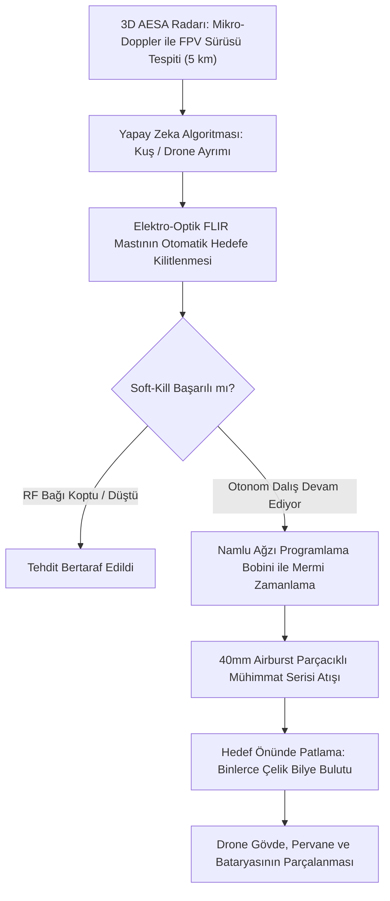

# 🎯 Proje: MKE TOLGA (Drone Savunma ve C-UAS Sistemi)

[

<p align="center">
  
</p>
](https://en.wikipedia.org/wiki/Technology_readiness_level)
[](../../README.md)
[](../README.md)
[](../README.md)


> **"Kamikaze FPV ve sürü drone tehditlerine karşı hava kalkanı: Mikro-radar tespiti, yapay zeka ve 40mm akıllı parçacıklı mühimmatla gök kubbede çelik şarapnel bulutu."**

---

## 🛡️ Stratejik Tanım & Doktriner Öncelik

MKE TOLGA, modern harp sahasında tankları, zırhlı muharebe araçlarını, piyade siperlerini ve kritik askeri tesisleri felç eden asimetrik **FPV (First-Person View) kamikaze dronelar** ile ticari modifiye edilmiş mini İHA sürülerini fiziksel olarak havada imha etmek amacıyla MKE tarafından geliştirilmiş **C-UAS (Counter-Unmanned Aerial Systems) Nokta Hava Savunma Sistemidir**. Ukrayna ve Orta Doğu'daki çatışmalar, klasik hava savunma füzelerinin birkaç yüz dolarlık minik FPV dronlara karşı maliyet-etkin olmadığını ve yetişemediğini açıkça kanıtlamıştır.

TOLGA sistemi bu doktriner boşluğu, **Hard-Kill (Kinetik Parçacıklı Mühimmat)** ve **Soft-Kill (RF Karıştırma / Jammer)** yeteneklerini tek bir otomatik platformda birleştirerek doldurmaktadır. Sistemin kalbini oluşturan **40mm Akıllı Parçacıklı Hava Savunma Mühimmatı (Airburst)**, namludan çıkarken drone'un mesafesine göre elektronik olarak programlanır. Hedefe 1-2 metre kala patlayan mermi, binlerce yüksek hızlı çelik şarapnel tanesiyle havada geçilmez bir bulut oluşturarak dronun pervanelerini, optik lenslerini ve elektronik devrelerini saniyenin onda birinde paramparça eder.

---

## 📊 Kapsamlı Teknik Özellikler Tablosu

| Parametre | Değer | Taktik Karşılığı |
| :--- | :--- | :--- |
| **Sistem Sınıfı** | C-UAS / Drone Nokta Savunma Sistemi | Sabit Kule, Römork veya Zırhlı Araç Üstü |
| **İmha Prensibi** | 40mm Programlanabilir Parçacıklı (Airburst) + Çok Namlulu Kinetik Önleme | Fiziksel parçalama garantisi |
| **Yumuşak İmha (Soft-Kill)**| Entegre Çok Bantlı GNSS & RF Karıştırıcı (Jammer) | Komuta telsiz bağını kesme |
| **Hedef Tespit Menzili**| 5+ km (Küçük Radar Kesitli Mini/Mikro İHA) | 3D AESA Radar taraması |
| **Optik Teşhis Menzili**| 3+ km (Termal & Gündüz FLIR Takip Mastı) | Otomatik yapay zeka hedefleme |
| **Etkili İmha Menzili** | 1.500 Metre (Parçacık Bulutu Kapsama Alanı) | Güvenli mesafede havada imha |
| **Reaksiyon Süresi** | < 2 Saniye (Tehdit Tespitinden İlk Atıma) | Dalış yapan FPV dronlara anında tepki |
| **Namlu Yükseliş Açısı**| -10° ila +85° | Dik tepe dalışlarını karşılama |
| **Mühimmat Kapasitesi** | Kesintisiz Şerit Besleme / Yüksek Kapasiteli Sandık | Sürü saldırılarına karşı ardışık atış |
| **Çalışma Modları** | Tam Otonom (İnsansız), Yarı Otonom, Manuel | Operatör onaylı veya otonom tetik |

---

## 🔄 Sistem Mimarisi & Görev Akışı



---

## 🧩 Alt Sistemler ve Aviyonik/Elektronik Entegrasyonu

- **MKE 40mm Akıllı Mühimmat & Namlu Ağzı Programlayıcı:** Merminin namludan çıktığı mikro-saniyede radar tarafından ölçülen hedef mesafesini mermi tapasındaki mikroçipe indüksiyon yoluyla yükleyen akıllı programlama halkası.
- **Mikro-Doppler 3D AESA Radarı:** Dronların döner pervanelerinin yarattığı özgün frekans titreşimlerini analiz ederek rüzgarla uçuşan yaprak, kuş veya poşetleri saldırı amaçlı İHA'lardan ayırt eden gelişmiş radar.
- **Yapay Zeka Destekli Otomatik Hedef Sınıflandırma:** Kamikaze FPV, gözetleme quadcopteri ve sabit kanatlı kamikaze modellerini siluet ve uçuş dinamiğinden saniyeler içinde sınıflandıran derin öğrenme yazılımı.
- **Çok Eksenli Yüksek Hızlı Kule Tahriki:** 80°/saniye dönüş ve yükseliş hızına sahip elektrikli servo motorlar sayesinde saniyede 40-50 metre hızla dalış yapan FPV dronları kaçırmadan izleyen kule mimarisi.
- **Çelik Kubbe & ADOP Entegrasyonu:** Tespit edilen drone rotasını ve koordinatlarını üst komuta katmanına ileterek bölgesel hava savunma resmiyle paylaşma.

---

## 🎯 Görev Profili, Muharebe Senaryoları & Mühimmat Yelpazesi

### Görev Profilleri
- **Zırhlı Konvoy ve Tank Koruma:** Zırhlı muharebe araçlarının üzerine entegre edilerek intikal esnasında veya mevzideyken tepe saldırısı yapan FPV dronları imha etme.
- **Sınır Karakolu ve Üs Bölgesi Emniyeti:** Kritik üs bölgelerine gece/gündüz yaklaşan keşif ve bomba bırakan dronları yerleşim alanına girmeden etkisiz hale getirme.
- **Stratejik Tesis Savunması:** Rafineriler, mühimmat depoları ve hava meydanlarını sürü drone sabotajlarına karşı koruma.

### Mühimmat Entegrasyonu
- **MKE MOD 40 Airburst:** Yüzlerce volfram-karbür bilye içeren, mikrosaniyede infilak eden akıllı parça tesirli mühimmat.
- **Yüksek Hızlı 40x53 mm Bombaatar Fişekleri:** Standart tahrip ve yangın mühimmatı seçenekleri.

---

## 🚀 TRL Seviyesi ve Gelişim Yol Haritası

```
[TRL 1-6] ➔ [TRL 7: Namlu Ağzı Programlama & Radar Entegrasyonu] ➔ [TRL 8: Canlı Drone Sürüsü İmha Testleri] ➔ [TRL 9: Birlik Kullanımında Seri Üretim]
```

- [x] **Akıllı Mühimmat ve Zamanlama Bobini Geliştirilmesi:** 40mm mermilerin namlu çıkışında başarıyla programlanması (TRL 7).
- [x] **Canlı Drone Sürüsü Atış Testleri:** Karapınar poligonunda hareketli FPV ve sabit kanatlı dronlara karşı yapılan testlerde %100 kinetik imha başarısı (TRL 8).
- [x] **Sınır Birliklerinde Saha Denemeleri:** TSK sınır birliklerinde operasyonel çevre şartlarında testlerin icra edilmesi.
- [ ] **Araç Üstü Kompakt Varyant:** Zırhlı araç kulelerine takılabilecek hafifletilmiş pod versiyonunun seri üretimi.

---

## 🔗 Bağlantılar ve Dizin Navigasyonu

[⬅️ Üst Dizine](../README.md) | [🏛️ Dominion Hub](../../README.md) | [🏠 Ana Sayfa](../../../README.md)
