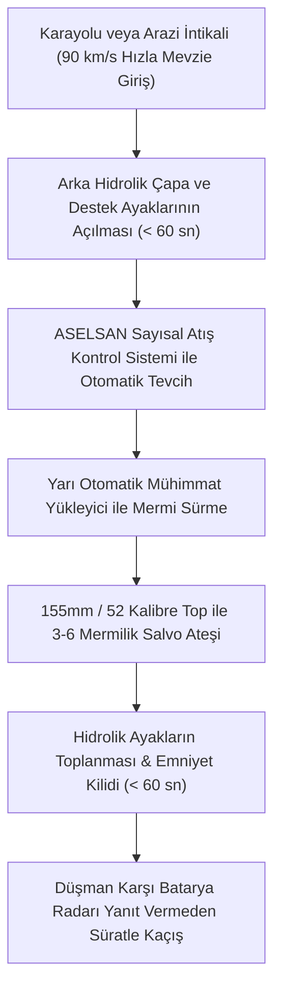

# 🚛 Proje: MKE YAVUZ (155mm Kamyona Monteli Obüs - TMO)

[](https://en.wikipedia.org/wiki/Technology_readiness_level)
[](../../README.md)
[](../README.md)
[](../README.md)


> **"Tekerlekler üzerinde 40 km'lik stratejik balistik vuruş: 'Vur ve Kaç' doktriniyle 1 dakikada mevzilenen, paletli obüs gücünü otoban süratiyle birleştiren taktik topçu sistemi."**

---

## 🛡️ Stratejik Tanım & Doktriner Öncelik

MKE YAVUZ, modern kara harbinin değişen taktik gereksinimleri doğrultusunda, Makine ve Kimya Endüstrisi A.Ş. (MKE) tarafından geliştirilmiş **155mm / 52 Kalibre Kamyona Monteli Obüs (TMO)** sistemidir. Paletli kundağı motorlu obüslerin (FIRTINA gibi) ağır bakım maliyetleri, düşük intikal süratleri ve tank taşıyıcı tırlara bağımlı lojistik operasyonlarına karşı YAVUZ; 6x6 taktik tekerlekli şasisiyle karayollarında 90 km/sa hızla yüzlerce kilometre intikal edebilen yüksek mobiliteli bir alternatiftir.

YAVUZ'un doktriner omurgasını modern topçunun altın kuralı olan **"Shoot & Scoot" (Vur ve Kaç)** prensibi oluşturur. Düşman karşı-batarya radarlarının atılan merminin yörüngesini takip ederek atış mevziine dakikalar içinde karşı ateş açabildiği günümüz harp sahasında YAVUZ; durduktan sonra 60 saniyeden kısa sürede hidrolik sabitleme ayaklarını yere basarak atışa hazır hale gelir. 3 ila 6 mermilik şok salvo atışını tamamladıktan sonra 60 saniye içinde toplanarak mevziyi terk eder ve düşman mermileri boş mevziye düşerken güvenli mesafeye uzaklaşmış olur.

---

## 📊 Kapsamlı Teknik Özellikler Tablosu

| Parametre | Değer | Taktik Önemi |
| :--- | :--- | :--- |
| **Silah Sistemi** | 155 mm / 52 Kalibre Yivli Obüs | FIRTINA ile aynı üstün balistik güç |
| **Şasi Konfigürasyonu** | 6x6 Ağır Hizmet Taktik Kamyon Şasisi | Zorlu arazide yüksek çekiş gücü |
| **Azami Atış Menzili** | 40+ km (Gaz Jeneratörlü HE-BB) / 30 km (M107) | Derin hedeflere hassas vuruş |
| **Mühimmat Kapasitesi** | 18 Adet Mühimmat + 18 Modüler Sevk Barutu | Araç üzerinde hazır cephane |
| **Atış Sürati** | 15 Saniyede 3 Atım (Ani) / Dakikada 4-6 Atım | Hızlı baskın darbesi |
| **Mevzilenme Süresi** | < 1 Dakika (Otomatik Hidrolik Ayaklar) | Süratli atışa hazırlık |
| **Mevzi Terk Süresi** | < 1 Dakika | Düşman karşı ateşinden tam kaçınma |
| **Azami Karayolu Hızı**| 90 km/sa | Paletli obüslere göre 3 kat hızlı intikal |
| **Harekat Sığası** | 600+ km | Kendi yakıtıyla kıtalararası menzil |
| **Mürettebat** | 5 Personel | STANAG korumalı zırhlı kabinde seyir |
| **Stratejik Taşınabilirlik**| Airbus A400M Askeri Kargo Uçağı ile Nakil | Havadan küresel intikal kabiliyeti |

---

## 🔄 Sistem Mimarisi & Görev Akışı



---

## 🧩 Alt Sistemler ve Aviyonik/Elektronik Entegrasyonu

- **Sayısal Atış Kontrol Sistemi:** Ataletsel navigasyon sistemi, balistik hesaplama bilgisayarı, namlu ağzı hız radarı ve dijital harita arayüzünü birleştiren entegre atış yönetim mimarisi.
- **Yarı Otomatik Mühimmat Doldurucu:** 155mm'lik ağır mermileri mekanik kollarla namlu hizasına getiren ve pnömatik pistonla kama yatağına süren, personel yorgunluğunu önleyen yarı otomatik doldurma sistemi.
- **Zırhlı Personel Kabini:** Mürettebatı el bombası, şarapnel parçaları ve 7.62mm zırh delici piyade tüfeği mermilerine karşı koruyan NATO STANAG balistik zırhlı çift kabin.
- **Hidrolik Stabilizasyon Ayakları (Spades):** 155mm 52 kalibre topun ateşleme anında ürettiği yüzlerce tonluk geri tepme kuvvetini doğrudan toprağa aktaran, aracı sarsmadan sabit tutan ağır hizmet hidrolik tablaları.
- **KBRN ve İklimlendirme:** Mürettebat kabininde nükleer, biyolojik ve kimyasal filtreleme ve zorlu iklim koşulları için yüksek güçlü klima ünitesi.

---

## 🎯 Görev Profili, Muharebe Senaryoları & Mühimmat Yelpazesi

### Görev Profilleri
- **Süratli İntikal ve Hızlı Topçu Desteği:** Yüzlerce kilometrelik sınır hattı boyunca tekerlekleri üzerinde hızla kaydırılarak beklenmeyen bölgelerde ani ateş baskısı oluşturma.
- **Shoot & Scoot Asimetrik Taarruz:** Düşman İHA ve karşı topçu keşif unsurlarının yoğun olduğu bölgelerde bir dakikada atış yapıp mevziden uzaklaşarak hayatta kalma.
- **Stratejik Hava İndirme:** A400M kargo uçaklarıyla denizaşırı operasyon sahalarına indirilerek dakikalar içinde savaşa dahil olma.

### Mühimmat Yelpazesi
- **MOD 274 155mm HE-BB:** 40+ km menzilli gaz jeneratörlü tahrip mermisi.
- **M107 HE:** 30 km menzilli standart yüksek infilaklı mühimmat.
- **MKE Modüler Sevk Barutları:** İstenilen menzil kademesine göre yanıcı kovanlı barut modülleri.

---

## 🚀 TRL Seviyesi ve Gelişim Yol Haritası

```
[TRL 1-6] ➔ [TRL 7: Prototip Atış ve Stabilite Testleri] ➔ [TRL 8: Kalifikasyon ve Dayanıklılık Testleri] ➔ [TRL 9: Seri Üretim Fazı & İhracat Görüşmeleri]
```

- [x] **Tasarım ve Prototip İmalatı:** 6x6 kamyon şasisi üzerinde 155mm 52 kalibre topun başarıyla dengelenmesi (TRL 7).
- [x] **Zorlu Poligon Atış ve Hareket Testleri:** Karapınar ve Şereflikoçhisar atış poligonlarında 40 km menzil ve mobilite testlerinin doğrulanması (TRL 8).
- [x] **Askeri Kalifikasyon:** TSK gereksinimlerini karşılayan seri üretim konfigürasyonunun tamamlanması (TRL 9).
- [ ] **Güneydoğu Asya ve Orta Doğu İhracatı:** Malezya ve bölge ülkelerinin kamyona monteli obüs ihalelerinde değerlendirme süreci.

---

## 🔗 Bağlantılar ve Dizin Navigasyonu

[⬅️ Üst Dizine](../README.md) | [🏛️ Dominion Hub](../../README.md) | [🏠 Ana Sayfa](../../../README.md)
