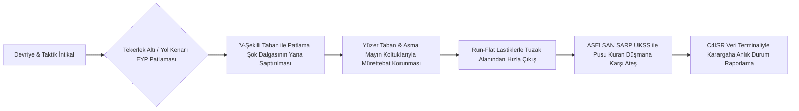

# 🚜 Proje: Nurol Makina EJDER YALÇIN (4x4 Taktik Tekerlekli Zırhlı Araç)

[

<p align="center">
  
</p>
](https://en.wikipedia.org/wiki/Technology_readiness_level)
[](../../README.md)
[](../README.md)
[](../README.md)


> **"Muharebe sahasında efsaneleşen çöl çitası: V-gövde mimarisi, eşsiz mayın bekası ve 10'dan fazla dünya ordusunda kendini kanıtlamış küresel zırhlı muharebe standardı."**

---

## 🛡️ Stratejik Tanım & Doktriner Öncelik

Nurol Makina EJDER YALÇIN 4x4, Türk savunma sanayiinin küresel kara platformları pazarındaki en parlak ihracat şampiyonlarından ve modern asimetrik harp sahasının en dayanıklı **Taktik Tekerlekli Zırhlı Araçlarından (TTZA / MRAP)** biridir. Ağır el yapımı patlayıcı (EYP), tanksavar mayını ve kinetik zırh delici mühimmat tehditlerinin en yoğun olduğu asimetrik çatışma alanlarında personelin hayatta kalmasını sağlamak üzere tasarlanan EJDER YALÇIN; Türkiye'nin yanı sıra NATO üyesi Macaristan (Gidrán adıyla), Katar, Özbekistan, Tunus, Çad ve Senegal dahil 10'u aşkın ülkenin silahlı kuvvetlerinde ana muharebe unsuru olarak görev yapmaktadır.

EJDER YALÇIN'ın doktriner başarısı, yüksek balistik korumayı olağanüstü arazi hareket kabiliyetiyle kusursuz biçimde harmanlamasında yatar. Patentli V-şekilli monokok gövde geometrisi ve patlama sönümleyici taban yapısı, tekerlek altında veya gövde merkezinde patlayan onlarca kilogramlık TNT şokunu dışarıya saptırarak kabin içindeki mürettebatın yaralanmasını önler. Modüler tasarımı sayesinde zırhlı personel taşıyıcı, tanksavar füze aracı, havan taşıyıcı, KBRN keşif ve hava savunma platformu gibi çok sayıda varyanta dakikalar içinde dönüştürülebilmektedir.

---

## 📊 Kapsamlı Teknik Özellikler Tablosu

| Parametre | Değer | Taktik Önemi |
| :--- | :--- | :--- |
| **Aks Mimarisi** | 4x4 Sürekli Dört Çeker & Bağımsız Süspansiyon | Her tekerlekte kilitli diferansiyel |
| **Azami Muharebe Ağırlığı**| 14.000 kg (14 Ton) | 4 tona varan yüksek faydalı yük kapasitesi |
| **Motor & Güç** | 375 BG Turboşarjlı Ağır Hizmet Dizel Motor | Sınıfının en güçlü tork eğrisi |
| **Tork Değeri** | 1.450 Nm @ 1200-1600 d/d | Ağır çamur ve dik yokuşta kesintisiz çekiş |
| **Azami Karayolu Hızı**| 120 km/sa | Otoban ve taktik hatta yüksek intikal |
| **Harekat Sığası (Menzil)**| 700+ km | Uzun menzilli sınır ve çöl devriyeleri |
| **Tırmanma Kapasitesi**| %60 Dik Meyil, %30 Yan Eğim | 50 cm dik basamak, 110 cm hendek aşma |
| **Mürettebat Taşıma** | 2 + 9 Personel (Toplam 11 Kişi) | Tam teçhizatlı mekanize piyade mangası |
| **Beka Sertifikasyonu**| STANAG 4569 Seviye 4a/3b Yüksek Beka | V-gövde, asma tavanlı yüzer koltuklar |
| **Silah Entegrasyonu** | ASELSAN SARP / SARP-DUAL UKSS | 12.7mm MT, 7.62mm MT, 40mm Bombaatar |
| **Alternatif Silahlar** | Roketsan OMTAS Lançeri / 120mm Alkar Havan | Tanksavar ve dolaylı ateş desteği |

---

## 🔄 Sistem Mimarisi & Görev Akışı



---

## 🧩 Alt Sistemler ve Aviyonik/Elektronik Entegrasyonu

- **V-Gövde ve Taban Patlama Zırhı:** Şasiye entegre deflektör geometrisi ve çok katmanlı balistik çelik taban plakası sayesinde patlama enerjisini kabin içine girmeden soğurma ve yana tahliye etme.
- **ASELSAN SARP & SARP-DUAL Kule:** Lazer mesafe ölçerli, gündüz/gece termal görüşlü, araç hareket halindeyken çift eksenli stabilizasyonla nokta atışı yapabilen uzaktan kumandalı silah istasyonu.
- **Asma Tavanlı Mayın Koltukları:** Araç tabanına hiçbir temas noktası bulunmayan, tavana ve yan sütunlara sabitlenmiş 5 noktalı emniyet kemerli enerji sönümleyici koltuklar.
- **Merkezi Lastik Şişirme (CTIS) & Balistik Run-Flat:** Sürücü kabininden kum, çamur, kar veya asfalt zeminlere göre lastik hava basıncını optimize etme; mermi isabetinde hava kaçırmadan 50 km güvenli sürüş.
- **360° Yakın Mesafe Durumsal Farkındalık:** Gövdenin dört bir yanına yerleştirilmiş zırh korumalı balık gözü kameralarla personelin araç dışına çıkmadan çevreyi izleme imkanı.

---

## 🎯 Görev Profili, Muharebe Senaryoları & Mühimmat Yelpazesi

### Görev Profilleri
- **Meskun Mahal Terörle Mücadele:** Şehir içi operasyonlarda dar sokaklara girerek ateş altındaki personeli tahliye etme ve barikatları aşma.
- **Sınır ve Konvoy Güvenliği:** Yüksek riskli ikmal hatlarında öncü kuvvet olarak EYP tuzaklarını bertaraf etme.
- **Çöl ve Sert İklim Operasyonları:** +55°C çöl sıcağında ve toz fırtınalarında motor ve filtre sistemleri tıkanmadan kesintisiz muharebe.

### Mühimmat Yelpazesi
- **12.7x99 mm (.50 BMG) & 7.62x51 mm NATO:** SARP kulesinden ateşlenen zırh delici ve izli piyade mühimmatları.
- **40mm Otomatik Bombaatar:** Toplu düşman unsurlarına karşı sütre arkası parça tesirli bomba atımı.
- **Güdümlü Tanksavar Füzeleri:** OMTAS ve Kornet-E entegrasyonu ile zırhlı hedeflere karşı 4 km menzilde imha.

---

## 🚀 TRL Seviyesi ve Gelişim Yol Haritası

```
[TRL 1-6] ➔ [TRL 7: Uluslararası Mayın Patlatma Sertifikasyonu] ➔ [TRL 8: TSK Envanteri & Muharebe Deneyimi] ➔ [TRL 9: Küresel Seri Üretim & NATO İhracatı]
```

- [x] **NATO STANAG Seviye 4a/3b Patlatma Testleri:** Almanya ve Türkiye'de gerçekleştirilen gerçek patlayıcı testlerinin başarıyla geçilmesi (TRL 8).
- [x] **TSK, Jandarma ve EGM Dağıtımı:** Güvenlik kuvvetlerinin envanterine yüzlerce araçlık teslimat ve operasyonel kullanım (TRL 9).
- [x] **NATO İhracatı (Macaristan Gidrán Projesi):** Macar Ordusu'na teslimatlar ve yerel montaj hattı anlaşması.
- [ ] **Otonom ve Hibrit Varyantlar:** Uzaktan kumandalı insansız lojistik ve keşif varyantlarının saha denemeleri.

---

## 🔗 Bağlantılar ve Dizin Navigasyonu

[⬅️ Üst Dizine](../README.md) | [🏛️ Dominion Hub](../../README.md) | [🏠 Ana Sayfa](../../../README.md)
