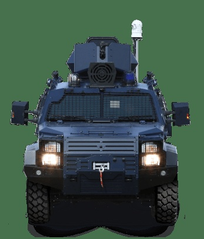
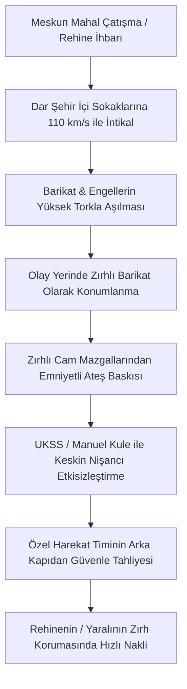

# 🚙 Proje: Nurol Makina ILGAZ II (4x4 Zırhlı İç Güvenlik Aracı)

[](https://en.wikipedia.org/wiki/Technology_readiness_level)
[](../../README.md)
[](../README.md)
[](../README.md)

<p align="center">
  
</p>

> **"Kentsel asayiş ve meskun mahal terör operasyonlarının çevik koruyucusu: Kompakt boyutlar, yüksek balistik zırh ve entegre atış mazgallarıyla kolluğun çelik zırhı."**

---

## 🛡️ Stratejik Tanım & Doktriner Öncelik

Nurol Makina ILGAZ II, özel harekat timlerinin, polis kuvvetlerinin, jandarma birliklerinin ve sınır muhafızlarının meskun mahal operasyonlarında, kentsel asayiş olaylarında, rehine kurtarma harekatlarında ve kritik tesis koruma görevlerinde süratle intikal edebilmesi için geliştirilmiş **4x4 Taktik Tekerlekli Hafif Zırhlı İç Güvenlik Aracıdır**. Ağır sınıf MRAP araçlarının manevra yapamayacağı kadar dar şehir içi sokaklarında, tarihi mahalle dokularında ve yoğun trafik ortamlarında sunduğu üstün çeviklikle taktik bir avantaj sağlar.

ILGAZ II'nin temel doktriner tasarımı; araç içindeki personelin dış tehditlere karşı maksimum balistik koruma altında kalırken, aynı zamanda aracı aktif bir muharebe platformuna dönüştürebilmesine olanak tanır. Araç gövdesine ve zırhlı camlara entegre edilmiş özel atış mazgalları sayesinde güvenlik güçleri, kabin içerisinden çıkmadan ve hedef olmadan dışarıdaki hedeflere piyade tüfekleriyle kesintisiz ateş açabilir. Kompakt gövdesine rağmen 9 tam teçhizatlı personeli taşıyabilen araç; ambulans, komuta kontrol ve keşif varyantlarıyla da emniyet güçlerine çok yönlü hizmet vermektedir.

---

## 📊 Kapsamlı Teknik Özellikler Tablosu

| Parametre | Değer | Taktik Özellik |
| :--- | :--- | :--- |
| **Araç Tipi** | 4x4 Hafif Taktik Zırhlı İç Güvenlik Aracı | Şehir içi ve kırsal alan intikali |
| **Azami Yüklü Ağırlık** | ~8.500 kg (8.5 Ton) | Köprü ve zayıf zeminlerde rahat geçiş |
| **Motor & Güç** | 300+ BG Turboşarjlı Dizel Motor | Ani hızlanma ve yüksek tırmanma |
| **Azami Hız** | 110 km/sa | Otoban ve kentsel hızlı intikal |
| **Harekat Sığası (Menzil)**| 700+ km | Kesintisiz devriye kabiliyeti |
| **Tırmanma Kapasitesi**| %60 Dik Meyil, %30 Yan Eğim | Kaldırım, basamak ve barikat aşma |
| **Mürettebat Kapasitesi**| 2 + 7 Personel (Toplam 9 Kişi) | Tam teçhizatlı özel harekat timi |
| **Balistik Koruma** | STANAG 4569 Balistik ve El Bombası Koruması | Zırh çeliği ve kompozit taban |
| **Atış Mazgalları** | Sağ/Sol ve Arka Kapılarda Entegre Mazgallar | Zırh altından tüfekle güvenli atış |
| **Silah İstasyonu** | Manuel Zırhlı Kalkanlı Kule veya 7.62/12.7mm UKSS | Tehdide anında ateş baskısı |
| **Görüş Donanımı** | Termal Gece Görüş & 360° Güvenlik Kameraları | Gece karanlığında sokağa hakimiyet |

---

## 🔄 Sistem Mimarisi & Görev Akışı



---

## 🧩 Alt Sistemler ve Aviyonik/Elektronik Entegrasyonu

- **Zırhlı Atış Mazgalları ve Balistik Camlar:** İçeriden dışarıya piyade tüfeği namlusu uzatılabilen, gaz sızdırmaz yaylı kapaklara sahip, yüksek seviyeli mermi çekirdeklerini durduran çok katmanlı lamine camlar.
- **Kompakt Uzaktan Komutalı Silah Sistemi:** Kule üzerine entegre edilen hafif UKSS veya 360° dönebilen zırhlı kalkanlı manuel silah yuvası ile personeli açığa çıkarmadan hedefi vurma.
- **Çevre Gözetleme ve Projektör Sistemi:** Gece operasyonlarında dar sokakları ve çatı katlarını aydınlatan kumandalı LED projektörler ve monitörden izlenen termal sürüş kameraları.
- **Akustik Sireni & Anons Sistemi:** Toplumsal olaylarda ve rehine pazarlıklarında dışarıya yüksek desibel ses yayını yapan megafon ve ikaz çakar donanımları.
- **Run-Flat Lastik ve Kurtarma Vinci:** Şehir içinde tuzaklanan çivilere veya mermi isabetlerine rağmen patlamayan lastikler ve engele takılma riskine karşı ön elektrikli vinç.

---

## 🎯 Görev Profili, Muharebe Senaryoları & Mühimmat Yelpazesi

### Görev Profilleri
- **Özel Harekat ve Terör Operasyonları:** Meskun mahalde hücre evlerine yönelik operasyonlarda timlerin güvenli intikalini ve operasyon sahasına baskın yapmasını sağlama.
- **Kritik Bina ve Elçilik Güvenliği:** Diplomatik misyonların, valiliklerin ve askeri tesislerin giriş noktalarında zırhlı nöbet ve nöbetçi devriye aracı rolü.
- **Zırhlı Ambulans:** Çatışma alanından yaralı personelin güvenle tahliye edilmesi için sedyeli tıbbi müdahale aracı.

### Silah ve Teçhizat Seçenekleri
- **7.62x51 mm / 12.7 mm Makineli Tüfek:** Kule üzerine monte edilen yakın alan ateş destek silahları.
- **Göz Yaşartıcı Gaz Fırlatıcıları:** Toplumsal olaylara müdahalede kule etrafına takılan çoklu gaz fişeği bataryaları.

---

## 🚀 TRL Seviyesi ve Gelişim Yol Haritası

```
[TRL 1-6] ➔ [TRL 7: Prototip ve Balistik Testler] ➔ [TRL 8: EGM & Jandarma Kabulü] ➔ [TRL 9: Seri Üretim & Sahada Görevde]
```

- [x] **ILGAZ II Tasarım ve Balistik Doğrulama:** Zırh çeliği mukavemet ve şok testlerinin tamamlanması (TRL 8).
- [x] **Kolluk Kuvvetleri Envanterine Giriş:** Emniyet Genel Müdürlüğü Özel Harekat Başkanlığı ve Jandarma Genel Komutanlığı'na teslimat (TRL 9).
- [x] **Yurt Dışı İhracat Başarısı:** Orta Doğu ve Afrika ülkelerinin güvenlik güçlerine ihracat teslimatlarının icrası.
- [ ] **Yapay Zeka Destekli Şehir İçi Otonom Rota:** GPS kesintilerinde sokak siluetlerinden harita çıkaran iç mekan seyrüsefer yükseltmesi.

---

## 🔗 Bağlantılar ve Dizin Navigasyonu

[⬅️ Üst Dizine](../README.md) | [🏛️ Dominion Hub](../../README.md) | [🏠 Ana Sayfa](../../../README.md)