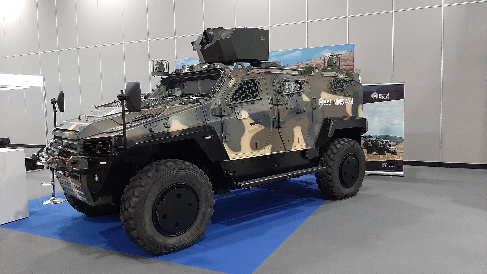
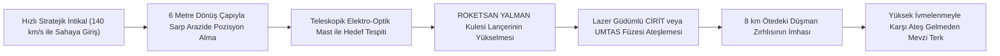

# 🚜 Proje: Nurol Makina YÖRÜK (NMS 4x4 Yeni Nesil Hafif Zırhlı Araç)

[](https://en.wikipedia.org/wiki/Technology_readiness_level)
[](../../README.md)
[](../README.md)
[](../README.md)

<p align="center">
  
</p>

> **"Zırhlı muharebe araçlarının spor arabası: 140 km/sa azami sürat, 6 metre dönüş yarıçapı, sahada sökülüp takılan modüler zırhı ve YALMAN kulesiyle hızlı taarruzun zirvesi."**

---

## 🛡️ Stratejik Tanım & Doktriner Öncelik

Nurol Makina YÖRÜK (uluslararası adıyla **NMS 4x4**), dünya savunma otoritelerince "zırhlı araç dünyasının süper spor arabası" olarak tanımlanan, düşük ağırlık merkezi, bağımsız çift salıncaklı süspansiyon sistemi ve fütüristik çizgileriyle yeni nesil hafif taktik zırhlı muharebe aracı konseptini baştan tanımlayan bir mühendislik zaferidir. 140 km/sa azami hızı ile sınıfının dünyadaki en hızlı zırhlı aracı olan YÖRÜK; özel kuvvetlerin, keşif kollarının ve hızlı intikal tugaylarının operasyonel hızını maksimize eder.

YÖRÜK'ün askeri doktrine kazandırdığı en devrimci nitelik, **Ölçeklenebilir Modüler Zırh Mimarisi**dir. Araç gövdesine entegre kompozit zırh plakaları, görev tanımına ve bölgedeki tehdit profiline göre sahada dakikalar içinde personele ihtiyaç duyulmadan sökülüp takılabilir. Böylece araç gerektiğinde helikopter kancasında taşınabilecek kadar hafifletilebilir (STANAG Seviye 1), gerektiğinde ise ağır tanksavar mayınlarına ve makineli tüfek ateşine karşı en üst seviyeye (STANAG Seviye 4) çıkarılabilir. Estonya Silahlı Kuvvetleri'nin katı NATO standartlarındaki ihalesini kazanarak Avrupa Birliği ve NATO ordularının envanterine giren YÖRÜK, Türk mühendisliğinin küresel vitrinidir.

---

## 📊 Kapsamlı Teknik Özellikler Tablosu

| Parametre | Değer | Taktik Karşılığı |
| :--- | :--- | :--- |
| **Aks Mimarisi** | 4x4 Bağımsız Süspansiyonlu Dört Çeker | Her tekerlekte bağımsız yaylanma |
| **Muharebe Ağırlığı** | 8.000 - 10.000 kg (Zırh seviyesine göre) | Havadan ve karadan yüksek taşınabilirlik |
| **Motor & Güç** | 300 BG Turboşarjlı Yüksek Performans Dizel | Benzersiz ivmelenme ve tork tepkisi |
| **Azami Karayolu Hızı**| 140 km/sa | Sınıfının dünyadaki en yüksek sürati |
| **Dönüş Yarıçapı** | Sadece 6 Metre | Dar sokak ve orman yollarında eşsiz manevra |
| **Menzil (Harekat Sığası)**| 700+ km | Uzun menzilli derin keşif akınları |
| **Tırmanma Kapasitesi**| %70 Dik Meyil, %40 Yan Eğim | 40 cm basamak, 90 cm su geçişi |
| **Taşıma Kapasitesi** | 2 + 7 Personel (Toplam 9 Kişi) | Yüksek iç hacim ergonomisi |
| **Zırh Teknolojisi** | Ölçeklenebilir Modüler Kompozit Zırh | Sahada değiştirilebilir koruma seviyesi |
| **Hava İndirme Uyum** | CH-47 Chinook kancasında, C-130 / A400M içinde | Stratejik havadan intikal yeteneği |
| **Silah Entegrasyonu** | ROKETSAN YALMAN Silah Kulesi / SARP-L UKSS | CİRİT, UMTAS, SUNGUR, 7.62/12.7mm |

---

## 🔄 Sistem Mimarisi & Görev Akışı



---

## 🧩 Alt Sistemler ve Aviyonik/Elektronik Entegrasyonu

- **Ölçeklenebilir Kompozit Zırh Kitleri:** Sahadaki tehdit durumuna göre cıvatalı montajla zırh seviyesi artırılıp azaltılabilen, ağırlık ve yakıt ekonomisini optimize eden zırh mimarisi.
- **ROKETSAN YALMAN Entegre Silah Kulesi:** Aynı kule üzerinden 70mm Lazer Güdümlü CİRİT füzeleri, UMTAS tanksavar füzeleri ve SUNGUR hava savunma füzelerini ateşleyebilen çok rollü kule sistemi.
- **ASELSAN SARP-L Hafif UKSS:** 7.62mm makineli tüfek taşıyan, düşük ağırlıklı, stabilize termal/TV kameralı uzaktan kumandalı silah istasyonu.
- **Tam Bağımsız Çift Salıncaklı Süspansiyon:** Yüksek hızlarda dahi engebeli arazide tekerleklerin yerle temasını kesmeyen, sürücüye ralli aracı konforunda dinamik sürüş sağlayan süspansiyon geometrisi.
- **C4ISR Sayısal Kokpit:** Tüm göstergelerin dijital ekranlardan takip edildiği, gece görüş gözlüğü (NVG) uyumlu iç aydınlatma ve şifreli telsiz veri terminali.

---

## 🎯 Görev Profili, Muharebe Senaryoları & Mühimmat Yelpazesi

### Görev Profilleri
- **Hafif Taarruz ve Akıncı Birlikleri:** Düşman hatlarının zayıf noktalarına yüksek hızla sızarak komuta merkezlerini ve lojistik hatları vurup geri çekilme.
- **Tanksavar ve Hava Savunma Avcısı:** YALMAN kulesi entegrasyonu ile düşman helikopterlerine, İHA'larına ve zırhlı araçlarına karşı mobilize pusu kurma.
- **Hava İndirme Harekatı:** Kargo uçakları veya ağır yük helikopterleriyle düşman gerisine indirilerek sürpriz taarruzlar icra etme.

### Mühimmat Yelpazesi
- **ROKETSAN CİRİT:** 8 km menzilli lazer güdümlü 70mm hassas füze.
- **ROKETSAN UMTAS / L-UMTAS:** 8 km menzilli ağır zırh delici tanksavar füzesi.
- **ROKETSAN SUNGUR:** Alçak irtifa hava savunma füzesi.
- **7.62x51 mm & 12.7 mm Mühimmat:** UKSS yakın savunma mermileri.

---

## 🚀 TRL Seviyesi ve Gelişim Yol Haritası

```
[TRL 1-6] ➔ [TRL 7: Dinamik Sürüş & Modüler Zırh Testleri] ➔ [TRL 8: TSK Kalifikasyonu] ➔ [TRL 9: NATO & Küresel Seri Üretim]
```

- [x] **Radikal Tasarım ve Sürat Doğrulaması:** 140 km/sa azami hız ve 6 metre dönüş testlerinin kanıtlanması (TRL 8).
- [x] **TSK ve Yurt Dışı Kabul Testleri:** Katar ve Çad silahlı kuvvetlerine teslimatların gerçekleştirilmesi (TRL 9).
- [x] **Estonya NATO İhalesi Zaferi:** Estonya Savunma Kuvvetleri'nin açtığı uluslararası zırhlı araç ihalesinin kazanılarak seri üretime başlanması.
- [ ] **YALMAN Kulesi ile Tam Entegre Seri Teslimatlar:** TSK Kara Kuvvetleri tanksavar birliklerine YÖRÜK-YALMAN konfigürasyonunun yaygınlaştırılması.

---

## 🔗 Bağlantılar ve Dizin Navigasyonu

[⬅️ Üst Dizine](../README.md) | [🏛️ Dominion Hub](../../README.md) | [🏠 Ana Sayfa](../../../README.md)