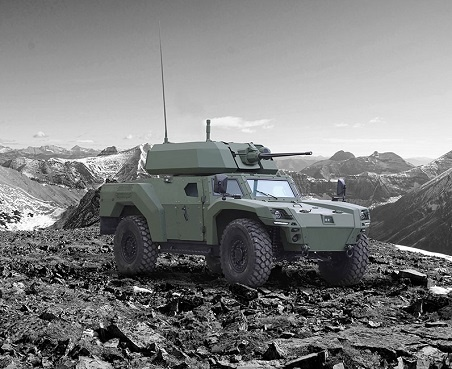
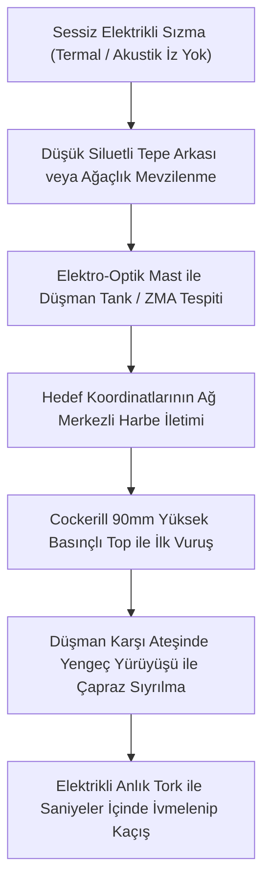

# ⚡ Proje: OTOKAR AKREP II (Yeni Nesil Zırhlı Keşif ve Silah Platformu)

[](https://en.wikipedia.org/wiki/Technology_readiness_level)
[](../../README.md)
[](../README.md)
[](../README.md)

<p align="center">
  
</p>

> **"Türkiye'nin ilk elektrikli zırhlısı: Sıfır termal ve akustik iz ile hayalet gibi sızan, yengeç yürüyüşüyle manevra yapan ve 90mm topla vuran yeni nesil muharebe avcısı."**

---

## 🛡️ Stratejik Tanım & Doktriner Öncelik

OTOKAR AKREP II, modern ve geleceğin dijital muharebe sahaları için Otokar tarafından sıfırdan geliştirilmiş, Türkiye'nin ilk **elektrikli, hibrit ve dizel güç grubu** seçeneklerine sahip çok maksatlı zırhlı keşif, gözetleme ve ateş destek platformudur. Geleneksel içten yanmalı motorlara sahip zırhlı araçlar yaydıkları yüksek motor gürültüsü ve termal egzoz sıcaklığı sebebiyle düşman termal kameraları ve akustik sensörleri tarafından kilometrelerce öteden tespit edilebilirken; AKREP II'nin elektrikli modeli (**AKREP IIe**), sıfıra yakın termal izi ve neredeyse tamamen sessiz ilerleyebilme kabiliyetiyle sahada bir "hayalet avcı" rolü üstlenir.

AKREP II'nin doktriner üstünlüklerinden biri de dört tekerlekten bağımsız yönlendirme sistemidir. Arka aksın ön aksla aynı yöne dönmesi sayesinde araç çapraz eksende kayarak ilerleyebilir (**Yengeç Yürüyüşü / Crab Walk**). Bu kabiliyet, düşman ateşinden kaçarken veya binaların arkasından burnunu çıkarmadan mevzi alırken benzersiz bir taktik esneklik sağlar. Kompakt ve son derece alçak siluetine rağmen John Cockerill 90mm yüksek basınçlı top kulesi gibi ağır bir silah sistemini başarıyla taşıyabilen AKREP II, zırhlı süvari birliklerinin geleceğidir.

---

## 📊 Kapsamlı Teknik Özellikler Tablosu

| Parametre | AKREP IIe (Tam Elektrikli) | AKREP IId (Dizel) / AKREP IIh (Hibrit) |
| :--- | :--- | :--- |
| **Güç Grubu Tipi** | Yüksek Voltajlı Li-İyon Batarya + Elektrik Motorları | Turboşarjlı Dizel / Hibrit Tahrik Mimarisi |
| **Azami Hız** | 110 km/sa (Anlık yüksek tork) | 110 km/sa |
| **Menzil (Harekat Sığası)**| 250+ km (Sessiz Elektrikli İntikal) | 700+ km (Dizel / Hibrit Modda) |
| **Termal ve Akustik İz** | Neredeyse Sıfır (Düşman FLIR'ında görünmez) | Standart Düşük Akustik & Egzoz Soğutmalı |
| **Manevra Kabiliyeti** | Dört Tekerlekten Yönlendirme & Yengeç Yürüyüşü | Tüm Akslardan Dümenleme (All-Wheel Steer) |
| **Mürettebat** | 3 Personel (Komutan, Nişancı, Sürücü) | 3 Personel |
| **Silah Entegrasyonu** | 90mm John Cockerill Kule / 25-30mm BOZOK Kule | 90mm Kule, 25mm Top, ATGM veya Lazer Silahı |
| **Balistik & Mayın Beka** | STANAG 4569 Balistik ve Mayın Koruma Seviyesi | Modüler Kompozit Zırh + V Taban Yapısı |
| **Sürüş Mimarisi** | Drive-by-Wire (Elektronik Sürüş / Otonoma Hazır) | Sayısal Aktarma Organları Kontrolü |
| **Gözetleme Mimarisi** | 360° Panoramik Termal Mast & Akıllı Hedef Takibi| Entegre Dijital C4ISR Sistemi |

---

## 🔄 Sistem Mimarisi & Görev Akışı



---

## 🧩 Alt Sistemler ve Aviyonik/Elektronik Entegrasyonu

- **Drive-by-Wire Elektronik Sürüş Sistemi:** Mekanik direksiyon ve pedal bağlantıları yerine tamamen dijital sinyallerle çalışan, araca istendiğinde uzaktan kumandalı veya tam otonom insansız zırhlı araç yeteneği kazandıran kontrol mimarisi.
- **Dört Tekerlekten Dümenleme & Yengeç Sürüşü:** Ön ve arka tekerleklerin zıt yöne dönerek minimum dönüş çapı sağlaması veya aynı yöne açılarak arabanın yan yan yengeç gibi kaymasını sağlayan bağımsız hidrolik-elektrikli yönlendirme.
- **Sıvı Soğutmalı Yüksek Enerjili Batarya Paketi:** Aşırı sıcak ve soğuk iklim koşullarında batarya hücre sıcaklığını ideal seviyede tutan termal yönetim sistemi ve zırh altı yangın izolasyonu.
- **Cockerill 90mm Top Entegrasyonu:** Hafif ve kompakt şasi üzerinde 90mm çapında mühimmat ateşleyebilen, namludan tanksavar füzesi atma kabiliyetine sahip gelişmiş kule sistemi.
- **Artırılmış Gerçeklik ve Gece Görüş Kokpiti:** Sürücü ve komutana kask üstü göstergeler ve dijital ekranlarla aracın zırhını saydamlaştıran 360 derece durumsal farkındalık desteği.

---

## 🎯 Görev Profili, Muharebe Senaryoları & Mühimmat Yelpazesi

### Görev Profilleri
- **Sessiz İleri Keşif ve Gözetleme:** Düşman savunma hatlarının derinliklerine gece karanlığında termal kameralara yakalanmadan sızarak istihbarat toplama.
- **Tanksavar ve Ateş Destek:** 90mm yivli top veya entegre tanksavar füzeleriyle düşman mekanize birliklerine pusu kurarak ağır zırhlıları imha etme.
- **Geleceğin İnsansız / Otonom Muharebe Aracı:** Dijital altyapısı sayesinde insanlı ekiplerin önüne sürülerek tehlikeli bölgeleri tarayan insansız öncü araç rolü.

### Mühimmat Yelpazesi
- **90mm Yüksek Basınçlı Mühimmat:** APFSDS (Zırh Delici Sabot), HESH (Ezici Başlıklı) ve HE (Tahrip).
- **25mm / 30mm Otomatik Top Mühimmatı:** BOZOK ve MIZRAK kulelerinden ateşlenen zırh delici ve parça tesirli mühimmatlar.
- **Güdümlü Tanksavar Füzeleri:** OMTAS veya lazer güdümlü tanksavar füzeleri.

---

## 🚀 TRL Seviyesi ve Gelişim Yol Haritası

```
[TRL 1-6] ➔ [TRL 7: Elektrikli Platform & Atış Kalifikasyonu] ➔ [TRL 8: Saha Doğrulama & Kule Entegrasyonu] ➔ [TRL 9: Seri Üretim Siparişi]
```

- [x] **AKREP IIe Tam Elektrikli Prototip İmalatı:** Dünyanın ilk elektrikli zırhlı muharebe araçlarından biri olarak dinamik testlerin tamamlanması (TRL 7).
- [x] **90mm Kule ve Ağır Silah Entegrasyonu:** Atış poligonlarında 90mm top geri tepme kuvvetinin şasi üzerinde başarıyla sönümlenmesi ve atış kalifikasyonu (TRL 8).
- [x] **Dizel (AKREP IId) ve Hibrit Modeller:** Geleneksel orduların lojistik ihtiyaçlarına uygun dizel güç grubu varyantının geliştirilmesi ve tanıtımı.
- [ ] **Seri Üretim Envanter Sözleşmesi:** TSK ve yurt dışı müttefik ülkelerle seri üretim ve tedarik müzakerelerinin sonuçlandırılması.

---

## 🔗 Bağlantılar ve Dizin Navigasyonu

[⬅️ Üst Dizine](../README.md) | [🏛️ Dominion Hub](../../README.md) | [🏠 Ana Sayfa](../../../README.md)