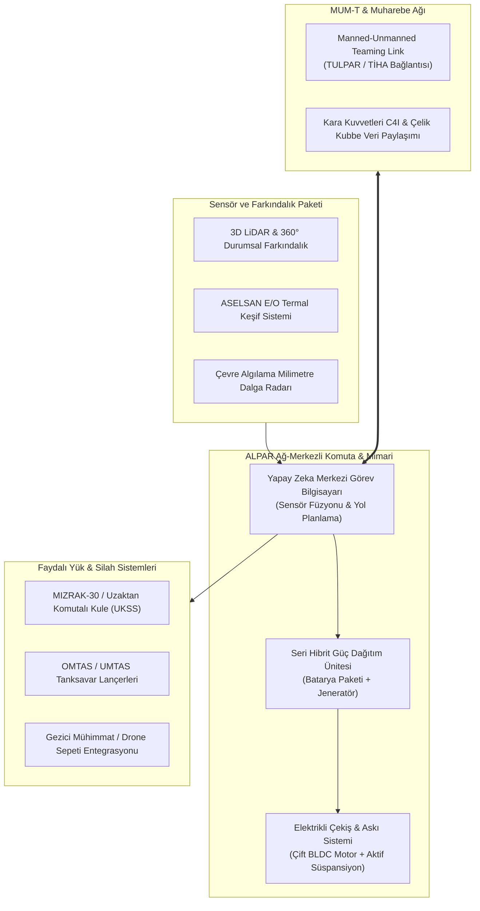

# 🤖 Proje: ALPAR (Ağır Sınıf İnsansız Kara Aracı)

  

---

## 🛡️ Stratejik Tanım & Doktriner Öncelik

**ALPAR**, modern asimetrik harp ve hibrit muharebe sahalarının gereksinimlerine yanıt olarak OTOKAR mühendisliğiyle geliştirilen **15 ton sınıfı Ağır İnsansız Kara Aracıdır (A-İKA)**. Türk Silahlı Kuvvetleri'nin insan kaybını asgariye indirme ve robotik sistemlerle muharebe sahası derinliğini artırma doktrini kapsamında tasarlanan ALPAR; otonom devriye, keşif-gözetleme, intikal hattı güvenliği ve doğrudan zırhlı ateş desteği icra eder.

Platform, insanlı muharebe araçları (TULPAR, COBRA II) ve insansız hava araçları (SİHA / TİHA) ile müşterek harekat (Manned-Unmanned Teaming - MUM-T) icra edebilen yüksek yapay zeka işlem kapasitesine ve seri hibrit elektrik tahrik mimarisine sahiptir. Düşük akustik ve termal iz seviyesi, platformun sınır hattı ve derin taarruz bölgelerinde sessiz yaklaşma yeteneğini (silent watch & drive) benzersiz kılar.

---

## 📊 Kapsamlı Teknik Özellikler

| Parametre | Değer / Özellik | Açıklama |
| :--- | :--- | :--- |
| **Muharebe Ağırlığı** | ~15.000 kg (15 Ton) | Görev donanımına göre modüler konfigürasyon |
| **Tahrik Sistemi** | Seri Hibrit (Dizel Jeneratör + Çift Elektrik Motoru) | Sıfır emisyonlu bataryadan sessiz sürüş |
| **Azami Hız** | 70+ km/s | Asfalt ve stabilize yol performansı |
| **Sessiz İntikal Hızı** | 20+ km/s | Tam elektrikli batarya sürüş modu |
| **Operasyonel Menzil** | 500+ km (Hibrit) / ~50 km (Sadece Batarya) | Jeneratör destekli uzun süreli saha görevi |
| **Zırh ve Koruma Seviyesi** | STANAG 4569 Modüler Balistik & Mayın Koruması | Kompozit zırh plakaları ve V-tabanlı gövde |
| **Faydalı Yük Kapasitesi** | 3.000+ kg | Kule, mühimmat, lojistik pod ve sensörler |
| **Otonomi Düzeyi** | Seviye 3+ / 4 Otonom Seyrüsefer | GNSS-bağımsız SLAM, LiDAR ve AI engel sakınma |
| **Haberleşme** | Çift Frekanslı Yedekli RF Veri Bağı, KEMENT, SATCOM | Elektronik karıştırmaya dayanıklı ağ mimarisi |

---

## 🧩 Alt Sistemler ve Aviyonik / Elektronik Entegrasyonu

- **Sensör Füzyon İşlemcisi:** LiDAR, termal kameralar, milimetrik dalga radarları ve akustik atış yeri tespit sensörlerinden gelen verileri tek bir taktik durumsal farkındalık resminde birleştirir.
- **Sessiz Gözetleme (Silent Watch):** Motor kapalıyken lityum-iyon batarya bloğu ile 48 saate kadar kesintisiz elektro-optik keşif ve hedef işaretleme yapabilir.
- **MUM-T Entegrasyonu:** TULPAR ZMA veya komuta kontrol araçlarındaki görev komutanı tarafından tek tuşla hedef tahsisi veya ileri hat tarama görevine yönlendirilebilir.

---

## 🎯 Görev Profili, Muharebe Senaryoları & Mühimmat Yelpazesi

1. **Ağır Keşif ve İleri Hat İntikali:** Düşman temas hattında mayınlı sahaların tespiti, pusu tehlikesi olan boğaz ve vadilerin öncü taranması.
2. **Doğrudan Ateş Desteği ve Zırh İmhası:** MIZRAK kule sistemine entegre 30mm otomatik top ve tandem harp başlıklı OMTAS/KARAOK füzeleri ile düşman zırhlı unsurlarına doğrudan angajman.
3. **Lojistik ve Yaralı Tahliyesi (CASEVAC):** Yüksek faydalı yük kapasitesi sayesinde mühimmat ikmali ve sıcak temas altındaki yaralı personelin insansız geri nakli.
4. **Sürü ve Gezici Mühimmat Taşıyıcılığı:** Arka gövdeye monte edilebilen fırlatma tüpleri ile kamikaze dronların (BOYGA, KARGU) hedefe yönlendirilmesi.

---

## 🚀 TRL Seviyesi ve Gelişim Yol Haritası

- **Mevcut Durum:** `TRL 6` (Saha ve laboratuvar ortamında sistem kalifikasyonu ve otonomi testleri aktif sürdürülmektedir).
- [x] Konsept Tasarımı ve IDEF Uluslararası Gösterimi
- [x] Otonomi Seviye 3+ Rota Takibi, Engel Aşma ve Çevre Haritalama Testleri
- [x] Hibrit Güç Grubu ve Sessiz Sürüş Entegrasyonu
- [ ] MIZRAK-30 ve Tanksavar Entegre Atışlı Saha Testleri
- [ ] TSK Kara Kuvvetleri Müşterek Birlik Denemeleri ve Seri Üretim Hazırlığı

---

## 🔗 İç Dizin Navigasyonu

[⬅️ Üst Dizine (OTOKAR)](../README.md) | [🏛️ Dominion Hub (DOMINION_LAND)](../../README.md) | [🏠 Ana Sayfa](../../../README.md)
