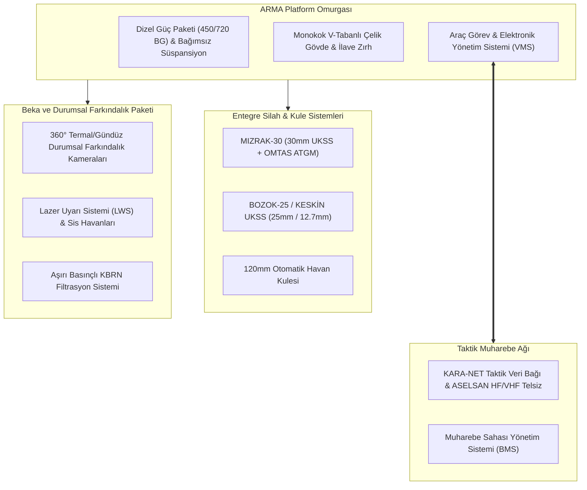

# 🏢 Proje: ARMA (6x6 & 8x8 Modüler Taktik Tekerlekli Zırhlı Araç)

  

---

## 🛡️ Stratejik Tanım & Doktriner Öncelik

**ARMA Ailesi (6x6 ve 8x8)**, OTOKAR tarafından zorlu coğrafi ve muharebe şartlarında yüksek balistik ve mayın koruması, üstün arazi kabiliyeti ve amfibi yetenek sunmak üzere geliştirilmiş yeni nesil modüler taktik tekerlekli zırhlı araç platformudur. Zırhlı Personel Taşıyıcı (ZPT), Zırhlı Muharebe Aracı (ZMA), Komuta-Kontrol, Havan Aracı, KBRN Keşif ve Radar/Sensör Taşıyıcı gibi çok yönlü konfigürasyonlara adapte edilebilen ortak modüler gövde mimarisine sahiptir.

NATO STANAG standartlarının en üst kademelerinde test edilip kalifiye edilen ARMA, çok sayıda müttefik ve dost ülkenin (Birleşik Arap Emirlikleri, Bahreyn, Estonya vb.) silahlı kuvvetleri tarafından tercih edilmiş, yüksek ihracat başarısı ve gerçek muharebe ortamı güvenilirliği elde etmiştir.

---

## 📊 Kapsamlı Teknik Özellikler

| Parametre | ARMA 6x6 | ARMA 8x8 | Açıklama |
| :--- | :--- | :--- | :--- |
| **Muharebe Ağırlığı** | ~23.000 kg (23 Ton) | ~30.000 kg (30 Ton) | Görev donanımı ve zırh kitine bağlı azami ağırlık |
| **Personel Kapasitesi** | 10 (Sürücü + Komutan + 8 Er) | 12 (Sürücü + Komutan + Nişancı + 9 Er) | Mayına dayanıklı ergonomik askılı koltuklar |
| **Güç Grubu (Motor)** | 450 BG Turbo Dizel | 720 BG Çok Yakıtlı Dizel | Elektronik kontrollü otomatik şanzıman |
| **Azami Karayolu Hızı** | 105 km/s | 105 km/s | Entegre merkezi lastik şişirme (CTIS) |
| **Amfibi Hız** | 8 km/s (Çift Su Jeti) | 8 km/s (Çift Su Jeti) | Hazırlıksız suda yüzebilme kabiliyeti |
| **Operasyonel Menzil** | 700+ km | 700+ km | Standart yakıt depoları ile kesintisiz intikal |
| **Meyil Tırmanma / Yan Eğim** | %60 / %30 | %60 / %30 | Üstün arazi engeli aşma geometrisi |
| **Hendek Aşma / Dik Engel** | 1.2 m / 0.6 m | 2.0 m / 0.7 m | Çok akslı bağımsız süspansiyon dinamiği |
| **Balistik & Mayın Koruması** | STANAG 4569 Seviye 2 - 4+ | STANAG 4569 Seviye 3 - 5 | V-taban mimarisi, ilave seramik/kompozit zırh kitleri |

---

## 🧩 Alt Sistemler ve Aviyonik / Elektronik Entegrasyonu

- **Araç Elektronik Mimarisi (Vetronics):** MIL-STD-1275 standardında merkezi güç dağıtımı ve CAN-Bus tabanlı dijital kontrol altyapısı.
- **Entegre Kule Uyumluluğu:** MIZRAK-30, BOZOK-25, ÜÇOK 12.7mm UKSS ve 105mm/120mm tanksavar top kulelerine kadar geniş entegrasyon havuzu.
- **Aktif Beka Donanımı:** Lazer İkaz Alıcısı (LWS), otomatik yangın bastırma sistemi, patlama emici taban kaplaması ve kesintisiz KBRN koruma hücresi.

---

## 🎯 Görev Profili, Muharebe Senaryoları & Mühimmat Yelpazesi

1. **Mekanize Piyade İntikali & Taarruz:** Düşman ateş hattına yüksek hızla personeli zırhlı koruma altında ulaştırma ve kule silahlarıyla piyadeye doğrudan ateş desteği.
2. **Nehir ve Sulak Alan Geçişleri:** Amfibi çift su jeti sayesinde köprü veya istihkam gerekmeksizin göl ve nehir engellerini yüzerek aşma.
3. **Zırhlı Tanksavar Avcılığı:** Kuleye entegre tandem harp başlıklı OMTAS füzeleri ile düşman ana muharebe tanklarını 4 km menzilde imha.
4. **Sınır ve İç Güvenlik Devriyesi:** Uzun menzilli elektro-optik direk sensörleri ile geniş coğrafi alanlarda 7/24 kesintisiz hudut emniyeti.

---

## 🚀 TRL Seviyesi ve Gelişim Yol Haritası

- **Mevcut Durum:** `TRL 9` (Tam kalifiye, seri üretimde, çok uluslu orduların envanterinde aktif muharebe kanıtlı platform).
- [x] Tasarım, prototip ve kapsamlı çöl/kutup iklim testleri
- [x] STANAG Seviye 4+ balistik ve mayın patlatma sertifikasyonu
- [x] Seri üretim hattı optimizasyonu ve yüzlerce aracın teslimatı
- [x] Farklı ülke orduları (BAE RABDAN 8x8 türevi, Bahreyn, Estonya) ihracat programları
- [x] Yeni nesil hibrit tahrik ve otonom konvoy takip modülleri entegrasyonu

---

## 🔗 İç Dizin Navigasyonu

[⬅️ Üst Dizine (OTOKAR)](../README.md) | [🏛️ Dominion Hub (DOMINION_LAND)](../../README.md) | [🏠 Ana Sayfa](../../../README.md)
