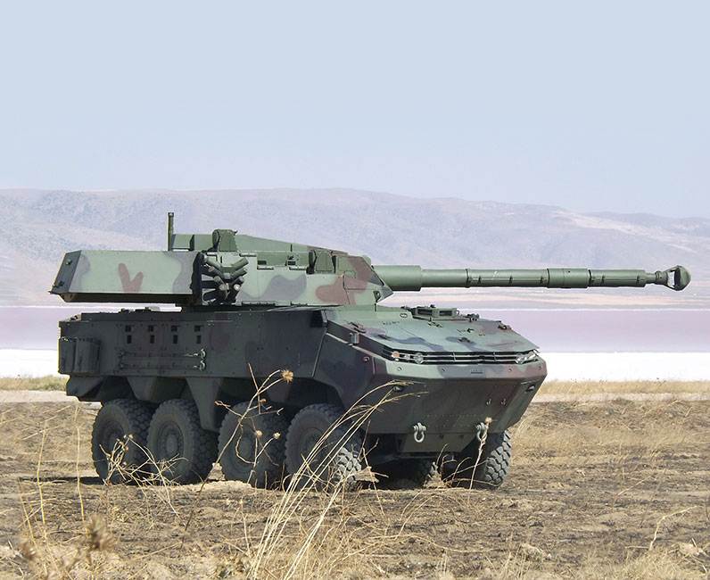
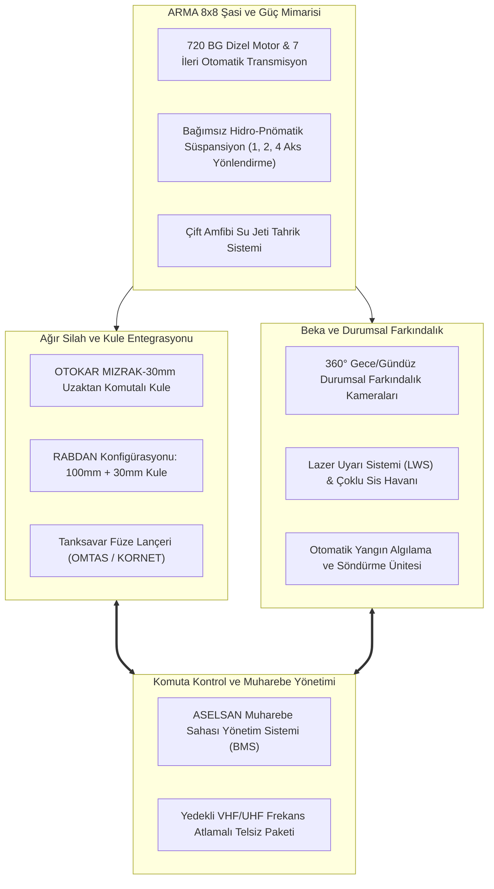

# 🏢 Proje: ARMA 8x8 (Tekerlekli Zırhlı Muharebe Aracı)

  

---

## 🛡️ Stratejik Tanım & Doktriner Öncelik

**ARMA 8x8**, OTOKAR'ın tekerlekli zırhlı araç ürün ailesinin en yüksek taşıma kapasitesine, koruma düzeyine ve ateş gücü potansiyeline sahip ağır siklet üyesidir. Modern mekanize birliklerin derin taarruz ve yüksek tempolu harekat doktrinlerine uygun olarak geliştirilen platform; 30 tona varan azami muharebe ağırlığı ile ağır silah kuleleri, tanksavar güdümlü füze istasyonları ve gelişmiş elektronik harp podlarını rahatlıkla bünyesinde taşır.

Yüksek arazi hareket kabiliyetini bağımsız hidro-pnömatik süspansiyon ve çok akslı yönlendirme sistemiyle birleştiren ARMA 8x8, aynı zamanda sınıfında nadir bulunan amfibi yüzme yeteneğini de korumaktadır. Birleşik Arap Emirlikleri Silahlı Kuvvetleri'nin "RABDAN 8x8" adıyla envanterine kattığı ve yüzlerce adet tedarik ettiği araç, Türk savunma sanayiinin küresel ölçekteki en büyük kara platformu ihracat başarılarından birini temsil eder.

---

## 📊 Kapsamlı Teknik Özellikler

| Parametre | Değer / Özellik | Açıklama |
| :--- | :--- | :--- |
| **Muharebe Ağırlığı** | ~30.000 kg (30 Ton) | Balistik zırh paketi ve kule konfigürasyonuna göre |
| **Mürettebat / Taşınan Birlik** | 12 Kişi (Komutan + Nişancı + Sürücü + 9 Personel) | Mayın şokunu sönümleyen askılı ergonomik koltuklar |
| **Motor & Güç** | 720 BG Turboşarjlı Çok Yakıtlı Dizel Motor | Elektronik kumandalı otomatik şanzıman (7 ileri, 1 geri) |
| **Güç / Ağırlık Oranı** | ~24 BG / Ton | Yüksek ivmelenme ve seri taktik manevra yeteneği |
| **Azami Karayolu Hızı** | 105 km/s | CTIS (Merkezi Lastik Şişirme) ve Run-Flat destekli |
| **Amfibi Yetenek & Hız** | 8 km/s (Çift Arka Su Jeti ile Yüzebilme) | Dalga kıran ve sintine pompası entegrasyonu |
| **Operasyonel Menzil** | 700+ km | Genişletilmiş korumalı yakıt depoları |
| **Hendek Aşma / Dik Engel** | 2.0 metre / 0.70 metre | 8 tekerden çekiş ve kilitli diferansiyeller |
| **Balistik / Mayın Koruması** | STANAG 4569 Seviye 4 / 4b+ | Monokok V-tabanlı gövde, ilave kompozit zırh |

---

## 🧩 Alt Sistemler ve Aviyonik / Elektronik Entegrasyonu

- **Elektronik Mimari (CAN-Bus Vetronics):** Sürücü ve komutan için dijital çok fonksiyonlu gösterge panelleri (MFD), arıza tespit sistemi ve yedekli güç dağıtımı.
- **Ağır Kule Taşınabilirliği:** Gövde yapısı, 30mm'den 105mm yüksek basınçlı yivsiz tank toplarına ve 120mm havan kulelerine kadar her türlü taret mimarisine entegre edilebilir taret boğazı çapına ve mukavemetine sahiptir.
- **Aktif/Pasif Koruma Entegrasyonu:** Lazer ikaz alıcıları, akustik keskin nişancı tespit sistemleri ve opsiyonel aktif koruma sistemi (PULAT / AKKOR benzeri) montaj yuvaları.

---

## 🎯 Görev Profili, Muharebe Senaryoları & Mühimmat Yelpazesi

1. **Ağır Zırhlı Muharebe:** Ana muharebe tankları ile omuz omuza görev icra ederek düşman piyade mevzilerini, hafif zırhlı araçlarını 30mm otomatik top ile delip geçme.
2. **Kıyı ve Nehir Amfibi Harekatı:** Denizden karaya intikalde çıkarma gemisinden bağımsız yüzerek kıyı başı tutma ve nehir taarruz hatlarını süratle zorlama.
3. **Zırhlı Tanksavar Savunması:** 4 km mesafeye kadar tandem başlıklı OMTAS füzeleri ile düşman zırhlı birliklerinin karşı taarruzlarını kırma.
4. **Müşterek Taktik Komuta Merkezi:** Geniş iç hacmi sayesinde tabur ve tugay seviyesi seyyar zırhlı komuta kontrol aracı rolü.

---

## 🚀 TRL Seviyesi ve Gelişim Yol Haritası

- **Mevcut Durum:** `TRL 9` (Uluslararası sahada yüzlerce adet teslim edilmiş, muharebe kanıtlı seri üretim platformu).
- [x] Prototip geliştirme ve zorlu çöl dayanıklılık testleri
- [x] Balistik ve patlatma testleri ile STANAG Seviye 4b sertifikasyonu
- [x] BAE Silahlı Kuvvetleri Rabdan 8x8 projesi kapsamında seri teslimatlar
- [x] Çok uluslu NATO müttefikleri için yeni görev paketi entegrasyonları
- [ ] Yeni nesil hibrit motor ve insansız/uzaktan sürüş kiti geliştirmeleri

---

## 🔗 İç Dizin Navigasyonu

[⬅️ Üst Dizine (OTOKAR)](../README.md) | [🏛️ Dominion Hub (DOMINION_LAND)](../../README.md) | [🏠 Ana Sayfa](../../../README.md)
