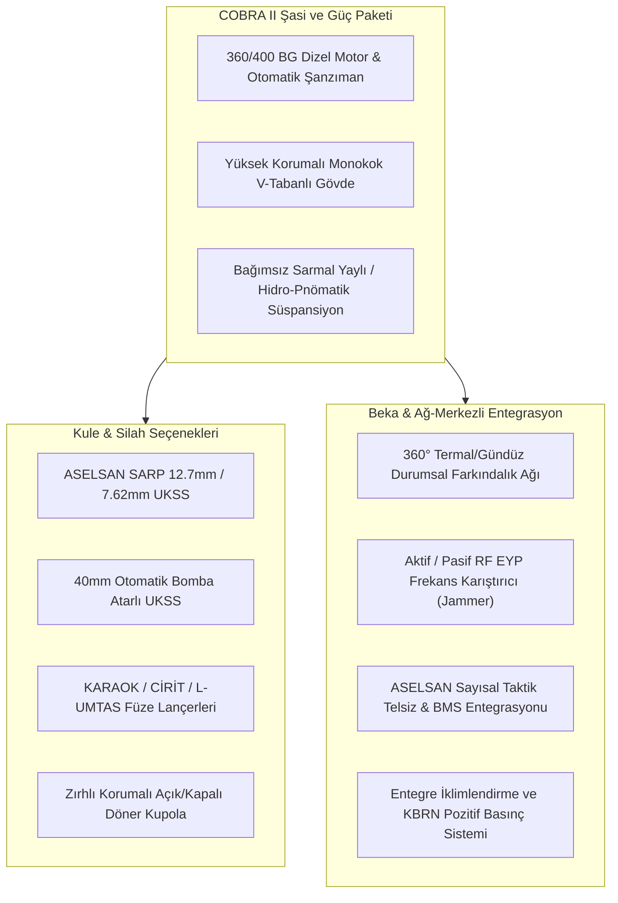

# 🐍 Proje: COBRA II (Taktik Tekerlekli Zırhlı Araç 4x4)

  

---

## 🛡️ Stratejik Tanım & Doktriner Öncelik

**COBRA II**, dünya çapında efsaneleşen ilk nesil COBRA aracının operasyonel mirası ve küresel kullanıcı geri bildirimleri üzerine OTOKAR tarafından geliştirilmiş, sınıfının en yüksek koruma, iç hacim ve yük taşıma kapasitesine sahip **4x4 Taktik Tekerlekli Zırhlı Aracıdır (TTZA)**. Asimetrik tehditlerin yoğun olduğu terörle mücadele bölgelerinden yüksek yoğunluklu konvansiyonel çatışma alanlarına kadar çok geniş bir yelpazede görev icra eder.

Modüler monokok gövde yapısı sayesinde personel taşıyıcı, silah platformu, sınır gözetleme aracı, zırhlı ambulans, komuta kontrol merkezi ve radar taşıyıcı varyantları üretilmiştir. Türk Silahlı Kuvvetleri, Emniyet Genel Müdürlüğü, Jandarma Genel Komutanlığı ile 15'ten fazla ülkenin ordusu tarafından aktif olarak kullanılan COBRA II, Ukrayna ve Afrika gibi zorlu muharebe sahalarında sağladığı yüksek beka ve mürettebat korumasıyla uluslararası düzeyde kanıtlanmıştır.

---

## 📊 Kapsamlı Teknik Özellikler

| Parametre | Değer / Özellik | Açıklama |
| :--- | :--- | :--- |
| **Muharebe Ağırlığı** | ~14.500 kg (14.5 Ton) | Zırh kiti ve faydalı yüke bağlı azami ağırlık |
| **Taşıma Kapasitesi** | 11 Personele kadar (Sürücü, Komutan + 9 Personel) | Mayın şok emici asılı koltuk tertibatı |
| **Motor & Güç** | 360 BG / 400 BG Turboşarjlı Su Soğutmalı Dizel | Otomatik transmisyon ile sürekli 4x4 çekiş |
| **Azami Karayolu Hızı** | 110 km/s | Yüksek taktik intikal sürati |
| **Operasyonel Menzil** | 700+ km | Korunaklı yakıt depoları ile otonom hareket |
| **Meyil Tırmanma / Yan Eğim** | %60 / %30 | Dik eğim ve zorlu vadi yollarında stabilite |
| **Sudan Geçme Derinliği** | 1.0 m (Amfibi varyantta suda yüzebilme) | Opsiyonel amfibi yüzme kiti mevcuttur |
| **Balistik Koruma** | STANAG 4569 Seviye 3 / 4 (Modüler Zırh) | Kinetik enerjili mühimmat ve şarapnel koruması |
| **Mayın & EYP Koruması** | STANAG 4569 Seviye 3a/3b & Yan Patlama Koruması | V-şekilli taban plakası ve patlama emici tabanlık |

---

## 🧩 Alt Sistemler ve Aviyonik / Elektronik Entegrasyonu

- **SARP UKSS Entegrasyonu:** Araç içinden nişancı tarafından lazer mesafe ölçer ve termal kamera ile hedefin gece/gündüz hareket halindeyken vurulması.
- **Sınır Gözetleme Varyantı:** Teleskopik mast üzerine monte edilmiş elektro-optik kamera paketi (ASELSAN ŞAHİNGÖZÜ) ve kara gözetleme radarı (ACAR) ile hudut hattında 20+ km menzilde hedef tespiti.
- **Elektronik Koruma:** Konvoy güvenliği için araç üzerine monteli uzaktan komutalı patlayıcı önleme frekans karıştırıcıları (JAMMER).

---

## 🎯 Görev Profili, Muharebe Senaryoları & Mühimmat Yelpazesi

1. **Öncü Keşif ve Konvoy Emniyeti:** Mayınlı yollarda ve pusu ihtimali olan bölgelerde askeri ve lojistik konvoyların önünde güvenli intikal hattı oluşturma.
2. **Meskun Mahal Muharebesi:** Yüksek manevra kabiliyeti ve kompakt boyutları ile dar sokaklarda personeli koruma ve çatı keskin nişancılarına karşı 12.7mm/40mm UKSS ile nokta vuruş.
3. **Sınır Güvenliği ve Kaçakçılıkla Mücadele:** Termal mast sistemleriyle hudut ihlallerini gece karanlığında milimetrik tespit ve müdahale timini bölgeye sürme.
4. **Zırhlı Tıbbi Tahliye (Ambulans):** Çatışma hattından yaralı personeli kesintisiz balistik ve mayın koruması altında sahra hastanelerine nakletme.

---

## 🚀 TRL Seviyesi ve Gelişim Yol Haritası

- **Mevcut Durum:** `TRL 9` (Dünya çapında 2000'den fazla üretilmiş, aktif savaş tecrübesine sahip seri üretim platformu).
- [x] Tasarım, prototip imalatı ve uluslararası kalifikasyon süreçleri
- [x] TSK, Jandarma ve Emniyet kabul muayeneleri ve toplu teslimatlar
- [x] 15'ten fazla ülkeye geniş çaplı ihracat (Doğu Avrupa, Afrika, Orta Doğu, Asya)
- [x] Mayınlı ve EYP'li sahalarda gerçek muharebe beka kanıtı
- [x] Otonom sürüş kiti ve insansız konvoy takip sistemleri entegrasyonu

---

## 🔗 İç Dizin Navigasyonu

[⬅️ Üst Dizine (OTOKAR)](../README.md) | [🏛️ Dominion Hub (DOMINION_LAND)](../../README.md) | [🏠 Ana Sayfa](../../../README.md)
