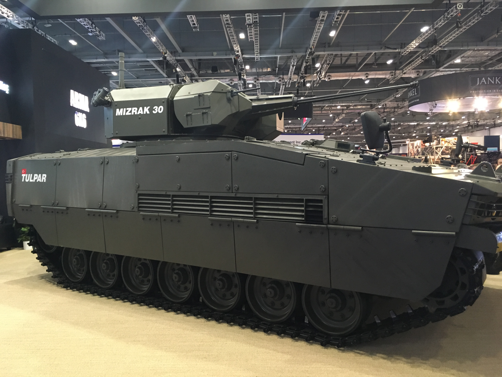
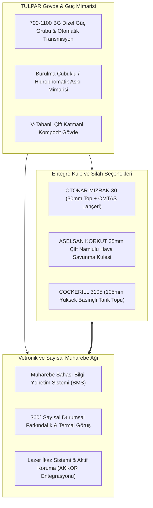

# 🐎 Proje: TULPAR (Yeni Nesil Paletli Zırhlı Muharebe Aracı)

  

---

## 🛡️ Stratejik Tanım & Doktriner Öncelik

**TULPAR**, adını Türk mitolojisindeki efsanevi kanatlı attan alan, modern ve gelecekteki muharebe sahalarının gereksinimlerine göre OTOKAR tarafından tasarlanmış çok amaçlı ve üstün korumalı **Yeni Nesil Paletli Zırhlı Muharebe Aracıdır (ZMA)**. ALTAY gibi yeni nesil Ana Muharebe Tankları (AMT) ile müşterek harekat icra edebilecek seviyede yüksek taktik hareket kabiliyetine, modüler balistik zırh yapısına ve üstün ateş gücüne sahiptir.

28 tondan 45 tona kadar esneyebilen modüler şasi mimarisi sayesinde TULPAR; Zırhlı Muharebe Aracı (30mm/35mm kuleli), Zırhlı Personel Taşıyıcı, Hafif Tank (105mm yüksek basınçlı yivli tank topu), Havan Aracı, Keşif, Zırhlı Kurtarıcı ve Komuta Kontrol Aracı olarak yapılandırılabilir. Dünyadaki en zorlu NATO kullanıcı testlerine tabi tutulmuş ve Avrupa'dan Asya'ya birçok ülkenin ihale süreçlerinde en üst teknik puanları toplamıştır.

---

## 📊 Kapsamlı Teknik Özellikler

| Parametre | Değer / Özellik | Açıklama |
| :--- | :--- | :--- |
| **Muharebe Ağırlığı** | 28.000 kg - 45.000 kg (28 - 45 Ton) | Konfigürasyon ve zırh koruma paketine göre |
| **Taşıma Kapasitesi** | 12 Kişi (3 Mürettebat + 9 Mekanize Piyade) | Şok emici asılı koltuklar ve acil çıkış kapağı |
| **Motor & Güç** | 700 BG - 1100 BG Turboşarjlı Dizel Motor | Otomatik şanzıman ve entegre hidrostatik dümen |
| **Güç / Ağırlık Oranı** | 22 - 25 BG / Ton | Çamurlu ve engebeli arazide tank temposunda intikal |
| **Azami Hız** | 70+ km/s | İleri ve geri viteslerde yüksek manevra hızı |
| **Operasyonel Menzil** | 500+ km | Korunaklı iç yakıt tankları |
| **Meyil Tırmanma / Yan Eğim** | %60 / %30 | Dik eğim ve teras tırmanma yeteneği |
| **Hendek Aşma / Dikey Engel** | 2.6 metre / 1.0 metre | Paletli askı mimarisi ve kauçuk/çelik palet desteği |
| **Balistik / Mayın Koruması** | STANAG 4569 Seviye 5+ Balistik & Seviye 4 Mayın | Modüler seramik kompozit zırh ve V-şekilli iç taban |

---

## 🧩 Alt Sistemler ve Aviyonik / Elektronik Entegrasyonu

- **Açık Sistem Vetronik Mimarisi:** MIL-STD-1553 ve Ethernet tabanlı veri yolları ile araçtaki tüm sensör, kule ve motor parametrelerinin komutan ve sürücü ekranlarına aktarılması.
- **Aktif Koruma Sistemi Entegrasyonu:** ASELSAN AKKOR aktif koruma sistemi radar sensörleri ve karşı tedbir mühimmatları ile tanksavar füzelere karşı 360° kalkan.
- **MUM-T (İnsanlı-İnsansız Birlikteliği):** TULPAR içerisindeki komutan terminalinden ALPAR gibi ağır İKA'ların kontrolü ve ortak ateş idaresi.

---

## 🎯 Görev Profili, Muharebe Senaryoları & Mühimmat Yelpazesi

1. **Ana Muharebe Tankı Desteği:** ALTAY tanklarının yanında yer alarak düşman piyadesini, tanksavar mevzilerini ve alçak irtifa İHA'larını 30mm/35mm top ateşiyle bastırma.
2. **Hafif Tank Muharebesi (105mm Konfigürasyon):** Yüksek hareket kabiliyetiyle dağlık bölgelerde ve dar köprü geçişlerinde ana tankların giremediği alanlarda ağır zırhlı hedefleri avlama.
3. **Mekanize Piyade İndirme:** Düşman tahkimat hattının içine kadar piyade birliğini STANAG Seviye 5 koruma altında sokup güvenli indirme yapma.
4. **Hava Savunma Koruması:** 35mm parçacıklı mühimmat (ATOM) atan kule varyantıyla seyir füzelerine ve intihar dronlarına karşı hava kalkanı oluşturma.

---

## 🚀 TRL Seviyesi ve Gelişim Yol Haritası

- **Mevcut Durum:** `TRL 7` (Sistem prototip doğrulaması tamamlanmış, zorlu kullanıcı saha ve atış kalifikasyon testleri icra edilmektedir).
- [x] Modüler gövde tasarımı ve prototip üretimi
- [x] Farklı kule entegrasyonları (MIZRAK-30, 105mm Cockerill)
- [x] Uluslararası çöl ve kış şartları mobilite testleri
- [x] Mayın patlatma ve balistik mukavemet sertifikasyonu
- [ ] TSK ve dost ülke envanter tedarik programları için seri üretim fazı

---

## 🔗 İç Dizin Navigasyonu

[⬅️ Üst Dizine (OTOKAR)](../README.md) | [🏛️ Dominion Hub (DOMINION_LAND)](../../README.md) | [🏠 Ana Sayfa](../../../README.md)
