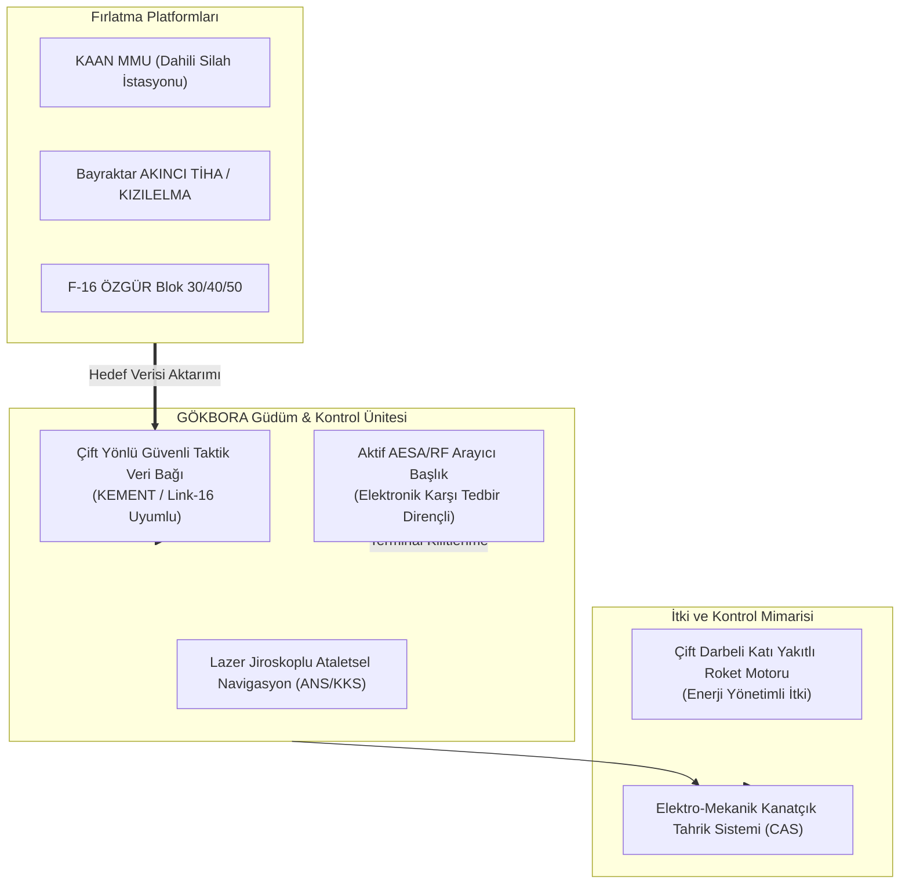

# ⚔️ Proje: GÖKBORA (Görüş Ötesi Hava-Hava ve Ağ-Merkezli Füze Sistemi)

[

  

](../../../docs/TRL_GUIDE.md)

---

## 🛡️ Stratejik Tanım & Doktriner Öncelik

**GÖKBORA**, ROKETSAN tarafından modern hava muharebesinin en kritik gereksinimi olan Görüş Ötesi Hava-Hava (BVRAAM - Beyond Visual Range Air-to-Air Missile) üstünlüğünü sağlamak ve aynı zamanda kara konuşlu hava savunma bataryalarıyla müşterek ağ üzerinden yönlendirilebilmek üzere geliştirilen yeni nesil füze konseptidir. GÖKDOĞAN projesinden elde edilen teknolojik birikimi daha ileri itki, çift darbeli katı yakıtlı roket motoru ve çift yönlü taktik veri bağı mimarisiyle taçlandıran platform; 100+ km mesafedeki düşman savaş uçaklarını, havadan erken ihbar uçaklarını (AWACS), seyir füzelerini ve silahlı insansız hava araçlarını imha etmek üzere optimize edilmiştir.

Platform, Türk Silahlı Kuvvetleri'nin **Çelik Kubbe** entegre hava savunma doktrinine ve 5. Nesil Milli Muharip Uçak KAAN'ın dahili istasyon gereksinimlerine tam uyumlu olarak tasarlanmıştır.

---

## 📊 Kapsamlı Teknik Özellikler

| Parametre | Değer / Özellik | Açıklama |
| :--- | :--- | :--- |
| **Füze Tipi** | BVRAAM (Görüş Ötesi Hava-Hava Füzesi) | Ağ-merkezli hava ve satıhtan hava entegrasyonu |
| **Operasyonel Menzil** | 100+ km | Çift darbeli roket motoru ile son safhada yüksek enerji |
| **Azami Hız** | Mach 4+ (Süpersonik / Hipersonik geçiş) | Hedefe kaçış manevrası bırakmayan terminal sürat |
| **Harp Başlığı** | Yüksek İnfilaklı Parçacık Tesirli Harp Başlığı | Lazer yaklaşma tapalı akıllı patlatma |
| **Arayıcı Başlık** | Aktif Radar (AESA / RF) Arayıcı Başlık | Karşı-elektronik tedbirlere (ECCM) yüksek mukavemet |
| **Güdüm Mimarisi** | ANS (Ataletsel) + KKS + Çift Yönlü Veri Bağı + Terminal RF | Uçuş esnasında hedef güncelleme (Mid-Course Update) |
| **Uyumlu Platformlar** | KAAN, F-16 ÖZGÜR, HÜRJET, AKINCI, KIZILELMA | Standart MIL-STD-1760 arayüzü ve dahili istasyon uyumu |
| **Hedef Yelpazesi** | 5. Nesil Uçaklar, Seyir Füzeleri, İHA'lar, AWACS | Yüksek g-kuvveti altında keskin manevra kabiliyeti |

---

## 🧩 Alt Sistemler ve Aviyonik / Elektronik Entegrasyonu

- **Ağ-Merkezli Hedefleme (Network-Centric Warfare):** Füze, atış yapılan uçak radarı kapalı olsa dahi (pasif yaklaşma), HAKİM komuta kontrol sistemi veya E-7T HİK uçağından gelen radar iziyle hedefe yönlendirilebilir.
- **Çift Darbeli Motor Mimarisi (Dual-Pulse):** Füze orta safhada yakıtını ekonomik tüketirken, hedefe yaklaştığı terminal aşamada ikinci darbeyi ateşleyerek yüksek kinetik enerjiye ve yüksek g manevra kabiliyetine ulaşır.
- **Dahili İstasyon Optimizasyonu:** KAAN'ın radar kesit alanını (RCS) artırmamak için katlanır kanatçık mimarisi ile dahili istasyonlara tam sığma özelliği.

---

## 🎯 Görev Profili, Muharebe Senaryoları & Mühimmat Yelpazesi

1. **Görüş Ötesi Önleme:** Düşman savaş uçaklarını kendi radar menzillerinin ötesinde tespit edip 100+ km'den imha etme.
2. **Kritik Hava Varlıklarını Avlama:** Düşmanın harekat sahasındaki tanker uçakları, AWACS erken ihbar uçakları ve sinyal istihbarat platformlarına karşı derin hava taarruzu.
3. **MUM-T Kapsamında İHA'dan Atış:** AKINCI veya KIZILELMA tarafından taşınarak insanlı savaş uçaklarının risk almadığı hatlarda düşman hava unsurlarına sürpriz angajman.
4. **Alçaktan Uçan Seyir Füzeleriyle Mücadele:** Yüksek hız ve hassas RF arayıcı başlık ile araziyi takip ederek sızmaya çalışan seyir füzelerini havada yakalama.

---

## 🚀 TRL Seviyesi ve Gelişim Yol Haritası

- **Mevcut Durum:** `TRL 6` (Sistem seviyesi konsept ve alt bileşen yer testleri doğrulanmış, hava platformu entegrasyon safhasında).
- [x] RF Arayıcı Başlık ve Algoritma Laboratuvar Simülasyonları
- [x] Çift darbeli roket motoru zemin ateşleme testleri
- [x] Milli görev bilgisayarı ve veri bağı entegrasyonu
- [ ] Hava platformlarından serbest bırakma ve atışlı telemetri testleri
- [ ] KAAN dahili silah yuvası aviyonik entegrasyonu ve kabul muayenesi

---

## 🔗 İç Dizin Navigasyonu

[⬅️ Üst Dizine (ROKETSAN)](../README.md) | [🏛️ Dominion Hub (DOMINION_LAND)](../../README.md) | [🏠 Ana Sayfa](../../../README.md)
