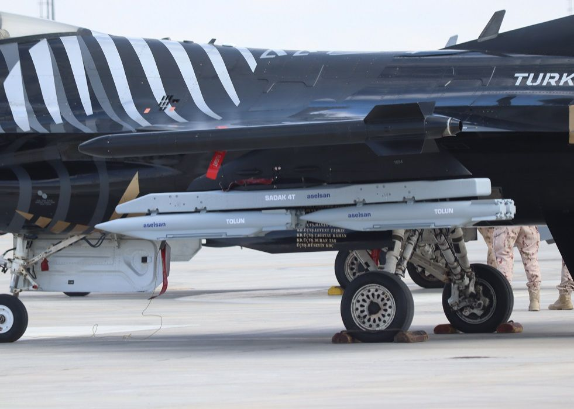
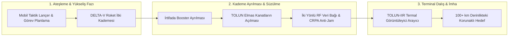

# 🚀 Proje: GÖKTAN (Karadan Atılan Hassas Güdümlü TOLUN Vuruş Sistemi)

  

> **Geliştirici:** ASELSAN & DELTA-V Uzay Teknolojileri  
> **Sınıf:** Karadan Karaya Hibrit Roket Motorlu Hassas Güdümlü Mühimmat Sistemi (GLSDB Muadili)  
> **Stratejik Önem:** Normalde savaş uçaklarından atılan ASELSAN TOLUN süzülen minyatür bombasının, DELTA-V üretimi hibrit roket motoru ile karadaki taktik araçlardan 100+ km menzile ve 360 derece her yöne ateşlenmesini sağlayan devrimsel topçu/füze sistemi.

---

## 🛡️ Stratejik Tanım & Doktriner Öncelik

**GÖKTAN Projesi**, modern topçu ve derin darbe doktrininde çığır açan bir mühendislik çözümüdür. Hava Kuvvetleri envanterindeki yüksek hassasiyetli **ASELSAN TOLUN** (ve TOLUN-IIR) süzülen minyatür mühimmatını, Türkiye'nin uzay roket motoru teknolojilerindeki öncüsü **DELTA-V** tarafından geliştirilen itki kademesiyle birleştirerek **karadan-karaya (Surface-to-Surface)** ateşlenen uzun menzilli bir topçu füzesine dönüştürür.

Hava kuvvetlerinin yoğun hava savunma tehdidi veya olumsuz meteorolojik şartlar nedeniyle kalkış yapamadığı durumlarda; kara birliklerine savaş uçağı hassasiyetinde ve sığınak delici güçte 100+ km derin darbe kabiliyeti kazandırır. Mühimmat, roket motoruyla yüksek irtifaya taşındıktan sonra kademe ayrılması gerçekleşir; TOLUN kanatlarını açarak ters yön dahil **360 derece** herhangi bir açıdaki hedefe süzülür, tepelerin ve engellerin arkasındaki korunaklı hedefleri cerrahi hassasiyetle imha eder.

---

## 📊 Kapsamlı Teknik Özellikler

| Parametre | Değer / Özellik | Açıklama |
| :--- | :--- | :--- |
| **Sistem Sınıfı** | Karadan Atılan Roket Destekli Süzülen Mühimmat (GLSDB) | Hava mühimmatının kara topçusuna entegrasyonu |
| **Vurucu Kademe** | ASELSAN TOLUN / TOLUN-IIR Minyatür Bomba | Katlanır kanatlı yüksek L/D süzülme oranı |
| **İtki Kademesi** | DELTA-V İleri Teknoloji Roket Booster Motoru | Yüksek irtifa ve hıza çıkaran birinci kademe |
| **Operasyonel Menzil** | 100+ Kilometre | Kademe ayrılması sonrası uzun mesafe süzülme |
| **Güdüm Mimarisi** | ANS/KKS (Anti-Jamming CRPA) + Kızılötesi (TOLUN-IIR) | Uçuş esnasında iki yönlü veri bağı ile hedef güncelleme |
| **Vuruş Hassasiyeti (CEP)** | < 1 - 3 Metre (IIR başlıkla nokta vuruş) | Hareketli ve sabit hedeflere tam isabet |
| **Angajman Zarfları** | 360° Çok Yönlü Manevra ve Ters Açı Vuruşu | Dağ arkası ve dik açılı sığınak hedefleri |
| **Taşıyıcı Platform** | 6x6 / 8x8 Taktik Tekerlekli Çok Namlulu Lançer Aracı | Tek araçtan çoklu salvo ateşleme kabiliyeti |

---

## 🧩 Alt Sistemler ve Aviyonik / Elektronik Entegrasyonu

- **ASELSAN Atış Kontrol ve Görev Planlama:** Lançer aracındaki komuta konsolu üzerinden mühimmatın kademe ayrılma noktası, ara dönüş noktaları (waypoints) ve hedefe yaklaşma açısı 3 boyutlu olarak programlanır.
- **TOLUN-IIR ve Veri Bağı:** Kızılötesi görüntüleyici başlığa sahip varyantta, mühimmat hedefe yaklaşırken aldığı termal görüntüyü operatöre aktarır; operatör son saniyede vuruş noktasını (Man-in-the-Loop) güncelleyebilir.

---

## 🎯 Görev Profili, Muharebe Senaryoları & Mühimmat Yelpazesi

1. **Ters Yamaç ve Dağ Arkası İmha:** Geleneksel topçu mermilerinin ve düz uçuşlu roketlerin vuramadığı dağların arka yamacındaki mağara ve radar mevzilerini süzülerek arkadan vurma.
2. **Çoklu Eşzamanlı Salvo (Time-on-Target):** Tek bir lançerden ateşlenen birden fazla TOLUN mühimmatının farklı rotalardan uçarak düşman hava savunma bataryasını aynı saniyede doyuma uğratması.
3. **Hava Kuvvetleri Yükü Azaltma:** Savaş uçaklarını riske atmadan karadan 100+ km derinlikteki stratejik sığınakları 1 metre beton delici harp başlığıyla imha etme.

---

## 🚀 TRL Seviyesi ve Gelişim Yol Haritası

- **Mevcut Durum:** `TRL 8` (Sinop Test Merkezi'nde icra edilen atışlı saha testlerinde kademe ayrılması, kanat açma ve uzun menzilli hedef vuruşu başarıyla doğrulanmıştır).
- [x] ASELSAN ve DELTA-V ortaklığında roket adaptörü ve ayrılma mekanizması tasarımı
- [x] Sinop atış alanında gerçekleştirilen canlı atış testinde hedefin tam isabetle vurulması (Şubat 2025)
- [ ] TSK Topçu ve Füze birliklerine mobil batarya konfigürasyonunda seri teslimatlar

---

## 🔗 İç Dizin Navigasyonu

[⬅️ Üst Dizine (ROKETSAN)](../README.md) | [🏛️ Dominion Hub (DOMINION_LAND)](../../README.md) | [🏠 Ana Sayfa](../../../README.md)
