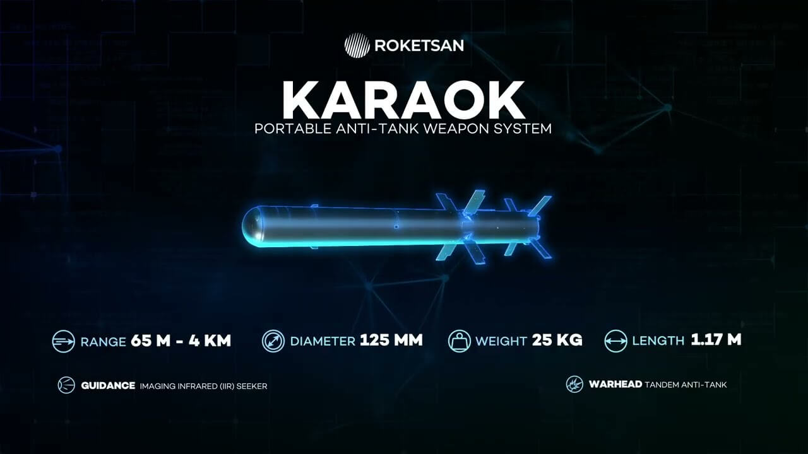
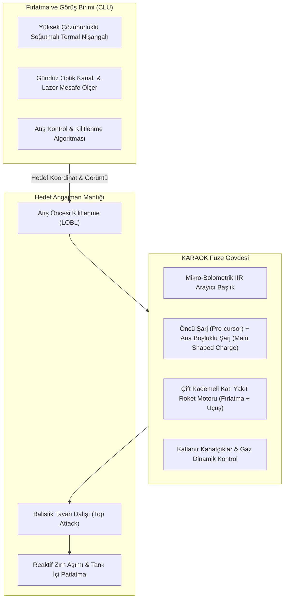

# 🐉 Proje: KARAOK (Kısa Menzilli At-Unut Tanksavar Silahı)

  

---

## 🛡️ Stratejik Tanım & Doktriner Öncelik

**KARAOK**, ROKETSAN tarafından piyade birlikleri, hava indirme tugayları ve özel harekat timlerinin zırhlı tehditlere karşı omuzdan atılan tek er kullanımına uygun taşınabilir tanksavar ihtiyacını karşılamak üzere geliştirilmiş **3. Nesil "At-Unut" (Fire-and-Forget) güdümlü tanksavar füze sistemidir (ATGM)**. Dünyadaki FGM-148 Javelin muadili olan platform; omuzdan veya tek kullanımlık lançer tüpünden ateşlenerek modern ana muharebe tanklarının en zayıf noktası olan taret tepesini dikey açıyla vuran **"Üstten Vuruş" (Top Attack)** yeteneğine sahiptir.

KARAOK'un sahip olduğu **Yumuşak Fırlatma (Soft Launch)** teknolojisi, füzenin kapalı mekanlardan, bina içlerinden veya koruganlardan personele geri tepme alevi ve aşırı basınç şoku vermeksizin ateşlenebilmesini sağlar; bu durum meskun mahal muharebelerinde Mehmetçiğe emsalsiz bir taktik üstünlük kazandırır.

---

## 📊 Kapsamlı Teknik Özellikler

| Parametre | Değer / Özellik | Açıklama |
| :--- | :--- | :--- |
| **Füze Çapı** | 125 mm | Kompakt taşınabilir gövde |
| **Toplam Sistem Ağırlığı** | < 16 kg (Füze + Fırlatma Tüpü) | Tek er tarafından sırtta kolayca taşınabilir |
| **Menzil** | 2.500+ Metre (2.5 km) | Genişletilmiş angajman mesafesi |
| **Güdüm Sistemi** | Görüntüleyici Kızılötesi (IIR) Arayıcı Başlık | Karşı tedbirlere ve sislemeye karşı yüksek bağışıklık |
| **Harp Başlığı Tipi** | Zırh Delici Tandem Şarjlı Harp Başlığı | Reaktif zırhları (ERA) delip ana zırhı imha eder |
| **Vuruş Modları** | Doğrudan Vuruş (Direct Attack) / Üstten Vuruş (Top Attack) | Operatör tarafından hedefin türüne göre seçilir |
| **Fırlatma Motoru** | Soft Launch (Düşük İtki Başlangıç Motoru) | Kapalı alanlardan güvenli ateşleme |
| **Hazırlık & Reaksiyon Süresi** | < 10 saniye | Hızlı açılma, soğuma ve hedefe kilitlenme |

---

## 🧩 Alt Sistemler ve Aviyonik / Elektronik Entegrasyonu

- **IIR Arayıcı Başlık Mimarisi:** Yerli optik ve dedektör altyapısıyla geliştirilen IIR başlık, gece/gündüz ve her türlü sis, duman ve sis perdesi altında tankın termal silüetini takip eder.
- **Top Attack Algoritması:** Füze ateşlendikten sonra irtifa kazanarak hedefin üzerine çıkar ve dik bir açıyla zırh kalınlığının en ince olduğu taret tavanına dalarak hedefin mühimmat deposunu patlatır (catastrophic kill).
- **Tek Er Ergonomisi:** Modüler Atış Kontrol Ünitesi (CLU) fırlatma tüpünden ayrılarak tekrar kullanılabilir, hafif yapısı sayesinde piyadenin intikal hızını düşürmez.

---

## 🎯 Görev Profili, Muharebe Senaryoları & Mühimmat Yelpazesi

1. **Meskun Mahal Tank Avcılığı:** Pencere veya bina içinden ateşlenen KARAOK ile sokakta ilerleyen düşman zırhlı sütunlarının öncü araçlarını durdurma.
2. **Pusu ve İntikal Hattı Engellemesi:** Hava indirme birliklerinin dağlık arazide düşman zırhlı karşı taarruzlarına karşı derin pusu hatları kurması.
3. **Korumalı Mevzi ve Sığınak İmhası:** Doğrudan vuruş modunda kalın betonarme sığınakları ve makineli tüfek yuvalarını noktasal imha.
4. **Hafif Zırhlı ve Kıyı Hedefleri:** Hızlı hücumbotlar veya kıyı çıkarma araçlarına karşı kıyı savunma birliklerince kullanım.

---

## 🚀 TRL Seviyesi ve Gelişim Yol Haritası

- **Mevcut Durum:** `TRL 9` (Tasarım, kalifikasyon ve kullanıcı kabul atışları başarıyla tamamlanmış; seri üretimde TSK envanterine girmiştir).
- [x] Omuzdan atış ve kapalı mekan atış güvenlik testleri
- [x] Hareketli ve reaktif zırhlı tank hedeflerine karşı canlı harp başlıklı atışlar
- [x] TSK kabul muayenesi ve kalifikasyon belgelendirmesi
- [x] Seri üretim hattından kuvvet komutanlıklarına teslimatlar
- [x] İnsansız kara araçlarına (İKA) ve hafif taktik araçlara çoklu lançer entegrasyonu

---

## 🔗 İç Dizin Navigasyonu

[⬅️ Üst Dizine (ROKETSAN)](../README.md) | [🏛️ Dominion Hub (DOMINION_LAND)](../../README.md) | [🏠 Ana Sayfa](../../../README.md)
