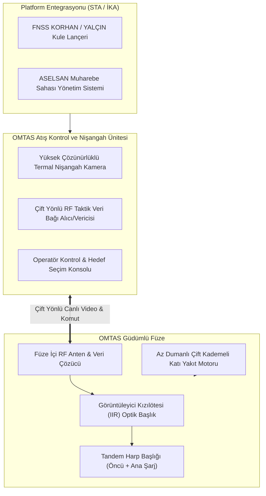

# 🛡️ Proje: ROKETSAN OMTAS (Orta Menzilli Tanksavar Silah Sistemi)

  

---

## 🛡️ Stratejik Tanım & Doktriner Öncelik

**OMTAS (Orta Menzilli Tanksavar Silah Sistemi)**, ROKETSAN tarafından modern kara muharebe sahasındaki en ağır zırhlı ve reaktif korumalı (ERA) ana muharebe tanklarını 4 kilometre mesafeden imha etmek üzere geliştirilmiş milli tanksavar füze sistemidir. Piyade birlikleri tarafından üçayak (tripod) üzerinden fırlatılabildiği gibi, Türk Kara Kuvvetleri'nin **Silah Taşıyıcı Araçlar (STA)** projesi kapsamında FNSS KAPLAN ve PARS 4x4 araç kulelerine entegre edilerek mobil avcı birliklerinin ana vurucu gücünü oluşturmuştur.

Platformu benzersiz kılan unsur; Görüntüleyici Kızılötesi (IIR) arayıcı başlığı ile çift yönlü RF (Radyo Frekans) veri bağı entegrasyonudur. Bu sayede operatör füzeyi sütre (tepe, bina, orman) gerisinden ateşleyebilir, uçuş esnasında füze kamerasından gelen canlı görüntüyü izleyerek hedef seçimi yapabilir, uçuş sırasında hedef değiştirebilir (At-Güncelle) veya doğrudan "At-Unut" modunda angajman icra edebilir.

---

## 📊 Kapsamlı Teknik Özellikler

| Parametre | Değer / Özellik | Açıklama |
| :--- | :--- | :--- |
| **Etkili Menzil** | 200 Metre - 4.000 Metre (4 km) | Gündüz, gece ve zorlu hava koşullarında kesintisiz |
| **Füze Çapı** | 160 mm | Ağır zırh tahribatı için optimize edilmiş gövde |
| **Füze & Tüp Ağırlığı** | ~35 kg | Tripod ve araç kulelerine uyumlu modüler yapı |
| **Güdüm Mimarisi** | Soğutmalı IIR Arayıcı Başlık + Çift Yönlü RF Veri Bağı | Gerçek zamanlı video aktarımı ve telekomut |
| **Harp Başlığı Tipi** | Reaktif Zırhlara (ERA) Karşı Etkili Tandem Başlık | Ana tank zırhını yüksek derinlikte delme kabiliyeti |
| **Vuruş Modları** | Doğrudan Vuruş (Direct) & Üstten Vuruş (Top Attack) | Zırhın zayıf noktasına milimetrik yönlendirme |
| **Atış Modları** | At-Unut, At-Güncelle, Sütre Gerisinden Atış | Görüş hattı dışındaki (BLOS) hedeflere angajman |
| **Platform Entegrasyonu** | Üçayak, KAPLAN STA, PARS 4x4 STA, ZMA, İKA | STANAG 4569 uyumlu zırhlı araç kuleleri |

---

## 🧩 Alt Sistemler ve Aviyonik / Elektronik Entegrasyonu

- **Sütre Gerisinden Güvenli Atış (LOAL):** Operatör hedefin görüş hattında olmadığı durumlarda füzeyi ateşler; füze tepeyi aştığında canlı görüntü operatör ekranına gelir, operatör tankı işaretler ve füze hedefe dalar.
- **Tandem Harp Başlığı Teknolojisi:** Öncü şarj (pre-cursor) tank üzerindeki patlayıcı reaktif zırh kasetini (ERA) patlatıp nötralize ederken, hemen ardından patlayan ana şarj tankın ana kompozit zırhını delerek içerideki personeli ve mühimmatı imha eder.
- **Ağır Kule Entegrasyonu:** STA araçlarında çift lançerli kule üzerinde tam stabilize şekilde seyir halindeyken bile hedefe kilitlenme ve atış kabiliyeti.

---

## 🎯 Görev Profili, Muharebe Senaryoları & Mühimmat Yelpazesi

1. **Zırhlı Birlik Karşı Taarruzunun Kırılması:** 4 km menzilde düşman tank bölüklerinin koordineli karşı taarruzlarını üstten vuruş modu ile durdurma.
2. **Gizli ve Sütre Arkası Pusular:** Piyade veya STA unsurlarının tepe arkasında gizlenerek düşman radar ve optiklerine görünmeden atış yapması.
3. **Müstahkem Tahkimat ve Beton Sığınak İmhası:** Doğrudan vuruş modunda düşmanın komuta merkezlerini ve beton siperlerini tek atışta çökertme.
4. **İnsansız Araçlarla Koordineli Av:** İnsansız hava araçlarının işaretlediği koordinata doğru ateşlenip havada hedef güncelleme ile tank avı.

---

## 🚀 TRL Seviyesi ve Gelişim Yol Haritası

- **Mevcut Durum:** `TRL 9` (Tam kalifiye, seri üretimde, yüzlerce adet TSK ve Jandarma envanterine teslim edilmiş muharebe kanıtlı sistem).
- [x] Sistem tasarım, yer ve uçuş kalifikasyon testleri
- [x] STA (Silah Taşıyıcı Araçlar) projesi kapsamında KAPLAN ve PARS entegrasyonu
- [x] Hareketli hedef ve ERA zırhlı hedef imha doğrulama atışları
- [x] Seri üretim bantlarından yüzlerce adedin Türk Kara Kuvvetleri'ne teslimatı
- [x] Dost ve müttefik ülkelere yönelik ihracat teslimatları

---

## 🔗 İç Dizin Navigasyonu

[⬅️ Üst Dizine (ROKETSAN)](../README.md) | [🏛️ Dominion Hub (DOMINION_LAND)](../../README.md) | [🏠 Ana Sayfa](../../../README.md)
