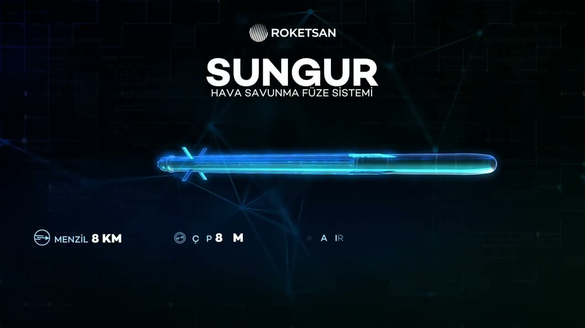
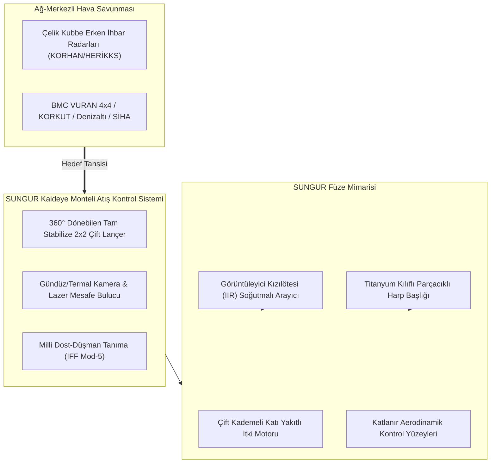

# ⚔️ Proje: SUNGUR (Alçak İrtifa Hava Savunma Füze Sistemi)

  

---

## 🛡️ Stratejik Tanım & Doktriner Öncelik

**SUNGUR**, ROKETSAN tarafından Türk Silahlı Kuvvetleri'nin muharebe sahasındaki hareketli birliklerini, zırhlı konvoylarını ve kritik üs bölgelerini alçak irtifa hava tehditlerine karşı korumak amacıyla geliştirilmiş milli **Hava Savunma Füze Sistemidir (SHORAD / MANPADS)**. ABD menşeili FIM-92 Stinger füzelerinin yerini almak ve çok daha gelişmiş kızılötesi görüntüleyici (IIR) teknoloji sunmak üzere tasarlanmıştır.

Platform; omuzdan atılan tek er konfigürasyonunun (MANPADS) yanı sıra, 360 derece hareket kabiliyetine sahip cayro-stabilize kule ile **BMC VURAN 4x4** taktik tekerlekli zırhlı aracı üzerine monte edilmiş mobil batarya halinde de görev yapmaktadır. Ayrıca helikopterler (T129 ATAK) ve insansız hava araçları (AKINCI, TB2) için havadan-havaya öz savunma mühimmatı olarak da entegre edilmektedir. Türk hava sahasının çok katmanlı entegre hava savunma şemsiyesi olan **Çelik Kubbe**'nin en kritik nokta savunma kalkanıdır.

---

## 📊 Kapsamlı Teknik Özellikler

| Parametre | Değer / Özellik | Açıklama |
| :--- | :--- | :--- |
| **Azami Önleme Menzili** | 8.000 Metre (8 km) | Sınıfındaki klasik MANPADS füzelerinden daha uzun menzil |
| **Azami Önleme İrtifası** | 4.000+ Metre (4 km / ~13.000 ft) | Alçak ve orta-alçak irtifa hava koridoru |
| **Güdüm Sistemi** | Görüntüleyici Kızılötesi (IIR) Arayıcı Başlık | Karşı tedbirlere (Flare / Karıştırıcı) tam bağışıklık |
| **Harp Başlığı** | Yüksek İnfilaklı Parçacık Tesirli Titanyum Gövde | Hedef gövdesini parçalayan zırh delici şarapnel |
| **Füze Hızı** | Mach 2.2+ (Süpersonik) | Hızlı yaklaşan hava hedeflerine anında reaksiyon |
| **Tapa Tipi** | Çarpma ve Yaklaşma (Proximity) Tapası | Doğrudan vuruş ve yakın geçişte tahrip |
| **Hedef Yelpazesi** | Taarruz Helikopterleri, Yakın Hava Destek Uçakları, İHA, Seyir Füzeleri | Düşük radar/termal izli kamikaze dronlara karşı yüksek etkinlik |
| **Platform Konfigürasyonları** | Tek Er (Omuzdan), Kaideye Monteli (BMC VURAN), Deniz Platformları, Helikopter | Modüler fırlatma mimarisi |

---

## 🧩 Alt Sistemler ve Aviyonik / Elektronik Entegrasyonu

- **Gelişmiş IIR Arayıcı Başlık:** Klasik tek dedektörlü ısı güdümlü füzelerin aldandığı flare (sahte ısı fişeği) ve termal yanıltıcılara aldanmaz; hedef uçağın geometrik konturunu tanıyarak doğrudan motor çıkışına veya kokpite yönelir.
- **HERİKKS / Çelik Kubbe Entegrasyonu:** Hava Savunma Erken İhbar ve Komuta Kontrol Sistemi (HERİKKS) ağına bağlı olarak radar izlerini önceden alır; operatör radarın baktığı yöne kulesini otomatik çevirir.
- **Hareket Halinde Atış:** BMC VURAN üzerine monteli cayro-stabilize kaide sayesinde konvoy seyrederken durmaksızın hedefe kilitlenip füze ateşleyebilir.

---

## 🎯 Görev Profili, Muharebe Senaryoları & Mühimmat Yelpazesi

1. **Konvoy ve İntikal Savunması:** İlerleyen zırhlı birliklerin üzerinde beliren düşman taarruz helikopterlerini ve FPV kamikaze dronlarını menzile girmeden düşürme.
2. **Üs Bölgesi Nokta Savunması:** Dağlık sınır karakolları ve stratejik radar üslerine yönelik sinsi alçak irtifa hava taarruzlarını bertaraf etme.
3. **Seyir Füzesi Önleme:** Vadi aralarından süzülen alçak irtifa seyir füzelerini hassas IIR başlık ve yaklaşma tapasıyla havada infilak ettirme.
4. **Helikopter Havadan-Havaya Muharebesi:** T129 ATAK kanat uçlarına takılarak düşman helikopterlerine ve İHA'larına karşı havadan havaya kalkan sağlama.

---

## 🚀 TRL Seviyesi ve Gelişim Yol Haritası

- **Mevcut Durum:** `TRL 9` (Tam kalifikasyon tamamlanmış, seri üretimde ve Türk Silahlı Kuvvetleri birliklerinde aktif operasyonel görevdedir).
- [x] Balistik fırlatma, ayrılma ve IIR arayıcı başlık güdüm testleri
- [x] Omuzdan tek er (MANPADS) atış testleri
- [x] BMC VURAN 4x4 araç üzeri hareketli hedefe atışlı doğrulama
- [x] TSK kabul muayenesi ve seri üretim teslimatları
- [x] İnsansız hava ve deniz platformlarına entegrasyon safhası

---

## 🔗 İç Dizin Navigasyonu

[⬅️ Üst Dizine (ROKETSAN)](../README.md) | [🏛️ Dominion Hub (DOMINION_LAND)](../../README.md) | [🏠 Ana Sayfa](../../../README.md)
