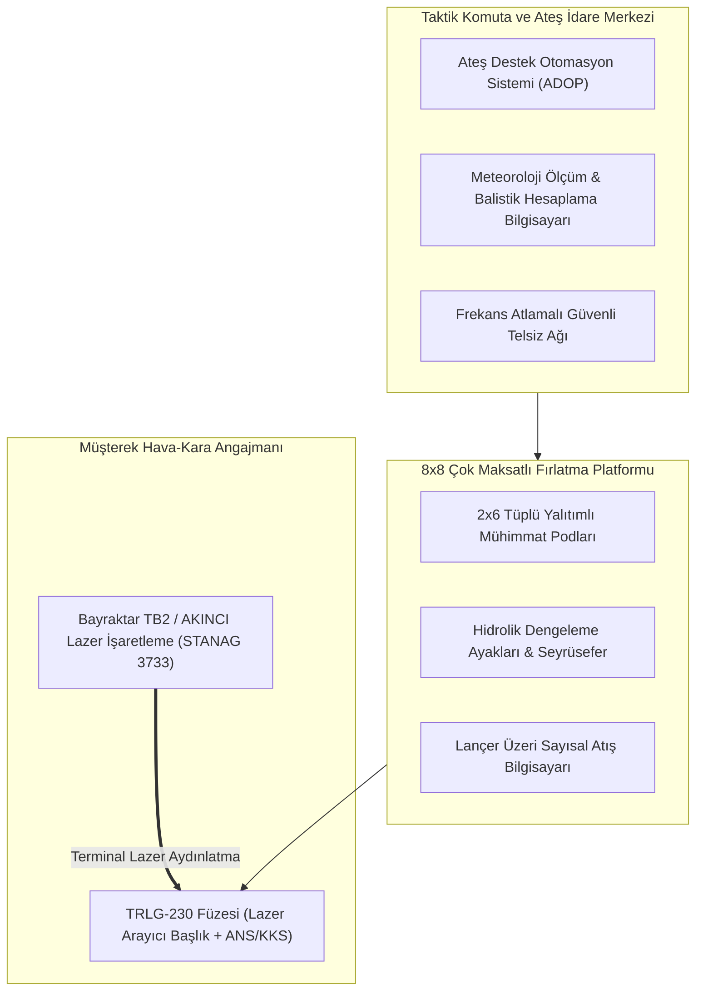

# 🚀 Proje: ROKETSAN TRG-230 (Lazer & KKS Güdümlü Taktik Füze Sistemi)

  

---

## 🛡️ Stratejik Tanım & Doktriner Öncelik

**TRG-230**, ROKETSAN tarafından modern topçu birliklerine 20 ila 70 kilometre derinlikteki yüksek öncelikli düşman hedeflerine karşı her türlü hava şartında kesintisiz, yoğun ve cerrahi hassasiyette ateş gücü sağlamak amacıyla geliştirilmiş **230mm Güdümlü Çok Namlulu Roket / Taktik Füze Sistemidir**. Klasik serbest düşüşlü roketlerin aksine Küresel Konumlama Sistemi (KKS/GPS/GLONASS) ve Ataletsel Navigasyon Sistemi (ANS) ile donatılmış olan füze, hedefleri 10 metrenin altında dairesel sapma (CEP) ile vurur.

Ayrıca sistemin lazer arayıcı başlıklı varyantı olan **TRLG-230**, Bayraktar TB2 veya AKINCI gibi Silahlı İnsansız Hava Araçlarının hedefi havadan lazerle aydınlatması sayesinde **CEP < 2 metre** gibi inanılmaz bir milimetrik isabet oranına ulaşır. Platformun havadan atılan varyantı **TRG-230-İHA (İHA-230)** ise TİHA'lardan süpersonik hızla fırlatılarak 150+ km menzildeki hedefleri hava savunma şemsiyesine girmeden avlama yeteneği kazandırmıştır.

---

## 📊 Kapsamlı Teknik Özellikler

| Parametre | Değer / Özellik | Açıklama |
| :--- | :--- | :--- |
| **Füze Çapı** | 230 mm | Ağır tahrip gücü sağlayan aerodinamik gövde |
| **Toplam Ağırlık** | ~215 kg | Fırlatma tüpü içinde mühürlü hazır mühimmat |
| **Etkili Menzil** | 20 km - 70 km (TRG-230) / 150+ km (İHA-230) | Karadan karaya veya havadan karaya konfigürasyon |
| **Güdüm Mimarisi** | ANS + KKS (GPS/GLONASS) + Yarı Aktif Lazer (TRLG) | Karıştırmaya dirençli Anti-Jamming KKS anteni |
| **Hassasiyet (CEP)** | < 2 Metre (Lazer Güdüm) / < 10 Metre (KKS/ANS) | Noktasal cerrahi imha kabiliyeti |
| **Harp Başlığı** | 42 kg Çelik Bilyeli / Parçacık Tesirli Yüksek İnfilaklı | Geniş alan etkisi ve zırhlı araç tahribatı |
| **Tahrip Yarıçapı** | 50+ Metre öldürücü etki alanı | Komuta çadırları, radar antenleri ve bataryalar |
| **Fırlatma Aracı** | 8x8 veya 6x6 Taktik Kamyon (Çok Namlulu Lançer) | Podlu yükleme ile hızlı mühimmat ikmali |
| **Reaksiyon & Ayrılış** | At ve Uzaklaş (Shoot-and-Scoot) | Salvo sonrası dakikalar içinde mevzi değişimi |

---

## 🧩 Alt Sistemler ve Aviyonik / Elektronik Entegrasyonu

- **Müşterek İHA-Topçu Angajmanı:** Karadaki topçu bataryası düşmanı görmese dahi, SİHA tarafından lazerle işaretlenen hedef koordinatına fırlatılan TRLG-230 son aşamada lazer izine kilitlenerek hareketli hedefleri dahi tam isabetle vurur.
- **Shoot-and-Scoot Kabiliyeti:** Araç durduktan 3 dakika sonra atışa hazır hale gelir; 12 adet roketi salvo halinde fırlattıktan sonra düşman karşı batarya radarları atış yerini tespit edip mermi gönderene kadar mevziyi terk eder.
- **Anti-Jamming Koruması:** Elektronik harp baskısı altındaki muharebe sahalarında GPS sinyalleri kesilse bile hassas lazer jiroskoplu ANS ünitesiyle rota doğruluğunu korur.

---

## 🎯 Görev Profili, Muharebe Senaryoları & Mühimmat Yelpazesi

1. **Karşı Batarya ve Radar İmhası:** 70 km derinlikte konuşlu düşman hava savunma radarlarını, roketatar mevzilerini ve obüs bataryalarını nokta atışıyla susturma.
2. **Kritik Komuta ve Lojistik Merkezleri:** Düşman tugay karargahlarını, mühimmat depolarını ve yakıt ikmal istasyonlarını tek bir salvo ile yerle bir etme.
3. **Kıyı ve Ada Savunması:** Kıyı bataryalarından fırlatılarak düşman çıkarma gemilerine ve açık deniz hedeflerine karşı uzun menzilli topçu örtüsü sağlama.
4. **İHA-230 ile Derin Stratejik Darbe:** AKINCI'dan fırlatılarak 150 km ötedeki stratejik hedeflere süpersonik hızla ulaşma.

---

## 🚀 TRL Seviyesi ve Gelişim Yol Haritası

- **Mevcut Durum:** `TRL 9` (Tam kalifiye, seri üretimde, TSK ve uluslararası müttefik orduların envanterinde geniş operasyonel geçmişe sahip).
- [x] Tasarım, balistik testler ve KKS/ANS güdüm doğrulaması
- [x] Lazer arayıcı başlıklı TRLG-230 uçuş testleri ve İHA ortak atışları
- [x] İHA-230 Havadan Karaya Süpersonik Füze varyantı uçuş testleri
- [x] TSK birliklerine toplu teslimat ve aktif sınır ötesi harekatlarda kullanım
- [x] Azerbaycan, Ukrayna, Bangladeş ve Körfez ülkelerine geniş ölçekli ihracat

---

## 🔗 İç Dizin Navigasyonu

[⬅️ Üst Dizine (ROKETSAN)](../README.md) | [🏛️ Dominion Hub (DOMINION_LAND)](../../README.md) | [🏠 Ana Sayfa](../../../README.md)
