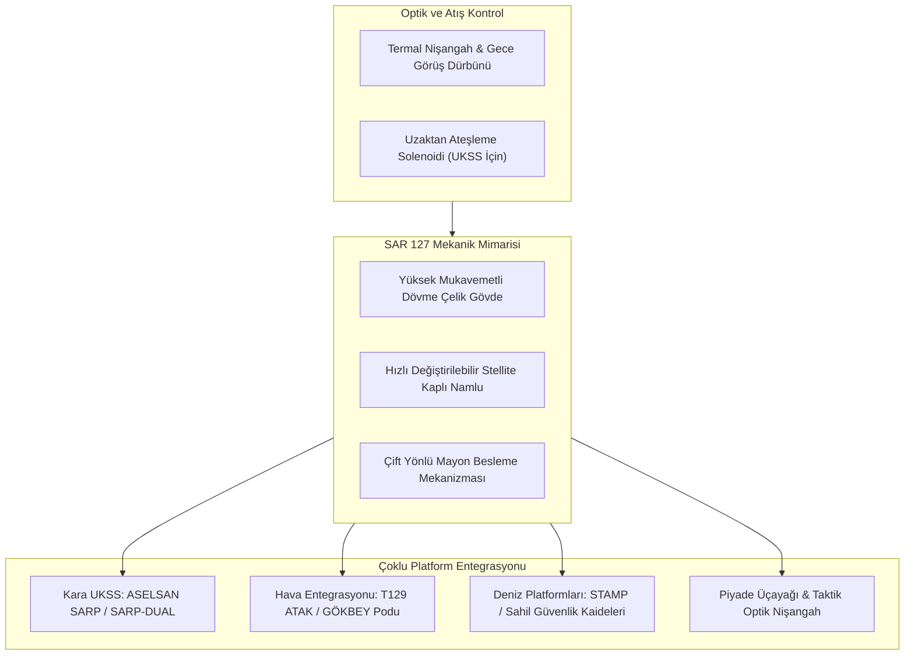

# ⚔️ Proje: SARSILMAZ SAR 127 MT (Ağır Makineli Tüfek)

[

  

](../../../docs/TRL_GUIDE.md)

---

## 🛡️ Stratejik Tanım & Doktriner Öncelik

**SAR 127 MT (ve HAVA/DENİZ varyantları)**, Sarsılmaz tarafından Türk savunma sanayiinin 12.7x99 mm (.50 BMG) kalibredeki ağır makineli tüfek alanındaki dışa bağımlılığına son vermek amacıyla geliştirilen milli **Ağır Makineli Tüfek Platformudur**. Piyade birlikleri tarafından üçayak üzerinde kullanılabildiği gibi, taktik tekerlekli ve paletli zırhlı araçların uzaktan komutalı silah kulelerine (UKSS), sahil güvenlik botlarına, hücumbotlara ve hava araçlarının (T129 ATAK, T625 GÖKBEY, HÜRKUŞ-C) harici silah podlarına entegre edilmek üzere tasarlanmıştır.

Yüksek atım hızı, hızlı değiştirilebilir namlu sistemi (QCB - Quick Change Barrel), zorlu çöl ve çamur testlerinde kanıtlanan aşırı mekanik dayanıklılığı ile SAR 127 MT; Türk Silahlı Kuvvetleri ve Emniyet Genel Müdürlüğü birimlerine kara, hava ve deniz alanlarında kesintisiz yüksek ateş gücü sunar.

---

## 📊 Kapsamlı Teknik Özellikler

| Parametre | Değer / Özellik | Açıklama |
| :--- | :--- | :--- |
| **Kalibre** | 12.7x99 mm NATO (.50 BMG) | Standart NATO zırh delici, yangın ve izli mühimmatlar |
| **Çalışma Prensibi** | Kısa Geri Tepmeli, Açık Mekanizma | Yüksek atış kararlılığı ve minimum ısınma birikimi |
| **Atım Hızı (Teorik)** | 900 - 1.200 Atım / Dakika (Hava/Araç Tipi) | Platform konfigürasyonuna göre ayarlanabilir hız |
| **Etkili Menzil** | 1.830 Metre (Nokta Hedefler) | Dürbünlü ve elektro-optik nişangah ile |
| **Azami Menzil** | 6.800 Metre | Alan baskı ve taciz ateşi mesafesi |
| **Toplam Ağırlık** | ~38 kg (Gövde + Hızlı Değişir Namlu) | Hafifletilmiş alaşım ve dayanıklı çelik gövde |
| **Besleme Sistemi** | M2/M9 Dağılabilen Mayonlu Şerit | Sağdan veya soldan çift yönlü besleme seçeneği |
| **Namlu Ömrü** | 15.000+ Atım (Stellite Kaplama İç Astar) | Aşınmaya ve yüksek ısıya dayanıklı özel çelik |
| **Platform Entegrasyonu** | Üçayak, Zırhlı Araç UKSS, Hücumbot Kaidesi, Hava Podu | MIL-STD-1913 Picatinny ve STANAG standart kuleler |

---

## 🧩 Alt Sistemler ve Aviyonik / Elektronik Entegrasyonu

- **Hızlı Namlu Değişimi (QCB):** Yoğun muharebe altında aşırı ısınan namlu saniyeler içinde alet gerekmeksizin yenisiyle değiştirilebilir; kilit boşluğu (headspace) ve zamanlama ayarı fabrika çıkışlı sabitlenmiştir.
- **Elektronik Ateşleme Kiti (Solenoid):** Zırhlı araç ve hava podu entegrasyonlarında kabin içinden joystick ve tetik düğmesiyle tam senkronize uzaktan atış yeteneği.
- **Çift Taraflı Mayon Besleme:** Araç içi dar alan kulelerinde mühimmat kutusunun yerleşimine göre sol veya sağ yönden besleme kolaylığı.

---

## 🎯 Görev Profili, Muharebe Senaryoları & Mühimmat Yelpazesi

1. **Zırhlı Araç Öz Savunması ve Piyade Desteği:** Zırhlı personel taşıyıcıların kulelerinde piyade timlerine yoğun baskı ve tahrip ateşi sağlama.
2. **Hafif Zırhlı ve Motorlu Hedef İmhası:** Düşmanın pikap, BTR ve hafif zırhlı keşif araçlarını zırh delici mühimmatla 1.5+ km'den durdurma.
3. **Alçak İrtifa İHA ve Dron Avcılığı:** Termal nişangah destekli UKSS üzerinden üs bölgelerine yaklaşan kamikaze dronları düşürme.
4. **Deniz Asimetrik Tehdit Savunması:** Liman ve üs girişlerinde hızlı su üstü hedeflerine ve intihar botlarına karşı yoğun salvo ateşi.

---

## 🚀 TRL Seviyesi ve Gelişim Yol Haritası

- **Mevcut Durum:** `TRL 9` (Kalifikasyon testleri tamamlanmış, seri üretim hattı faal, TSK ve emniyet birimlerine teslimatlar sürmektedir).
- [x] Tasarım, prototip imalatı ve zorlu 50.000 atım ömür testleri
- [x] Çamur, toz, buzlanma ve tuzlu su korozyon testleri
- [x] ASELSAN SARP kule entegrasyonu ve araç üzeri atışlı doğrulama
- [x] Hava podu ve deniz platformu montaj kalifikasyonları
- [x] TSK birliklerine seri teslimat ve ihracat pazarında aktif tanıtım

---

## 🔗 İç Dizin Navigasyonu

[⬅️ Üst Dizine (Sarsılmaz)](../README.md) | [🏛️ Dominion Hub (DOMINION_LAND)](../../README.md) | [🏠 Ana Sayfa](../../../README.md)
