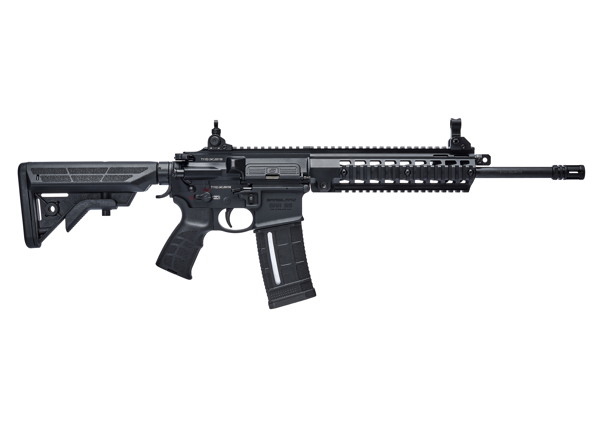
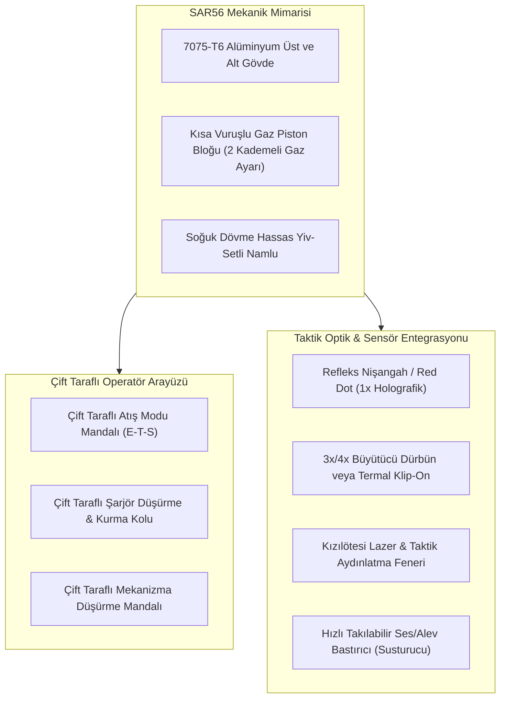

# 🔫 Proje: SAR56 (5.56x45mm Modern Piyade Tüfeği)

  

---

## 🛡️ Stratejik Tanım & Doktriner Öncelik

**SAR56**, Sarsılmaz tarafından Türk Silahlı Kuvvetleri Özel Kuvvetler Komutanlığı, Jandarma Özel Harekat (JÖH) ve Polis Özel Harekat (PÖH) unsurlarının yüksek tempolu meskun mahal ve arazi operasyonlarındaki özel ihtiyaçları doğrultusunda tasarlanmış **5.56x45 mm NATO kalibreli Yeni Nesil Piyade Tüfeğidir**. Dünya genelinde kanıtlanmış AR-15 platformunun ergonomik üstünlüğünü, kısa vuruşlu gaz piston (Short-Stroke Gas Piston) mekanizmasının mutlak güvenilirliği ile harmanlar.

Mekanizmaya sıcak barut gazı ve karbon partikülü girmesini engelleyen piston mimarisi sayesinde tüfek; aşırı çamur, su, kum ve toz altında dahi tutukluk yapmadan çalışır, bakım periyodu uzundur ve sürekli seri atışlarda dahi el kundağı aşırı ısınmaz. Çift taraflı (ambidextrous) kontrol mandalları ile operatöre iki elle de mükemmel tepki hızı sağlar.

---

## 📊 Kapsamlı Teknik Özellikler

| Parametre | Değer / Özellik | Açıklama |
| :--- | :--- | :--- |
| **Kalibre** | 5.56x45 mm NATO | Yüksek ilk hız ve kontrollü geri tepme |
| **Çalışma Prensibi** | Kısa Vuruşlu Gaz Pistonu & Döner Başlıklı Kilit | Minimum kirlenme, maksimum operasyonel güvenilirlik |
| **Namlu Seçenekleri** | 7.5" (Kişisel Savunma), 11" (CQB/Kısa), 14.5" (Standart Karabin) | Görev profiline göre kolayca adapte edilebilir |
| **Toplam Ağırlık** | ~3.000 gr - 3.200 gr (Namlu boyuna bağlı) | Hafifletilmiş uçak sınıfı alüminyum alaşım gövde |
| **Atış Hızı** | 750 - 950 Atım / Dakika | Yarı otomatik ve tam otomatik atış modları |
| **Etkili Menzil** | 400 - 500 Metre | 14.5" namlu ile nokta hedeflere hassas vuruş |
| **Şarjör Kapasitesi** | 30 Mermi (STANAG 4179 / Polimer Şeffaf) | Mühimmat seviyesini gösteren pencere desteği |
| **Dipçik & Ergonomi** | 6 Kademeli Ayarlanabilir Teleskopik Dipçik | Yanak dayama destekli ergonomik polimer |
| **Aksesuar Rayları** | Dört Yönlü MIL-STD-1913 Picatinny / M-LOK | Dürbün, termal, lazer işaretleyici, lamba, fener |

---

## 🧩 Alt Sistemler ve Aviyonik / Elektronik Entegrasyonu

- **Kısa Gaz Piston Teknolojisi:** Sıcak barut gazı namlu ucundaki piston kafasına çarparak mekanizmayı iter, gazın geri kalanı tahliye edilir. Böylece gövde içi ısınmaz ve temiz kalır.
- **Ayarlanabilir Gaz Bloğu:** Susturucu (suppressor) takıldığında aşırı basıncı tahliye etmek ve normal kullanım arasında hızlı geçiş yapmak için iki kademeli gaz ayar mekanizması.
- **Tam Ambidextrous:** Solak veya sağ elini kullanan operatörlerin silahı aynı ergonomi ve hızda maniple etmesine imkan veren simetrik mandal yerleşimi.

---

## 🎯 Görev Profili, Muharebe Senaryoları & Mühimmat Yelpazesi

1. **Meskun Mahal ve Bina İçi Operasyon (CQB):** 7.5" veya 11" kısa namlu konfigürasyonu ile oda temizliği ve dar koridor intikali.
2. **Özel Harekat Derin Keşif ve Pusu:** Susturucu ve termal klip-on entegrasyonu ile düşman hatları arkasında sessiz ve görünmez taarruz.
3. **VIP ve Kritik Tesis Koruma:** Kompakt yapısı sayesinde gizli taşıma ve araçtan ani iniş-biniş çatışmalarında süratli reaksiyon.
4. **Zırh Delici Mühimmat Desteği:** 5.56 mm M855A1 zırh delici mühimmatlar ile hafif çelik yelek ve araç kaportası delme.

---

## 🚀 TRL Seviyesi ve Gelişim Yol Haritası

- **Mevcut Durum:** `TRL 9` (Kalifikasyonları tamamlanmış, Jandarma ve Emniyet birliklerinin envanterinde aktif hizmet veren seri üretim tüfeği).
- [x] AR-15 ergonomisi ve gaz piston optimizasyonu
- [x] Ağır çamur, kum, dondurucu soğuk ve yüksek sıcaklık atış testleri
- [x] JÖH ve PÖH operasyonel birliklerine toplu teslimatlar
- [x] Yurt dışı kolluk kuvvetleri ve özel kuvvetlere ihracat teslimatları
- [x] Karbon el kundağı ve ultra hafif polimer varyant Ar-Ge çalışmaları

---

## 🔗 İç Dizin Navigasyonu

[⬅️ Üst Dizine (Sarsılmaz)](../README.md) | [🏛️ Dominion Hub (DOMINION_LAND)](../../README.md) | [🏠 Ana Sayfa](../../../README.md)
