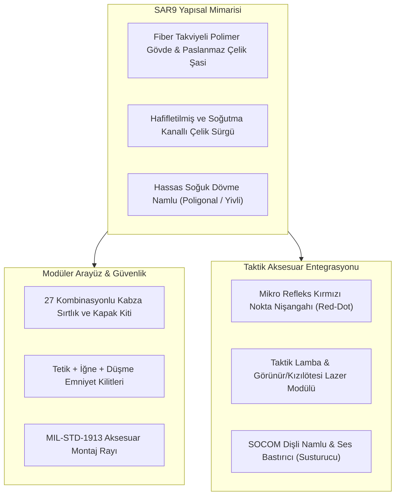

# 🔫 Proje: SAR9 (9x19mm Yarı Otomatik Hizmet Tabancası)

  

---

## 🛡️ Stratejik Tanım & Doktriner Öncelik

**SAR9 Ailesi (SAR9 Gen2, SAR9 METE, SAR9 SOCOM, SAR9 SP)**, Sarsılmaz tarafından Türkiye'nin "Özgün Yerli Tabanca Geliştirme Projesi" kapsamında Türk Silahlı Kuvvetleri ve Emniyet Teşkilatı'nın standart beylik tabancası ihtiyacını karşılamak üzere üretilmiş **9x19 mm Kalibre Polimer Gövdeli İğne Ateşlemeli (Striker-Fired) Tabancadır**. 50.000 atımlık zorlu TSK kabul testlerini sıfır hata ile tamamlayan tek platformdur.

Amerika Birleşik Devletleri sivil pazarında silah dünyasının en prestijli yayınları tarafından *"Editors' Choice"* ve *"Gun of the Year"* (Yılın Tabancası) ödüllerine layık görülen SAR9; modüler kabza yapısı, düşük tetik ağırlığı, patentli güvenlik kilitleri ve zengin optik/aksesuar arayüzü ile Türk mühendisliğinin küresel tabanca pazarındaki amiral gemisidir.

---

## 📊 Kapsamlı Teknik Özellikler

| Parametre | Değer / Özellik | Açıklama |
| :--- | :--- | :--- |
| **Kalibre** | 9x19 mm Parabellum (NATO) | Standart askeri ve kolluk mühimmatı |
| **Çalışma Prensibi** | Kısa Geri Tepmeli, İğne Ateşlemeli (Striker-Fired) | Horozsuz, yumuşak tetik çekişi ve hızlı sıfırlama |
| **Şarjör Kapasitesi** | 15+1 / 17+1 / 19+1 / 21+1 Mermi | Çift sıralı çelik şarjör mimarisi |
| **Namlu Boyu** | 113 mm (4.45") / 130 mm (SOCOM Yivli Namlu) | Soğuk dövme çelik, korozyona dayanıklı kaplama |
| **Toplam Boş Ağırlık** | ~780 gram | Güçlendirilmiş hafif mühendislik polimeri |
| **Tetik Ağırlığı** | ~2.0 - 2.5 kg (Tetik emniyetli) | Kısa reset mesafesi ile hızlı mükerrer atış |
| **Gövde & Ergonomi** | Değiştirilebilir Kabza Sırtlığı ve Yan Kapaklar | 27 farklı kabza kombinasyonu ile her ele uyum |
| **Optik Hazırlığı** | Optic Ready (OR) / Red-Dot Montaj Yuvası | Trijicon RMR, Shield RMS vb. mikro refleks nişangahlar |
| **Emniyet Sistemleri** | Tetik Emniyeti, İğne Emniyeti, Düşme Emniyeti | Kazara ateş almayı önleyen 3 kademeli pasif kilit |

---

## 🧩 Alt Sistemler ve Aviyonik / Elektronik Entegrasyonu

- **Mühendislik Polimeri ve Çelik Raylar:** Gövde içindeki çelik kızaklar, polimer yapının esnekliği ile birleşerek namlu ekseninde kusursuz hareket sağlar ve geri tepme şokunu yumuşatır.
- **Optic-Ready (OR) Sürgü Mimarisi:** Sürgü üzerine fabrika çıkışlı işlenen freze yuvası sayesinde adaptör plakaları ile pazardaki tüm popüler mikro red-dot refleks nişangahlar sıfır toleransla monte edilir.
- **50.000 Atım Ömür Testi Başarısı:** Ağır asit, çamur banyosu, dondurucu buz kalıbı ve 1.5 metre beton düşme testlerinden sonra bile tutukluksuz ateşleme yapabilen yüksek malzeme kalitesi.

---

## 🎯 Görev Profili, Muharebe Senaryoları & Mühimmat Yelpazesi

1. **Standart Görev Beylik Tabancası:** TSK, Jandarma ve Emniyet personelinin gündelik devriye, yakın koruma ve meskun mahal asayiş görevi.
2. **Özel Kuvvetler Taarruz Tabancası (SAR9 SOCOM):** Dişli namluya monte edilen susturucu ve yükseltilmiş gez-arpacık ile gizli baskın operasyonları.
3. **Taktik Atıcılık ve Dinamik Mücadele:** Hızlı şarjör değiştirme hunisi (magwell) ve yüksek kapasiteli 19/21'lik şarjörlerle dinamik temas hatlarında üstünlük.
4. **Hafif Zırhlı Tehditlere Karşı Yüksek Enerjili 9mm +P:** Yüksek basınçlı mühimmatlarla zırh delici balistik çekirdek atabilme mukavemeti.

---

## 🚀 TRL Seviyesi ve Gelişim Yol Haritası

- **Mevcut Durum:** `TRL 9` (Milyonlarca adetlik üretim kapasitesi, 400.000+ adetlik TSK/EGM teslimatı, dünya çapında kanıtlanmış seri üretim).
- [x] TSK Özgün Yerli Tabanca İhalesi Birinciliği
- [x] 50.000 atım ve ekstrem çevre koşulları kalifikasyonu
- [x] TSK ve EGM birliklerine 350.000'den fazla teslimat
- [x] ABD pazarında "Yılın Tabancası" ve "Editors' Choice" ödüllerinin kazanılması
- [x] Gen2, SOCOM, Subcompact ve Match varyantlarının seri üretime girmesi

---

## 🔗 İç Dizin Navigasyonu

[⬅️ Üst Dizine (Sarsılmaz)](../README.md) | [🏛️ Dominion Hub (DOMINION_LAND)](../../README.md) | [🏠 Ana Sayfa](../../../README.md)
