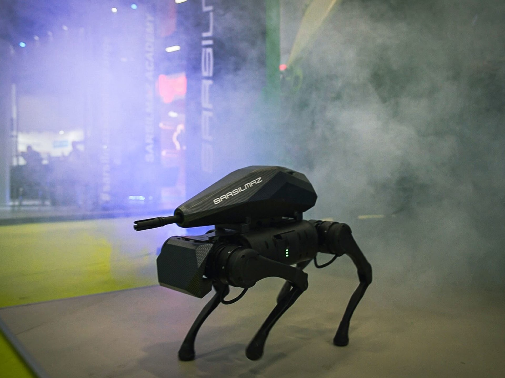
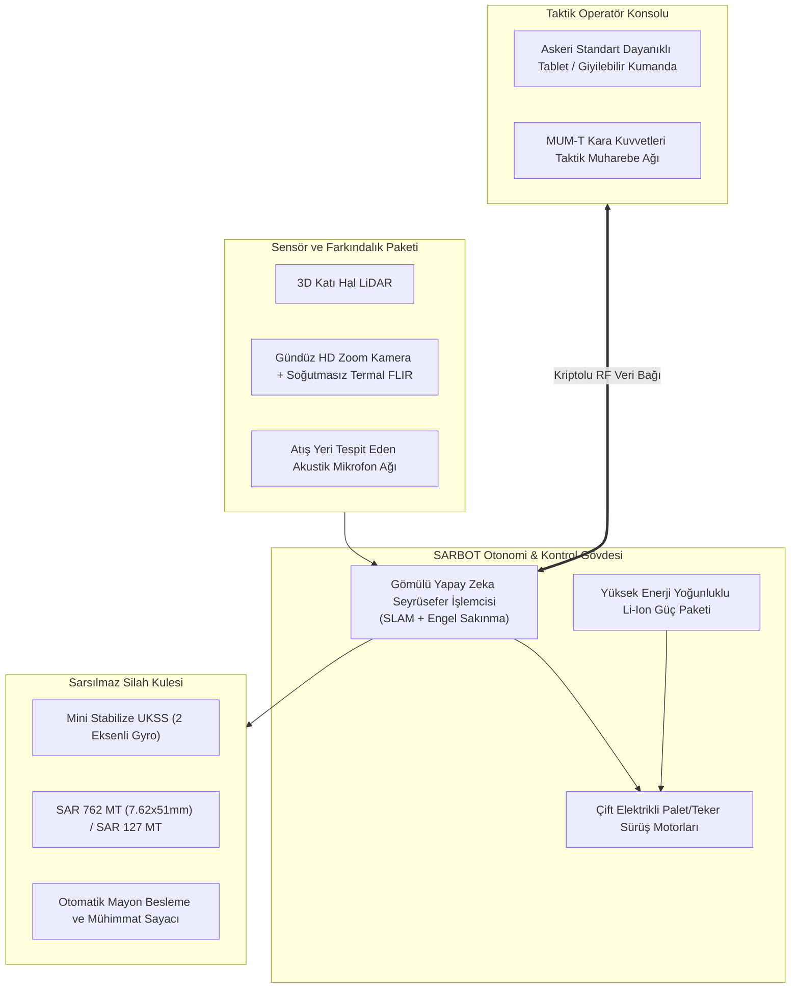

# 🤖 Proje: SARBOT (Silahlı Otonom Robotik Kara Aracı)

[

  

](../../../docs/TRL_GUIDE.md)

---

## 🛡️ Stratejik Tanım & Doktriner Öncelik

**SARBOT**, Türkiye'nin köklü silah üreticisi Sarsılmaz'ın otonom savunma teknolojileri ve robotik harp sahası vizyonu doğrultusunda geliştirdiği **Silahlı İnsansız Kara Aracı (SİKA) ve Robotik Platform Ailesidir**. İnsan hayatını riske atmadan sıcak temas bölgelerinde, meskun mahal operasyonlarında, mağara/tünel keşiflerinde ve kritik üs güvenliğinde Mehmetçiğe doğrudan ileri hat ateş desteği sağlamak üzere geliştirilmiştir.

Modüler paletli ve çok tekerlekli şasi seçeneklerine sahip olan SARBOT; yapay zeka destekli otonom rota takibi, dinamik engel sakınma, dost/düşman tanıma ve Sarsılmaz'ın yerli makineli tüfek aileleri (SAR 762 MT, SAR 127 MT, SAR 109T) ile donatılmış hafif uzaktan komutalı silah kuleleri ile donatılmıştır.

---

## 📊 Kapsamlı Teknik Özellikler

| Parametre | Değer / Özellik | Açıklama |
| :--- | :--- | :--- |
| **Araç Tipi** | Hafif / Orta Sınıf Silahlı İnsansız Kara Aracı (SİKA) | Paletli veya çok tekerlekli modüler yürüyüş takımı |
| **Tahrik & Güç** | Tam Elektrikli / BLDC Motor + Li-Ion Batarya Paketi | Sessiz intikal ve düşük termal ayak izi |
| **Operasyonel Süre** | 4 - 8 Saat (Batarya kapasitesine göre) | Hızlı değiştirilebilir modüler batarya blokları |
| **Azami Hız** | 15 - 25 km/s | Engebeli arazide ve bina içinde dinamik hareket |
| **Otonomi Düzeyi** | Seviye 3+ Otonom Seyrüsefer & Konvoy Takip | 3D SLAM, LiDAR ve Stereo Vizyon algoritmaları |
| **Faydalı Yük / Silah** | SAR 762 MT (7.62x51mm) / SAR 109T (9mm) / SAR 127 | Sarsılmaz UKSS stabilize hafif kule istasyonu |
| **Mühimmat Kapasitesi** | 500 - 1.000 Mermi (7.62mm) | Kesintisiz baskı ateşi sağlayan geniş kutu hazne |
| **Kontrol & Veri Bağı** | Güvenli Kriptolu RF Link + Wi-Fi Mesh + Fiber Optik Hat | Karıştırmaya dayanıklı 2+ km kontrol menzili |
| **Gözetleme & Sensörler** | 360° Gece/Gündüz Kamera, Termal FLIR, Akustik Algılayıcı | Tehdit yönünü anında tespit eden mikrofon dizilimi |

---

## 🧩 Alt Sistemler ve Aviyonik / Elektronik Entegrasyonu

- **Sessiz Yaklaşma ve Termal Görünmezlik:** Elektrik motorları sayesinde motor sesi çıkarmadan hedefe yaklaşabilir; egzoz ısısı olmadığı için düşman termal kameralarınca fark edilmesi son derece güçtür.
- **Akustik Atış Yeri Tespiti:** Üzerindeki mikrofon dizilimi düşman keskin nişancı veya tüfek ateşinin ses dalgalarını analiz ederek namluyu milisaniyeler içinde doğrudan atışın yapıldığı koordinata otomatik çevirir.
- **Tünel ve Mağara Modu:** GNSS (GPS) sinyalinin olmadığı yer altı sığınaklarında ve mağaralarda LiDAR tabanlı 3D haritalama yaparak yolunu otonom bulur ve geri döner.

---

## 🎯 Görev Profili, Muharebe Senaryoları & Mühimmat Yelpazesi

1. **Bina ve Tünel Girişi Öncü Keşif:** Askeri timlerin içeri girmesinden önce odaya girip tuzak, EYP ve düşman varlığını görüntüleme ve gerekirse ateşle temizleme.
2. **Karakol ve Üs Çevre Emniyeti:** Belirlenen sınır hattında otonom nöbet devriyesi icra ederek tel örgüye yaklaşan izinsiz sızmaları tespit etme.
3. **Piyade İleri Ateş Desteği:** Yoğun çatışma anında siperden çıkamayan personelin yerine öne sürülerek SAR 762 MT ile düşman mevzisini ateş altına alma.
4. **Yaralı ve Teçhizat İkmali:** Küçük boyutuna rağmen 100+ kg mühimmat veya sıhhiye malzemesini tehlikeli hat boyunca personele ulaştırma.

---

## 🚀 TRL Seviyesi ve Gelişim Yol Haritası

- **Mevcut Durum:** `TRL 7` (Saha prototipleri üretilmiş, askeri poligonlarda atışlı ve otonom hareket doğrulama testleri icra edilmektedir).
- [x] Konsept tasarımı ve robotik şasi imalatı
- [x] Otonomi algoritmaları, LiDAR entegrasyonu ve iç mekan haritalama testleri
- [x] SAR 762 MT makineli tüfek entegrasyonu ve atış denemeleri
- [ ] Karma sürü halinde hareket ve MUM-T müşterek harekat yazılımı
- [ ] Güvenlik kuvvetleri envanter kabul testleri

---

## 🔗 İç Dizin Navigasyonu

[⬅️ Üst Dizine (Sarsılmaz)](../README.md) | [🏛️ Dominion Hub (DOMINION_LAND)](../../README.md) | [🏠 Ana Sayfa](../../../README.md)
