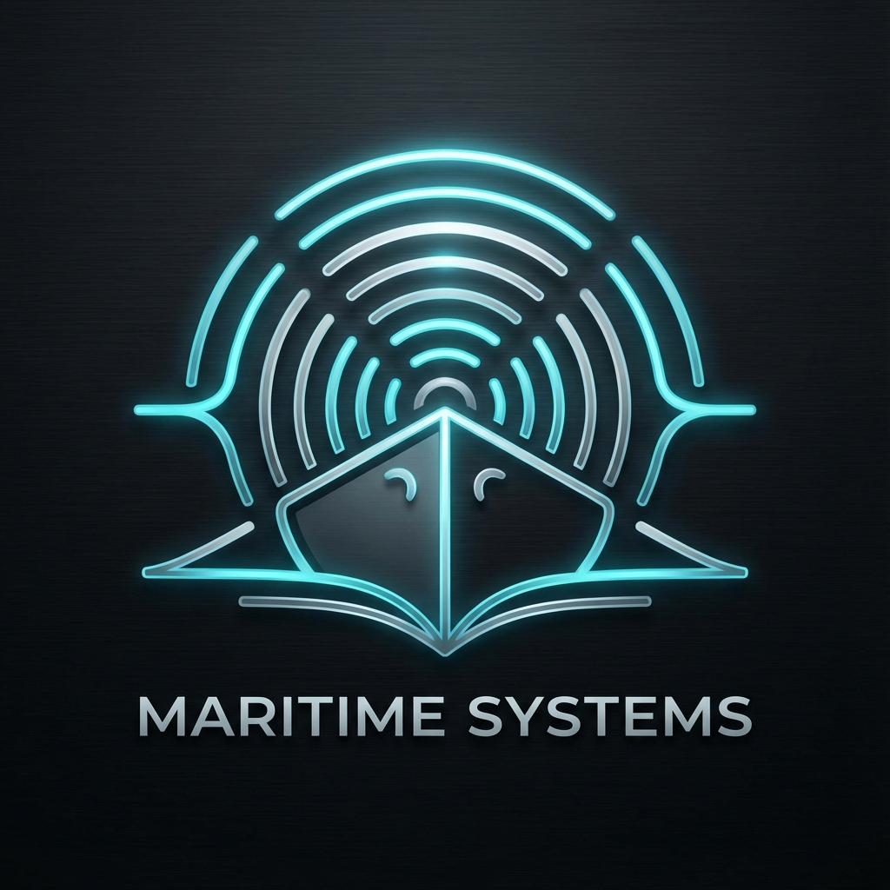
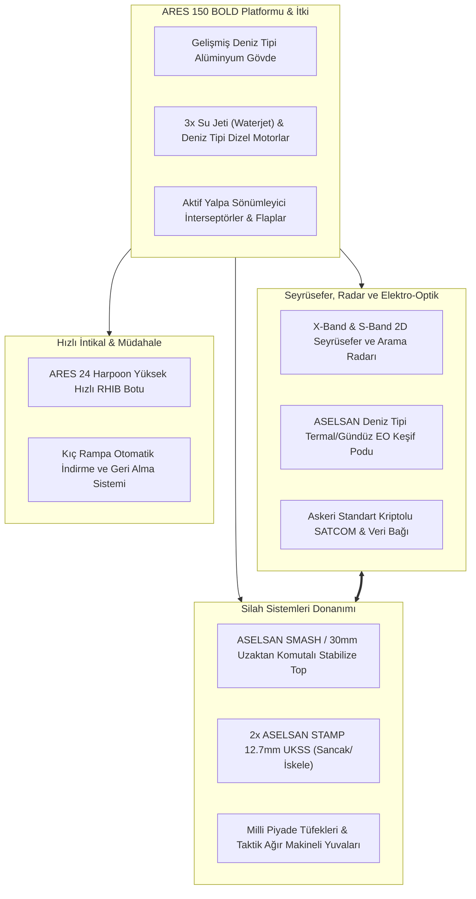

# ⚓ Proje: ARES 150 BOLD Karayel (Açık Deniz Karakol Botu)

---

## 🛡️ Stratejik Tanım & Doktriner Öncelik

**ARES 150 BOLD (Karayel Sınıfı)**, Antalya merkezli ARES Tersanesi tarafından geliştirilen, **48 metre uzunluğunda ve 37 knot üzerinde azami sürate sahip** dünyanın en hızlı ve gelişmiş Açık Deniz Karakol Gemilerinden (OPV / Fast Patrol Vessel) biridir. Mavi Vatan sınırlarında, Münhasır Ekonomik Bölgelerde (MEB) ve açık denizlerde devriye, deniz haydutluğuyla mücadele, kaçakçılık önleme, kritik enerji altyapılarının korunması ve arama-kurtarma görevlerini icra etmek üzere tasarlanmıştır.

Gelişmiş deniz tipi alüminyum gövdesi, yüksek denizcilik kabiliyeti (Sea-keeping) ve kıç tarafında yer alan özel rampa mekanizması sayesinde operasyon anında yüksek hızlı RHIB botları veya insansız deniz araçlarını (İDA) denize indirebilme ve geri alabilme yeteneğine sahiptir. Katar Sahil Güvenlik Komutanlığı başta olmak üzere uluslararası sularda görev yapan platform, Türk gemi inşa sanayiinin yüksek hızlı kompozit/alüminyum karakol gemileri alanındaki dünya liderliğini simgeler.

---

## 📊 Kapsamlı Teknik Özellikler

| Parametre | Değer / Özellik | Açıklama |
| :--- | :--- | :--- |
| **Tam Boy (LOA)** | 48.00 Metre | Derin V-karina açık deniz formu |
| **Genişlik (Beam)** | 8.95 Metre | Yüksek stabilite ve operasyonel alan |
| **Su Çekimi (Draft)** | 1.85 Metre | Sığ sulara ve koylara rahat yanaşma |
| **Deplasman** | ~265 Ton | Hafif ve mukavim deniz tipi alüminyum gövde |
| **Azami Sürat** | 37+ Knot (Yaklaşık 70 km/s) | Sınıfının dünyadaki en hızlı açık deniz gemisi |
| **Ekonomik Seyir Sürati** | 20 Knot | Uzun süreli intikal ve devriye sürati |
| **Seyir Siası (Menzil)** | 1.600+ Deniz Mili (NM) | Kesintisiz açık deniz görev icrası |
| **Ana Tahrik Sistemi** | 3x Dizel Deniz Motoru + 3x Rolls-Royce Kamewa Su Jeti | Olağanüstü manevra kabiliyeti ve ani duruş/hızlanma |
| **Mürettebat Kapasitesi** | 29 Personel (Subay, Astsubay ve Erler) | Yüksek konforlu yaşam ve harekat mahalleri |
| **Bot Entegrasyonu** | 1x ARES 24 Harpoon Hızlı Müdahale RHIB Botu | Kıç kızaklı mekanik rampa sistemi |

---

## 🧩 Alt Sistemler ve Aviyonik / Elektronik Entegrasyonu

- **3x Su Jeti Tahrik Mimarisi:** Geleneksel şaft-pervane yerine 3 bağımsız su jeti sayesinde gemi kendi etrafında 360 derece dönebilir, tam yoldayken metreler içinde acil fren yapabilir ve sığ sularda hasar görmeden görev yapar.
- **ASELSAN SMASH 30mm UKSS:** Kendi elektro-optik nişangahına sahip stabilize top sistemi ile deniz koşullarında hareket halindeyken asimetrik hedefleri, korsan teknelerini ve şüpheli botları noktasal imha.
- **Kıç Rampa Operasyonu:** Gemi seyir halindeyken dahi özel kuvvetler timini taşıyan ARES 24 Harpoon RHIB botu dakikalar içinde denize salınabilir ve aynı hızla tekne içine geri çekilebilir.

---

## 🎯 Görev Profili, Muharebe Senaryoları & Mühimmat Yelpazesi

1. **Açık Deniz Karakolu ve MEB Güvenliği:** Doğalgaz arama-sondaj platformları ve boru hatları çevresinde caydırıcı devriye icrası.
2. **Deniz Haydutluğu ve Kaçakçılıkla Mücadele:** 37 knot üzerindeki hızı sayesinde kaçmaya çalışan sürat motorlarını yakalama ve bordalama timi sevk etme.
3. **Kritik Kıyı Tesisleri ve Boğaz Savunması:** Stratejik üslerin girişinde asimetrik intihar teknelerine karşı 30mm ve 12.7mm UKSS ile kalkan oluşturma.
4. **Geniş Alan Arama-Kurtarma (SAR):** Uzun menzili ve açık deniz dalga mukavemeti ile kaza geçiren sivil ve askeri deniz araçlarına acil müdahale.

---

## 🚀 TRL Seviyesi ve Gelişim Yol Haritası

- **Mevcut Durum:** `TRL 9` (Tam kalifiye, seri üretilmiş, teslimatları tamamlanmış ve operasyonel filolarda aktif hizmet veren amiral gemisi bot).
- [x] Detaylı hidrodinamik tasarım ve tank testleri
- [x] Alüminyum tekne imalatı ve su jeti entegrasyonu
- [x] ASELSAN SMASH ve STAMP silah kuleleri atış testleri
- [x] Katar İçişleri Bakanlığı Sahil Güvenlik Komutanlığı'na filo teslimatı
- [x] İnsansız deniz aracı (İDA) taşıyıcı ana platform entegrasyonu

---

## 🔗 İç Dizin Navigasyonu

[⬅️ Üst Dizine (ARES)](../README.md) | [🏛️ Dominion Hub (DOMINION_SEA)](../../README.md) | [🏠 Ana Sayfa](../../../README.md)
